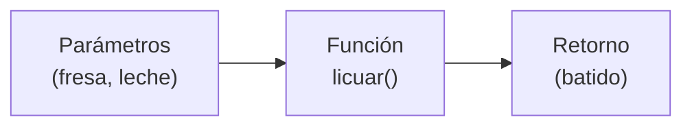

# 2. Funciones en Dart

> Las funciones son bloques de código reutilizables. En Flutter, igual que en Compose, la interfaz se construye combinando funciones y objetos.

---

## ⚙️ ¿Qué es una función?

Piensa en una **licuadora**: le das ingredientes (parámetros), hace un trabajo, y te devuelve un resultado (valor de retorno). No necesitas saber cómo funciona por dentro, solo qué le das y qué te devuelve.



---

## 📝 Declaración de funciones

En Dart **no existe la palabra `fun`**. El tipo de retorno va **al inicio**, antes del nombre (como en Java o C).

```dart
// tipoRetorno nombre(parámetros) { ... }
int sumar(int a, int b) {
  return a + b;
}

void main() {
  final resultado = sumar(3, 4);
  print(resultado); // 7
}
```

Comparación con Kotlin:

```kotlin
// Kotlin: el tipo de retorno va al final
fun sumar(a: Int, b: Int): Int {
    return a + b
}
```

```dart
// Dart: el tipo de retorno va al inicio, y el tipo del parámetro antes del nombre
int sumar(int a, int b) {
  return a + b;
}
```

### Funciones que no devuelven nada: `void`

Cuando una función solo **hace algo** (mostrar un mensaje, guardar un dato) y no devuelve un valor, su tipo de retorno es `void` (equivalente a `Unit` en Kotlin).

```dart
void saludar(String nombre) {
  print('¡Hola, $nombre!');
}

void main() {
  saludar('Lucía'); // ¡Hola, Lucía!
}
```

---

## ⚡ Funciones flecha `=>` (una sola expresión)

Si la función solo tiene **una expresión**, puedes usar la flecha `=>` en lugar de llaves y `return`. Es el equivalente al `=` de Kotlin.

```dart
// Forma larga
int doble(int x) {
  return x * 2;
}

// Forma corta con flecha
int dobleCorto(int x) => x * 2;

bool esMayorDeEdad(int edad) => edad >= 18;

String saludo(String nombre) => 'Hola $nombre';
```

> [!WARNING]
> La flecha `=>` solo admite **una expresión**, no varias instrucciones. Si necesitas un `if` con varias líneas, usa llaves `{ }`.

---

## 🎛️ Tipos de parámetros

Dart tiene **tres** tipos de parámetros:

| Tipo | Sintaxis | ¿Obligatorio? | ¿Importa el orden? |
|---|---|---|---|
| Posicionales obligatorios | `(int a, int b)` | ✅ Sí | ✅ Sí |
| Posicionales opcionales | `([int b = 0])` | ❌ No | ✅ Sí |
| **Nombrados** | `({int b = 0})` | Depende | ❌ No |

Los **parámetros nombrados** son tan importantes en Flutter que tienen su propio documento: [Parámetros Nombrados →](3-parametros-nombrados.md). Aquí veremos los dos primeros.

### Posicionales obligatorios

Son los que ya vimos: se pasan **en orden** y **todos** son necesarios.

```dart
String presentar(String nombre, int edad) {
  return '$nombre tiene $edad años';
}

void main() {
  print(presentar('Ana', 20));  // ✅ Ana tiene 20 años
  // presentar(20, 'Ana');      // ❌ Error: orden incorrecto
  // presentar('Ana');          // ❌ Error: falta la edad
}
```

### Posicionales opcionales `[ ]`

Se encierran entre **corchetes**. Si no se envían, toman su valor por defecto (o `null` si son de tipo anulable).

```dart
String presentar(String nombre, [int edad = 18, String? ciudad]) {
  final lugar = ciudad ?? 'algún lugar';
  return '$nombre tiene $edad años y vive en $lugar';
}

void main() {
  print(presentar('Ana'));                // Ana tiene 18 años y vive en algún lugar
  print(presentar('Ana', 25));            // Ana tiene 25 años y vive en algún lugar
  print(presentar('Ana', 25, 'Trujillo')); // Ana tiene 25 años y vive en Trujillo
}
```

> **Nota:** Con posicionales opcionales **no puedes saltarte uno**: para enviar `ciudad` debes enviar también `edad`. Esa limitación es justo lo que resuelven los parámetros nombrados.

---

## 🧩 Funciones como valores

En Dart, las funciones son **objetos**: se pueden guardar en variables y pasar como parámetros a otras funciones (igual que las lambdas en Kotlin).

### Funciones anónimas

Son funciones sin nombre. Se escriben `(parámetros) { cuerpo }` o `(parámetros) => expresión`.

```dart
void main() {
  // Guardar una función en una variable
  final multiplicar = (int a, int b) => a * b;
  print(multiplicar(3, 5)); // 15

  // Función anónima con cuerpo
  final despedir = (String nombre) {
    print('Adiós, $nombre');
  };
  despedir('Pedro'); // Adiós, Pedro
}
```

### Pasar funciones como parámetros

```dart
void ejecutarDosVeces(void Function() accion) {
  accion();
  accion();
}

void main() {
  ejecutarDosVeces(() => print('¡Hola!'));
  // ¡Hola!
  // ¡Hola!
}
```

El tipo `void Function()` significa *"una función que no recibe nada y no devuelve nada"*. Es el equivalente a `() -> Unit` en Kotlin.

| Dart | Kotlin |
|---|---|
| `void Function()` | `() -> Unit` |
| `int Function(int, int)` | `(Int, Int) -> Int` |
| `bool Function(String)` | `(String) -> Boolean` |

### Uso con listas

Las funciones anónimas brillan al trabajar con colecciones:

```dart
void main() {
  final numeros = [1, 2, 3, 4, 5];

  final dobles = numeros.map((n) => n * 2).toList();
  print(dobles); // [2, 4, 6, 8, 10]

  final pares = numeros.where((n) => n % 2 == 0).toList();
  print(pares); // [2, 4]

  numeros.forEach((n) => print('Número $n'));
}
```

> **Nota:** En Dart, `filter` se llama **`where`**, y `map`/`where` devuelven un `Iterable`, por eso se agrega `.toList()` al final. Además, Dart **no tiene `it`**: siempre debes nombrar el parámetro `(n) => ...`.

> [!TIP]
> **¿Por qué importa en Flutter?** Los botones reciben funciones para saber qué hacer al ser presionados:
> ```dart
> ElevatedButton(
>   onPressed: () => print('Presionado'),
>   child: const Text('Click'),
> )
> ```
> Es la misma idea que `onClick = { ... }` en Compose.

---

## ⚠️ Errores Comunes de Principiantes

1. **Escribir `fun`:** en Dart no existe; empieza con el tipo de retorno (`int`, `void`, `String`...).
2. **Poner el tipo después del nombre:** `edad: int` es Kotlin; en Dart es `int edad`.
3. **Usar `=>` con varias instrucciones:** la flecha solo admite una expresión.
4. **Usar `it` en lambdas:** en Dart siempre se nombra el parámetro: `lista.map((x) => x * 2)`.

---

_Siguiente: [Parámetros Nombrados →](3-parametros-nombrados.md)_
