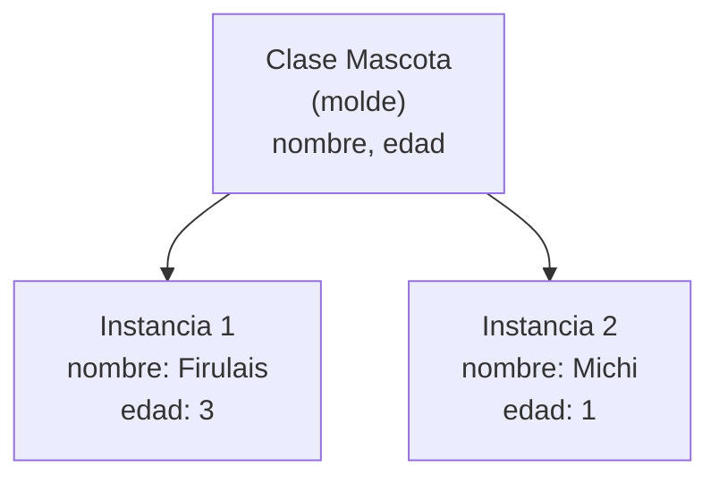

# 4. Clases e Instancias en Dart

> En Dart **todo es un objeto**: números, textos, funciones y, en Flutter, cada widget. Entender las clases es entender cómo está construido Flutter.

---

## 🏭 Clase vs Instancia

Piensa en un **molde para galletas** 🍪:

- La **clase** es el **molde**: define la forma que tendrán todas las galletas.
- Cada **instancia** (u objeto) es una **galleta concreta** hecha con ese molde. Todas tienen la misma forma, pero cada una puede tener distinto sabor o decoración.



---

## 📝 Declarar una clase

Una clase tiene **propiedades** (datos) y **métodos** (funciones que pertenecen a la clase).

```dart
class Mascota {
  // Propiedades
  String nombre;
  int edad;

  // Constructor
  Mascota(this.nombre, this.edad);

  // Método
  void presentarse() {
    print('Soy $nombre y tengo $edad años');
  }
}
```

### El constructor y `this.`

El **constructor** es la función especial que se ejecuta al crear una instancia. Tiene **el mismo nombre que la clase**.

`Mascota(this.nombre, this.edad);` es un atajo de Dart que significa *"el primer valor que me pasen guárdalo en `nombre`, y el segundo en `edad`"*. Sin el atajo, se vería así:

```dart
Mascota(String nombre, int edad)
    : nombre = nombre,
      edad = edad;
```

---

## 🍪 Crear instancias

Para crear un objeto se llama al constructor. En Dart moderno **no se usa `new`** (es opcional y se omite).

```dart
void main() {
  final perro = Mascota('Firulais', 3);
  final gato = Mascota('Michi', 1);

  perro.presentarse(); // Soy Firulais y tengo 3 años
  gato.presentarse();  // Soy Michi y tengo 1 años

  // Leer y modificar propiedades con el punto "."
  print(perro.nombre); // Firulais
  perro.edad = 4;
  perro.presentarse(); // Soy Firulais y tengo 4 años
}
```

> **Nota:** `final perro` impide que `perro` apunte a **otra** mascota, pero sí permite cambiar sus propiedades (`perro.edad = 4`), porque `edad` no es `final` dentro de la clase.

---

## 🏷️ Constructores con parámetros nombrados

Aquí se juntan las clases con lo que aprendiste en el [documento anterior](3-parametros-nombrados.md). Es **la forma más común en Flutter**.

```dart
class Producto {
  final String nombre;
  final double precio;
  final int stock;
  final String? descripcion;

  Producto({
    required this.nombre,
    required this.precio,
    this.stock = 0,
    this.descripcion,
  });
}

void main() {
  final laptop = Producto(
    nombre: 'Laptop',
    precio: 2500.0,
    stock: 5,
  );

  final mouse = Producto(precio: 45.0, nombre: 'Mouse'); // el orden no importa

  print('${laptop.nombre}: S/ ${laptop.precio} (${laptop.stock} en stock)');
  // Laptop: S/ 2500.0 (5 en stock)
  print(mouse.descripcion ?? 'Sin descripción');
  // Sin descripción
}
```

> [!TIP]
> Fíjate que todas las propiedades son `final`. En Flutter se prefieren **objetos inmutables**: en lugar de modificar un objeto, se crea uno nuevo. Es la misma idea que las `data class` con `val` en Kotlin.

---

## 🏗️ Constructores con nombre (named constructors)

Una clase puede tener **varios constructores**, cada uno con un nombre distinto: `NombreClase.otroNombre(...)`. Sirven para crear objetos de distintas maneras.

```dart
class Punto {
  final double x;
  final double y;

  Punto(this.x, this.y);

  // Constructor con nombre: crea el punto (0, 0)
  Punto.origen()
      : x = 0,
        y = 0;

  // Constructor con nombre: crea un punto a partir de un Map (útil con JSON)
  Punto.desdeMap(Map<String, double> datos)
      : x = datos['x'] ?? 0,
        y = datos['y'] ?? 0;
}

void main() {
  final a = Punto(3, 4);
  final b = Punto.origen();
  final c = Punto.desdeMap({'x': 1, 'y': 2});

  print('${a.x}, ${a.y}'); // 3.0, 4.0
  print('${b.x}, ${b.y}'); // 0.0, 0.0
  print('${c.x}, ${c.y}'); // 1.0, 2.0
}
```

> **Nota:** Verás mucho este patrón con JSON en Flutter: `Usuario.fromJson(json)`. Cumple el mismo rol que la conversión automática que hace Retrofit + Gson en Android.

---

## 🔐 Privacidad con guion bajo `_`

Dart **no tiene** `private` ni `public`. En su lugar, cualquier nombre que empiece con **`_`** es privado (solo visible dentro del mismo archivo).

```dart
class CuentaBancaria {
  final String titular;
  double _saldo = 0; // privado

  CuentaBancaria(this.titular);

  // Getter: permite leer el saldo, pero no modificarlo directamente
  double get saldo => _saldo;

  void depositar(double monto) {
    if (monto > 0) {
      _saldo += monto;
    }
  }
}

void main() {
  final cuenta = CuentaBancaria('Ana');
  cuenta.depositar(100);
  print(cuenta.saldo); // 100.0
  // cuenta.saldo = 1000000; // ❌ Error: saldo solo tiene getter
}
```

### Getters y setters

- **`get`** → una "propiedad calculada" que se lee como variable, pero ejecuta código.
- **`set`** → se ejecuta cuando se asigna un valor, útil para validar.

```dart
class Rectangulo {
  double ancho;
  double alto;

  Rectangulo(this.ancho, this.alto);

  double get area => ancho * alto;

  set lado(double valor) {
    ancho = valor;
    alto = valor;
  }
}

void main() {
  final r = Rectangulo(2, 3);
  print(r.area); // 6.0  → sin paréntesis, se lee como propiedad

  r.lado = 5;    // usa el setter
  print(r.area); // 25.0
}
```

---

## 🧬 Herencia básica: `extends` y `@override`

Una clase puede **heredar** de otra para reutilizar sus propiedades y métodos. En Dart **todas las clases se pueden heredar** (no hace falta `open` como en Kotlin).

```dart
class Animal {
  final String nombre;

  Animal(this.nombre);

  void hacerSonido() {
    print('$nombre hace un sonido');
  }
}

class Perro extends Animal {
  Perro(super.nombre); // pasa el nombre al constructor de Animal

  @override
  void hacerSonido() {
    print('$nombre dice: ¡Guau!');
  }
}

void main() {
  final animal = Animal('Genérico');
  final perro = Perro('Firulais');

  animal.hacerSonido(); // Genérico hace un sonido
  perro.hacerSonido();  // Firulais dice: ¡Guau!
}
```

> [!TIP]
> En Flutter crearás clases que heredan de `StatelessWidget` o `StatefulWidget` y sobrescriben el método `build`:
> ```dart
> class Saludo extends StatelessWidget {
>   final String nombre;
>
>   const Saludo({super.key, required this.nombre});
>
>   @override
>   Widget build(BuildContext context) {
>     return Text('Hola $nombre');
>   }
> }
> ```
> Es el equivalente a una función `@Composable` en Compose. ¡Ya puedes leer cada parte de este código!

---

## 🖨️ Mostrar un objeto: `toString()`

Si imprimes un objeto directamente, Dart muestra algo poco útil como `Instance of 'Mascota'`. Sobrescribe `toString()` para personalizarlo:

```dart
class Mascota {
  final String nombre;
  final int edad;

  Mascota(this.nombre, this.edad);

  @override
  String toString() => 'Mascota(nombre: $nombre, edad: $edad)';
}

void main() {
  print(Mascota('Michi', 1)); // Mascota(nombre: Michi, edad: 1)
}
```

> **Nota:** A diferencia de `data class` en Kotlin, Dart **no genera automáticamente** `toString()`, `==` ni `copy()`. En proyectos reales se usan paquetes como `freezed` o `equatable` para lograrlo.

---

## 📊 Resumen: Kotlin vs Dart

| Concepto | Kotlin | Dart |
|---|---|---|
| Crear instancia | `Mascota("Michi", 1)` | `Mascota('Michi', 1)` |
| Constructor | `class Mascota(val nombre: String)` | `Mascota(this.nombre);` |
| Propiedad inmutable | `val` | `final` |
| Privado | `private` | Prefijo `_` |
| Herencia | `open class` + `:` | `extends` (todas se pueden heredar) |
| Sobrescribir | `override fun` | `@override` |
| Constructores múltiples | `constructor(...)` | `Clase.nombre(...)` |
| `data class` | ✅ Nativo | ❌ Manual o con paquetes |

---

## ⚠️ Errores Comunes de Principiantes

1. **Olvidar `this.` en el constructor:** `Mascota(nombre, edad);` no asigna los valores a las propiedades y el código no compila.
2. **Propiedades no anulables sin inicializar:** `String nombre;` sin constructor que la asigne no compila.
3. **Usar `private`:** no existe en Dart, usa `_nombre`.
4. **Esperar que `print(objeto)` muestre los datos:** debes sobrescribir `toString()`.

---

## 🏋️ Ejercicios

1. Crea una clase `Estudiante` con `nombre` y `codigo` (obligatorios) y `promedio` (por defecto `0`) usando **constructor con parámetros nombrados**. Agrega un getter `aprobado` que devuelva `true` si el promedio es mayor o igual a 10.5.
2. Crea una clase `Temperatura` con una propiedad privada `_celsius`, un getter `fahrenheit` y un constructor con nombre `Temperatura.desdeFahrenheit(double f)`.
3. Crea una clase `Vehiculo` con un método `describir()` y una clase `Moto` que herede de ella y lo sobrescriba.

---

_Siguiente: [Sección 8 — ¿Qué es Flutter? y MaterialApp →](../8.%20flutter/1-que-es-flutter-y-materialapp.md)_
