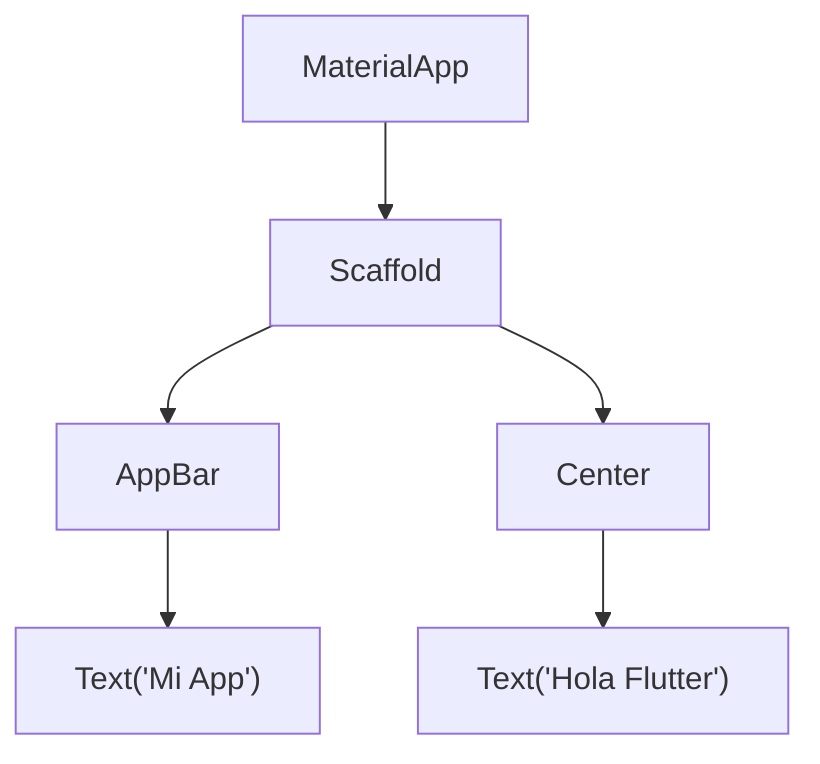

# 1. ¿Qué es Flutter? y `MaterialApp`

> Primeros pasos con Flutter: qué es un widget, cómo arranca una app y para qué sirve `MaterialApp`.

---

## 🎯 ¿Qué es Flutter?

Flutter es el framework de Google para crear aplicaciones **Android, iOS, web y escritorio con un solo código**, escrito en [Dart](../7.%20dart/1-variables-y-tipos.md).

Si ya conoces Jetpack Compose, Flutter te resultará familiar: ambos son **declarativos**. Describes *cómo debe verse* la pantalla y el framework se encarga de dibujarla.

| Concepto | Jetpack Compose | Flutter |
|---|---|---|
| Lenguaje | Kotlin | Dart |
| Pieza básica de UI | Función `@Composable` | **Widget** (una clase) |
| Plataformas | Android (y multiplataforma con KMP) | Android, iOS, web, escritorio |
| Recarga rápida | Live Edit | **Hot Reload** ⚡ |

---

## 🧱 En Flutter, todo es un Widget

Piensa en las piezas de **LEGO** 🧱: con piezas pequeñas armas piezas más grandes, y con esas armas un castillo completo.

En Flutter cada pieza es un **widget**: un texto, un botón, un espacio, una columna, incluso la app completa. Los widgets se meten unos dentro de otros formando un **árbol de widgets**.



Ese árbol en código se ve así (cada widget recibe a sus "hijos" con `child` o `children`):

```dart
MaterialApp(
  home: Scaffold(
    appBar: AppBar(
      title: const Text('Mi App'),
    ),
    body: const Center(
      child: Text('Hola Flutter'),
    ),
  ),
)
```

> [!TIP]
> Fíjate que todo son **parámetros nombrados** (`home:`, `appBar:`, `body:`, `child:`). Por eso los estudiamos a fondo en [Parámetros Nombrados](../7.%20dart/3-parametros-nombrados.md).

### `child` vs `children`

| Parámetro | Recibe | Ejemplo de widgets |
|---|---|---|
| `child` | **Un** widget | `Center`, `Padding`, `Container` |
| `children` | **Una lista** de widgets `[ ]` | `Column`, `Row`, `ListView` |

---

## 🚀 ¿Cómo arranca una app de Flutter?

Toda app empieza en `main()` (igual que cualquier programa Dart), que llama a **`runApp()`** con el widget raíz.

```dart
import 'package:flutter/material.dart';

void main() {
  runApp(const MiApp());
}

class MiApp extends StatelessWidget {
  const MiApp({super.key});

  @override
  Widget build(BuildContext context) {
    return const MaterialApp(
      home: Text('Hola Flutter'),
    );
  }
}
```

Paso a paso:
1. `import 'package:flutter/material.dart';` trae todos los widgets de Material Design.
2. `main()` es el punto de entrada.
3. `runApp(...)` le dice a Flutter: *"esta es la app, dibújala en pantalla"*.
4. `MiApp` es un widget creado por nosotros. Su método `build` devuelve **qué se dibuja**.

> **Nota:** El método `build` es el equivalente a una función `@Composable`: Flutter lo vuelve a llamar cada vez que necesita redibujar.

---

## 🏠 ¿Qué es `MaterialApp`?

`MaterialApp` es el **edificio** donde vive toda tu app 🏢. Antes de amueblar cada departamento (pantalla), el edificio define cosas que comparten todos:

- 🎨 El **tema** (colores, fuentes).
- 🏠 La **pantalla inicial** (`home`).
- 🧭 La **navegación** entre pantallas.
- 🌐 El idioma, el título de la app, etc.

Es el equivalente a `MaterialTheme { ... }` que envuelve el contenido en `setContent` de Compose.

```dart
import 'package:flutter/material.dart';

void main() {
  runApp(const MiApp());
}

class MiApp extends StatelessWidget {
  const MiApp({super.key});

  @override
  Widget build(BuildContext context) {
    return MaterialApp(
      title: 'Mi Primera App',
      debugShowCheckedModeBanner: false,
      theme: ThemeData(
        colorScheme: ColorScheme.fromSeed(seedColor: Colors.indigo),
      ),
      home: const PantallaInicio(),
    );
  }
}

class PantallaInicio extends StatelessWidget {
  const PantallaInicio({super.key});

  @override
  Widget build(BuildContext context) {
    return const Scaffold(
      body: Center(
        child: Text('¡Bienvenido!'),
      ),
    );
  }
}
```

### Parámetros más usados de `MaterialApp`

| Parámetro | ¿Para qué sirve? |
|---|---|
| `home` | Primera pantalla que se muestra |
| `title` | Nombre de la app (se ve en el administrador de tareas) |
| `theme` | Colores y estilos de toda la app |
| `debugShowCheckedModeBanner` | `false` oculta la etiqueta roja "DEBUG" |
| `routes` | Mapa de pantallas para navegar por nombre |

> [!TIP]
> `ColorScheme.fromSeed(seedColor: ...)` genera **toda una paleta** de colores a partir de un solo color. Cambia `Colors.indigo` por `Colors.teal` o `Colors.orange` y mira cómo cambia toda la app.

---

## ⚡ Hot Reload

Al guardar el archivo (o presionar `r` en la terminal), Flutter **aplica los cambios en menos de un segundo sin reiniciar la app** y sin perder lo que habías escrito en pantalla. Es como cambiar los muebles de una habitación sin tener que salir del edificio.

| Comando en terminal | Acción |
|---|---|
| `flutter create mi_app` | Crea un proyecto nuevo |
| `flutter run` | Ejecuta la app |
| `r` | Hot Reload (cambios rápidos) |
| `R` | Hot Restart (reinicia la app) |

---

## ⚠️ Errores Comunes de Principiantes

1. **Olvidar el `import` de material:** sin `package:flutter/material.dart` ningún widget existe.
2. **No envolver la app en `MaterialApp`:** muchos widgets (como `Scaffold` o `Text`) necesitan el tema y la configuración que `MaterialApp` provee.
3. **Confundir `child` con `children`:** `Column(child: ...)` no existe; `Column` usa `children: [ ... ]`.
4. **Olvidar las comas finales:** poner una coma `,` después de cada parámetro hace que el formateador ordene el código en forma de árbol, mucho más legible.

---

_Siguiente: [Scaffold →](2-scaffold.md)_
