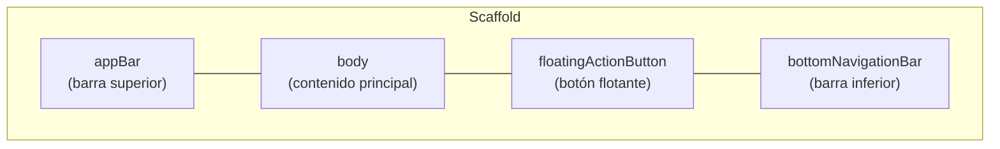

# 2. `Scaffold`: la estructura de una pantalla

> `Scaffold` es el esqueleto de cada pantalla: barra superior, contenido, botón flotante y barra inferior.

---

## 🏗️ ¿Qué es un Scaffold?

*Scaffold* significa **andamio** en inglés. Piensa en la estructura de un **departamento amoblado** 🛋️: ya trae lugares definidos para cada cosa.

- 🪟 Arriba, un **letrero** con el nombre → `appBar`
- 🛋️ En el centro, el **espacio principal** → `body`
- 🔘 En una esquina, un **botón de acción** → `floatingActionButton`
- 🚪 Abajo, una **barra de navegación** → `bottomNavigationBar`

Tú solo decides qué poner en cada lugar; `Scaffold` se encarga de acomodarlo.



Es el mismo concepto que el `Scaffold` de Jetpack Compose (¡hasta tiene el mismo nombre!).

---

## 📝 Ejemplo básico

```dart
import 'package:flutter/material.dart';

class PantallaInicio extends StatelessWidget {
  const PantallaInicio({super.key});

  @override
  Widget build(BuildContext context) {
    return Scaffold(
      appBar: AppBar(
        title: const Text('Mis Tareas'),
      ),
      body: const Center(
        child: Text('No tienes tareas pendientes 🎉'),
      ),
      floatingActionButton: FloatingActionButton(
        onPressed: () {
          print('Agregar tarea');
        },
        child: const Icon(Icons.add),
      ),
    );
  }
}
```

---

## 🧩 Las partes del Scaffold

### `appBar`: la barra superior

```dart
AppBar(
  title: const Text('Perfil'),
  backgroundColor: Colors.indigo,
  foregroundColor: Colors.white,
  actions: [
    IconButton(
      icon: const Icon(Icons.search),
      onPressed: () {},
    ),
    IconButton(
      icon: const Icon(Icons.settings),
      onPressed: () {},
    ),
  ],
)
```

| Parámetro | ¿Para qué sirve? |
|---|---|
| `title` | Título (normalmente un `Text`) |
| `actions` | Lista de botones a la derecha |
| `leading` | Widget a la izquierda (ej. botón de menú) |
| `backgroundColor` / `foregroundColor` | Color de fondo / color de texto e íconos |
| `centerTitle` | `true` centra el título |

> **Nota:** Si navegas a una segunda pantalla, el `AppBar` agrega **automáticamente** la flecha de "atrás" ←.

### `body`: el contenido principal

Es donde va todo lo importante de la pantalla. Recibe **un solo widget**, que normalmente es un `Column`, `ListView` o `Center` con más widgets adentro.

```dart
body: Padding(
  padding: const EdgeInsets.all(16),
  child: Column(
    children: const [
      Text('Hola'),
      Text('Bienvenido a la app'),
    ],
  ),
),
```

### `floatingActionButton`: el botón flotante

El botón redondo que "flota" sobre el contenido, para la acción principal de la pantalla (crear, agregar, escribir).

```dart
floatingActionButton: FloatingActionButton(
  onPressed: () {},
  child: const Icon(Icons.add),
),
```

### `bottomNavigationBar`: la barra inferior

Para moverse entre secciones principales de la app.

```dart
bottomNavigationBar: NavigationBar(
  selectedIndex: 0,
  destinations: const [
    NavigationDestination(icon: Icon(Icons.home), label: 'Inicio'),
    NavigationDestination(icon: Icon(Icons.search), label: 'Buscar'),
    NavigationDestination(icon: Icon(Icons.person), label: 'Perfil'),
  ],
),
```

> **Nota:** Para que la barra cambie de pestaña al tocarla necesitas **estado**. Lo veremos en [Stateless vs Stateful](4-stateless-vs-stateful.md).

---

## 📊 Resumen

| Parámetro | Lugar | Widget típico |
|---|---|---|
| `appBar` | Arriba | `AppBar` |
| `body` | Centro | `Column`, `ListView`, `Center` |
| `floatingActionButton` | Esquina inferior derecha | `FloatingActionButton` |
| `bottomNavigationBar` | Abajo | `NavigationBar` |
| `drawer` | Menú lateral (se abre deslizando) | `Drawer` |
| `backgroundColor` | Fondo de la pantalla | `Colors.grey.shade100` |

> [!TIP]
> **Regla práctica:** cada **pantalla** de tu app empieza con un `Scaffold`. Pero solo **uno** por pantalla: no metas un `Scaffold` dentro de otro.

---

## ⚠️ Errores Comunes de Principiantes

1. **Usar `Scaffold` sin `MaterialApp` arriba:** el Scaffold necesita el tema y la configuración que da `MaterialApp`.
2. **Pasar varios widgets al `body`:** `body` recibe uno solo; agrúpalos en un `Column`.
3. **Contenido tapado por la barra de estado:** si no usas `appBar`, envuelve el `body` en un `SafeArea` para que el contenido no quede debajo del reloj y la batería.

---

_Siguiente: [Widgets más usados →](3-widgets-mas-usados.md)_
