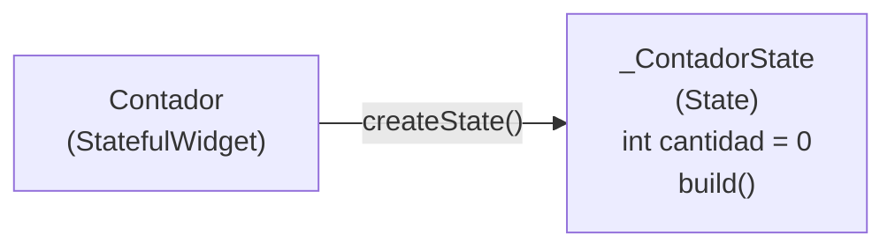
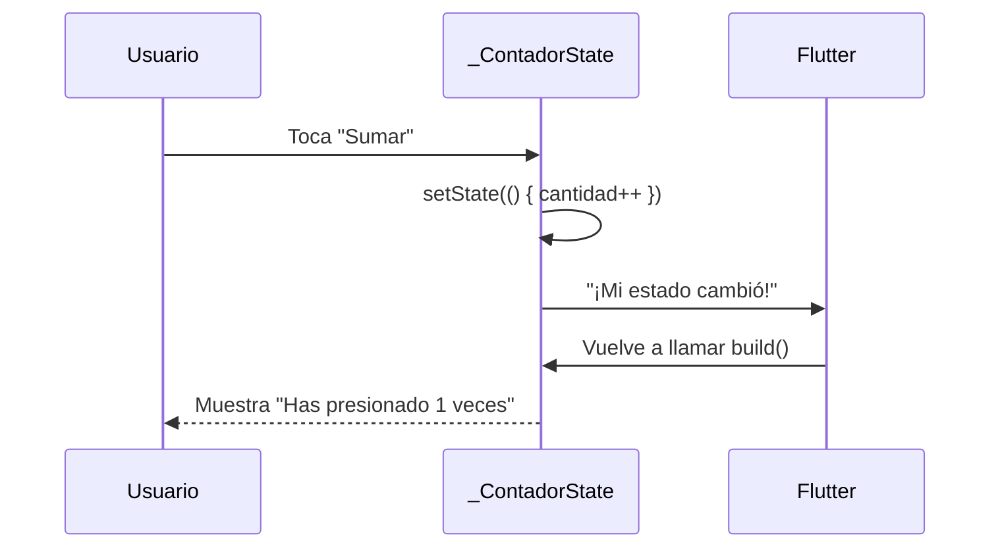
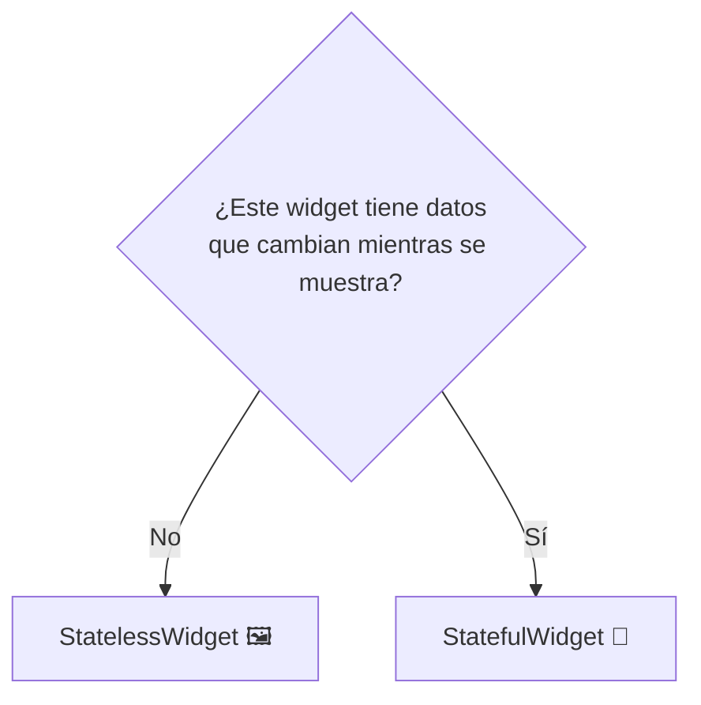

# 4. `StatelessWidget` vs `StatefulWidget`

> La diferencia entre un widget que **nunca cambia** y uno que **recuerda y reacciona**.

---

## 🖼️ La analogía: un cuadro vs una pizarra

- **`StatelessWidget`** → un **cuadro colgado en la pared** 🖼️. Muestra siempre lo mismo. Si quieres otra imagen, tienes que colgar otro cuadro.
- **`StatefulWidget`** → una **pizarra** 📝. Tiene información que puede cambiar (un contador, un texto escrito, un check marcado), y cuando cambia, se actualiza lo que ves.

Ese dato que puede cambiar se llama **estado** (*state*).

| | `StatelessWidget` | `StatefulWidget` |
|---|---|---|
| ¿Tiene datos que cambian? | ❌ No | ✅ Sí |
| ¿Se redibuja solo? | Solo si su "padre" le envía datos nuevos | Sí, al llamar `setState()` |
| Ejemplos | Un título, un ícono, una tarjeta de perfil | Un contador, un checkbox, un formulario |
| Equivalente en Compose | Composable sin `remember` | Composable con `remember { mutableStateOf() }` |

---

## 🖼️ `StatelessWidget`

Es una clase que hereda de `StatelessWidget` y sobrescribe el método `build`. Sus datos llegan por el **constructor** y son `final` (no cambian).

```dart
import 'package:flutter/material.dart';

class Saludo extends StatelessWidget {
  final String nombre;

  const Saludo({super.key, required this.nombre});

  @override
  Widget build(BuildContext context) {
    return Text(
      'Hola, $nombre 👋',
      style: const TextStyle(fontSize: 24),
    );
  }
}
```

Uso:

```dart
Column(
  children: const [
    Saludo(nombre: 'Ana'),
    Saludo(nombre: 'Luis'),
  ],
)
```

Comparación con Compose:

```kotlin
@Composable
fun Saludo(nombre: String) {
    Text(text = "Hola, $nombre 👋", fontSize = 24.sp)
}
```

> **Nota:** ¿Qué es `super.key`? Es un identificador opcional que Flutter usa internamente para distinguir widgets. Por ahora, simplemente inclúyelo siempre en el constructor.

---

## 📝 `StatefulWidget`

Un `StatefulWidget` se escribe con **dos clases**:

1. **El widget** (`Contador`): es la parte "pública", casi siempre vacía. Solo dice qué clase maneja su estado.
2. **El estado** (`_ContadorState`): guarda las variables que cambian y tiene el método `build`.



```dart
import 'package:flutter/material.dart';

class Contador extends StatefulWidget {
  const Contador({super.key});

  @override
  State<Contador> createState() => _ContadorState();
}

class _ContadorState extends State<Contador> {
  int cantidad = 0; // 👈 el estado

  @override
  Widget build(BuildContext context) {
    return Column(
      mainAxisAlignment: MainAxisAlignment.center,
      children: [
        Text(
          'Has presionado $cantidad veces',
          style: const TextStyle(fontSize: 20),
        ),
        const SizedBox(height: 16),
        ElevatedButton(
          onPressed: () {
            setState(() {
              cantidad++;
            });
          },
          child: const Text('Sumar'),
        ),
      ],
    );
  }
}
```

> [!TIP]
> No necesitas escribir esto de memoria. En VS Code o Android Studio escribe **`stful`** y presiona Enter: el editor genera ambas clases. Con **`stless`** genera un `StatelessWidget`.

---

## 🔄 `setState()`: avisar que algo cambió

`setState()` es como **tocar la campana** 🔔 para avisarle a Flutter: *"cambié un dato, vuelve a dibujar esta parte"*.



> [!WARNING]
> Si cambias la variable **sin** `setState`, el valor sí cambia en memoria, pero **la pantalla no se actualiza**:
> ```dart
> onPressed: () {
>   cantidad++; // ❌ La pantalla sigue mostrando el número anterior
> },
> ```

| Compose | Flutter |
|---|---|
| `var cantidad by remember { mutableStateOf(0) }` | `int cantidad = 0;` dentro de la clase `State` |
| `cantidad++` (redibuja automáticamente) | `setState(() { cantidad++; })` |

---

## ✅ Otro ejemplo: un interruptor

```dart
import 'package:flutter/material.dart';

class ModoOscuro extends StatefulWidget {
  const ModoOscuro({super.key});

  @override
  State<ModoOscuro> createState() => _ModoOscuroState();
}

class _ModoOscuroState extends State<ModoOscuro> {
  bool activado = false;

  @override
  Widget build(BuildContext context) {
    return SwitchListTile(
      title: const Text('Modo oscuro'),
      subtitle: Text(activado ? 'Activado 🌙' : 'Desactivado ☀️'),
      value: activado,
      onChanged: (nuevoValor) {
        setState(() {
          activado = nuevoValor;
        });
      },
    );
  }
}
```

---

## 🤔 ¿Cuál uso?



> [!TIP]
> **Regla de oro:** empieza siempre con `StatelessWidget`. Conviértelo en `StatefulWidget` solo cuando necesites que algo cambie (el editor tiene la opción *"Convert to StatefulWidget"*).

---

## ⚠️ Errores Comunes de Principiantes

1. **Olvidar `setState()`:** el dato cambia pero la pantalla no.
2. **Declarar el estado dentro de `build`:** `int cantidad = 0;` dentro de `build` se reinicia a `0` en cada redibujado. Debe declararse como propiedad de la clase `State`.
3. **Usar `StatefulWidget` para todo:** si no hay datos que cambien, usa `StatelessWidget`; es más simple y eficiente.
4. **Llamar `setState` dentro de `build`:** provoca un ciclo infinito de redibujado.

---

## 🏋️ Ejercicios

1. Crea un `StatelessWidget` llamado `TarjetaCurso` que reciba `nombre` y `creditos` (nombrados, obligatorios) y los muestre dentro de un `Container` con bordes redondeados.
2. Modifica el `Contador` para que tenga un botón **Restar** y otro **Reiniciar**. El contador no debe bajar de 0.
3. Crea una pantalla con un `TextField` y un `Text` debajo que muestre en tiempo real lo que el usuario escribe (pista: `onChanged` + `setState`).
4. Crea un `Scaffold` con un `FloatingActionButton` que agregue elementos a una lista (`List<String>`) mostrada con `ListView.builder`.

---

_Siguiente: Próximamente_
