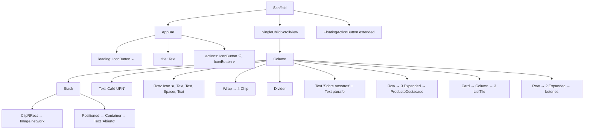

# 6. Ejercicio: Pantalla Stateless "Café UPN" ☕

> Construye paso a paso una pantalla completa usando **solo `StatelessWidget`** y los widgets del [Catálogo de Widgets](5-catalogo-de-widgets.md).

---

## 🎯 Objetivo

Crear la pantalla de **detalle de una cafetería**, como las que ves en apps de delivery o de reseñas. No hay que guardar datos ni reaccionar a toques: solo **armar la interfaz**.

Al terminar sabrás:

- Organizar una pantalla con `Scaffold`, `AppBar` y `SingleChildScrollView`.
- Combinar `Column`, `Row`, `Stack` y `Wrap` para acomodar widgets.
- Decorar con `Container`, `Card`, `Chip` y `Divider`.
- Crear **tu propio `StatelessWidget`** que recibe parámetros y reutilizarlo.

### 📏 Reglas del ejercicio

1. Solo `StatelessWidget`: **nada** de `StatefulWidget` ni `setState`.
2. Todos los botones llevan `onPressed: () {}` (no hacen nada todavía).
3. Si no recuerdas un widget, **búscalo en el [Catálogo](5-catalogo-de-widgets.md)** antes de preguntar o buscar en internet.

---

## 🖼️ Así debe quedar

```
┌────────────────────────────────────┐
│  ←          Café UPN        ♡   ⤴  │  ← AppBar
├────────────────────────────────────┤
│ ┌────────────────────────────────┐ │
│ │ (Abierto)                      │ │  ← Stack: imagen + etiqueta
│ │                                │ │
│ │          [ IMAGEN ]            │ │
│ │                                │ │
│ └────────────────────────────────┘ │
│                                    │
│ Café UPN                           │  ← Text grande
│ ★ 4.8  (230 reseñas)      S/ 8 - 25│  ← Row + Spacer
│                                    │
│ (☕ Café) (🍰 Postres) (📶 Wi-Fi)    │  ← Wrap de Chips
│ (🐾 Pet friendly)                   │
│ ────────────────────────────────── │  ← Divider
│ Sobre nosotros                     │
│ Café de especialidad preparado con │  ← Text párrafo
│ granos de la sierra de La Libertad │
│                                    │
│ Menú destacado                     │
│ ┌────────┐  ┌────────┐  ┌────────┐ │
│ │   ☕    │  │   🍦    │  │   🥐    │ │  ← Row de 3 ProductoDestacado
│ │ Latte  │  │ Frappé │  │Croissant│ │
│ │S/ 9.50 │  │S/ 12.00│  │S/ 6.00 │ │
│ └────────┘  └────────┘  └────────┘ │
│                                    │
│ ┌────────────────────────────────┐ │
│ │ 🕐 Horario                      │ │
│ │    Lun a Sáb · 7:00 - 21:00    │ │
│ │ ────────────────────────────── │ │  ← Card con 3 ListTile
│ │ 📍 Dirección                    │ │
│ │    Av. Principal 123, Trujillo │ │
│ │ ────────────────────────────── │ │
│ │ 📞 Teléfono                     │ │
│ │    (044) 123 456               │ │
│ └────────────────────────────────┘ │
│                                    │
│ ┌──────────────┐ ┌───────────────┐ │
│ │ 📞 Llamar     │ │ ➤ Cómo llegar │ │  ← Row con 2 Expanded
│ └──────────────┘ └───────────────┘ │
│                     ┌────────────┐ │
│                     │ 💺 Reservar │ │  ← FloatingActionButton.extended
│                     └────────────┘ │
└────────────────────────────────────┘
```

---

## 🧩 Widgets que vas a usar

| Parte de la pantalla | Widgets | Consulta en el catálogo |
|---|---|---|
| Estructura | `MaterialApp`, `Scaffold`, `AppBar`, `IconButton` | [Scaffold](5-catalogo-de-widgets.md#scaffold), [AppBar](5-catalogo-de-widgets.md#appbar) |
| Scroll | `SingleChildScrollView`, `Column` | [SingleChildScrollView](5-catalogo-de-widgets.md#singlechildscrollview), [Column](5-catalogo-de-widgets.md#column) |
| Portada | `Stack`, `Positioned`, `ClipRRect`, `Image.network`, `Container` | [Stack y Positioned](5-catalogo-de-widgets.md#stack-y-positioned), [Image y ClipRRect](5-catalogo-de-widgets.md#image-y-cliprrect) |
| Título y calificación | `Text`, `Row`, `Icon`, `Spacer`, `SizedBox` | [Row](5-catalogo-de-widgets.md#row), [Spacer](5-catalogo-de-widgets.md#spacer), [TextStyle](5-catalogo-de-widgets.md#textstyle) |
| Etiquetas | `Wrap`, `Chip` | [Wrap](5-catalogo-de-widgets.md#wrap), [Chip](5-catalogo-de-widgets.md#chip) |
| Descripción | `Divider`, `Text` | [Divider](5-catalogo-de-widgets.md#divider) |
| Menú destacado | Tu propio `StatelessWidget`, `Container`, `BoxDecoration`, `Expanded` | [Container](5-catalogo-de-widgets.md#container), [Expanded](5-catalogo-de-widgets.md#expanded) |
| Información | `Card`, `ListTile` | [Card](5-catalogo-de-widgets.md#card), [ListTile](5-catalogo-de-widgets.md#listtile) |
| Acciones | `OutlinedButton.icon`, `FilledButton.icon`, `FloatingActionButton.extended` | [Botones](5-catalogo-de-widgets.md#botones), [FloatingActionButton](5-catalogo-de-widgets.md#floatingactionbutton) |

---

## 🪜 Paso a paso

> [!TIP]
> Guarda el archivo después de cada paso y mira el resultado con **Hot Reload** (`r` en la terminal o el ícono ⚡). Ir de a poco te ayuda a encontrar errores rápido.

### Paso 0: Preparar el proyecto

Crea un proyecto nuevo (`flutter create cafe_upn`) y reemplaza **todo** el contenido de `lib/main.dart` con este punto de partida:

```dart
import 'package:flutter/material.dart';

void main() {
  runApp(const MiApp());
}

class MiApp extends StatelessWidget {
  const MiApp({super.key});

  @override
  Widget build(BuildContext context) {
    return MaterialApp(
      debugShowCheckedModeBanner: false,
      title: 'Café UPN',
      theme: ThemeData(
        colorSchemeSeed: Colors.brown,
        useMaterial3: true,
      ),
      home: const PantallaCafeteria(),
    );
  }
}

class PantallaCafeteria extends StatelessWidget {
  const PantallaCafeteria({super.key});

  @override
  Widget build(BuildContext context) {
    // 👇 Aquí vas a construir la pantalla
    return const Placeholder();
  }
}
```

> **Nota:** `Placeholder` dibuja una caja con una "X". Sirve para marcar dónde irá algo que todavía no construyes.

---

### Paso 1: Esqueleto y barra superior

La pantalla necesita su estructura base y una barra superior con:

- [ ] Un botón para **volver** a la izquierda.
- [ ] El título **"Café UPN"** centrado.
- [ ] Dos botones a la derecha: **favorito** y **compartir**.

📖 Consulta: [Scaffold](5-catalogo-de-widgets.md#scaffold), [AppBar](5-catalogo-de-widgets.md#appbar), [Botones](5-catalogo-de-widgets.md#botones), [Icon](5-catalogo-de-widgets.md#icon)

---

### Paso 2: Contenido con scroll

La pantalla es más alta que el celular.

- [ ] El usuario debe poder hacer **scroll** para ver todo el contenido.
- [ ] El contenido no debe quedar pegado a los bordes de la pantalla.
- [ ] Todos los elementos van **uno debajo del otro**, alineados a la izquierda.

📖 Consulta: [SingleChildScrollView](5-catalogo-de-widgets.md#singlechildscrollview), [Column](5-catalogo-de-widgets.md#column), [EdgeInsets](5-catalogo-de-widgets.md#edgeinsets), [MainAxisAlignment y CrossAxisAlignment](5-catalogo-de-widgets.md#mainaxisalignment-y-crossaxisalignment)

---

### Paso 3: Portada con etiqueta "Abierto"

- [ ] Una foto de portada que ocupe **todo el ancho**, con **esquinas redondeadas** y sin deformarse. Puedes usar `https://picsum.photos/600/300`.
- [ ] **Encima** de la foto, en la esquina superior izquierda, una etiqueta verde con el texto **"Abierto"** en blanco.

📖 Consulta: [Image y ClipRRect](5-catalogo-de-widgets.md#image-y-cliprrect), [BoxFit](5-catalogo-de-widgets.md#boxfit), [Stack y Positioned](5-catalogo-de-widgets.md#stack-y-positioned), [Container](5-catalogo-de-widgets.md#container), [BoxDecoration](5-catalogo-de-widgets.md#boxdecoration)

---

### Paso 4: Título y calificación

- [ ] El nombre **"Café UPN"** como título grande y llamativo.
- [ ] Debajo, una línea con: una **estrella**, la calificación **4.8**, la cantidad de reseñas **(230 reseñas)** con menos protagonismo, y el rango de precios **S/ 8 - 25** pegado al **borde derecho**.

📖 Consulta: [Text](5-catalogo-de-widgets.md#text), [TextStyle](5-catalogo-de-widgets.md#textstyle), [Row](5-catalogo-de-widgets.md#row), [Icon](5-catalogo-de-widgets.md#icon), [Spacer](5-catalogo-de-widgets.md#spacer), [SizedBox](5-catalogo-de-widgets.md#sizedbox), [Colors](5-catalogo-de-widgets.md#colors)

---

### Paso 5: Etiquetas de servicios

- [ ] Muestra los servicios del café como **etiquetas** con ícono: **Café**, **Postres**, **Wi-Fi** y **Pet friendly**.
- [ ] Si las etiquetas no caben en una línea, deben **bajar a la siguiente** (prueba girando el celular).

📖 Consulta: [Chip](5-catalogo-de-widgets.md#chip), [Wrap](5-catalogo-de-widgets.md#wrap), [Icon](5-catalogo-de-widgets.md#icon)

---

### Paso 6: Sobre nosotros

- [ ] Una **línea separadora** entre las etiquetas y esta sección.
- [ ] El subtítulo **"Sobre nosotros"**.
- [ ] Un párrafo descriptivo, con un color más suave que el título y fácil de leer:

  > Café de especialidad preparado con granos de la sierra de La Libertad. Un espacio tranquilo para estudiar, trabajar o conversar con amigos.

📖 Consulta: [Divider](5-catalogo-de-widgets.md#divider), [Text](5-catalogo-de-widgets.md#text), [TextStyle](5-catalogo-de-widgets.md#textstyle)

---

### Paso 7: Tu propio widget, `ProductoDestacado` ⭐

Este es el paso más importante. Las tres tarjetas del menú se ven **iguales** y solo cambian sus datos, así que en lugar de copiar y pegar, crea **un widget reutilizable** llamado `ProductoDestacado`.

- [ ] El widget recibe por su constructor el **ícono**, el **nombre** y el **precio** del producto.
- [ ] Se ve como una cajita con fondo de color suave y esquinas redondeadas, con el ícono, el nombre y el precio uno debajo del otro.
- [ ] El precio se muestra siempre con dos decimales: `S/ 9.50`.
- [ ] En la pantalla, bajo el subtítulo **"Menú destacado"**, las **tres tarjetas** aparecen una al lado de la otra y **todas del mismo ancho**:

| Producto | Precio | Ícono sugerido |
|---|---|---|
| Latte | 9.50 | `Icons.coffee` |
| Frappé | 12.00 | `Icons.icecream` |
| Croissant | 6.00 | `Icons.bakery_dining` |

📖 Consulta: [StatelessWidget](4-stateless-vs-stateful.md), [Parámetros Nombrados](../7.%20dart/3-parametros-nombrados.md), [Container](5-catalogo-de-widgets.md#container), [BoxDecoration](5-catalogo-de-widgets.md#boxdecoration), [Row](5-catalogo-de-widgets.md#row), [Expanded](5-catalogo-de-widgets.md#expanded)

---

### Paso 8: Tarjeta de información

- [ ] Una **tarjeta** que agrupe tres filas de información, cada una con ícono, título y detalle, separadas por líneas:

| Título | Detalle |
|---|---|
| Horario | Lun a Sáb · 7:00 a. m. - 9:00 p. m. |
| Dirección | Av. Principal 123, Trujillo |
| Teléfono | (044) 123 456 |

📖 Consulta: [Card](5-catalogo-de-widgets.md#card), [ListTile](5-catalogo-de-widgets.md#listtile), [Divider](5-catalogo-de-widgets.md#divider)

---

### Paso 9: Botones de acción

- [ ] Dos botones uno al lado del otro y **del mismo ancho**, cada uno con ícono y texto:
  - **Llamar**: acción secundaria.
  - **Cómo llegar**: acción principal, la que más resalta.
- [ ] Al hacer scroll hasta abajo, el botón flotante del paso 10 **no debe tapar** estos botones.

📖 Consulta: [Botones](5-catalogo-de-widgets.md#botones), [Row](5-catalogo-de-widgets.md#row), [Expanded](5-catalogo-de-widgets.md#expanded), [SizedBox](5-catalogo-de-widgets.md#sizedbox)

---

### Paso 10: Botón flotante

- [ ] Un botón flotante en la esquina inferior derecha con ícono y el texto **"Reservar"**.

📖 Consulta: [FloatingActionButton](5-catalogo-de-widgets.md#floatingactionbutton), [Scaffold](5-catalogo-de-widgets.md#scaffold)

---

## 🌳 Pista: árbol de widgets

Úsalo **solo si te atascas**: muestra qué widget va dentro de cuál.

<details>
<summary>Ver árbol de widgets</summary>



*(Los `SizedBox` separadores no se muestran para que el árbol se lea mejor.)*

</details>

---

## ✅ Lista de verificación

Antes de entregar, revisa que tu pantalla cumpla todo:

- [ ] Solo hay clases que extienden `StatelessWidget`.
- [ ] La pantalla hace scroll y **no** aparece la franja amarilla y negra (overflow).
- [ ] La imagen tiene esquinas redondeadas y la etiqueta "Abierto" está encima, arriba a la izquierda.
- [ ] El precio `S/ 8 - 25` está pegado al borde derecho.
- [ ] Los chips bajan de línea cuando no caben.
- [ ] `ProductoDestacado` está definido **una vez** y se usa **tres veces**.
- [ ] Las tres tarjetas del menú y los dos botones de abajo tienen el mismo ancho.
- [ ] El botón "Reservar" flota en la esquina inferior derecha.
- [ ] El editor no muestra advertencias de `const` (líneas azules).

---

## 🚀 Retos extra

1. **Avatar del dueño:** debajo de "Sobre nosotros", agrega un `ListTile` con un `CircleAvatar` (foto de `https://i.pravatar.cc/150`), el título `'María Rojas'` y el subtítulo `'Barista y fundadora'`.
2. **Widget `TituloSeccion`:** "Sobre nosotros" y "Menú destacado" usan el mismo estilo. Crea un `StatelessWidget` `TituloSeccion` que reciba el `texto` y úsalo en ambos lugares.
3. **Precio con descuento:** agrega a `ProductoDestacado` un parámetro opcional `double? precioAnterior`. Si no es `null`, muestra ese precio **tachado** en gris arriba del precio actual (📖 consulta: [TextStyle](5-catalogo-de-widgets.md#textstyle)).
4. **Calificación con estrellas:** reemplaza el ícono de estrella único por un `Row` con 5 íconos: 4 `Icons.star` y 1 `Icons.star_half`.
5. **Otra pantalla, mismos widgets:** usando lo aprendido, crea `PantallaCurso` con la información de un curso de la UPN (imagen, nombre, profesor con `CircleAvatar`, chips de horario, `Card` con créditos, aula y modalidad, y un botón "Matricularme").

---

_Anterior: [← Catálogo de Widgets](5-catalogo-de-widgets.md)_

_Siguiente: [Guía paso a paso: Café UPN →](7-guia-paso-a-paso-cafe-upn.md)_
