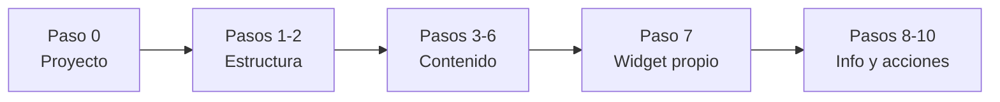

# 7. Guía paso a paso: Pantalla "Café UPN" ☕

> Construimos juntos, pieza por pieza, la pantalla del [Ejercicio 6](6-ejercicio-pantalla-stateless.md). En cada paso te damos **la base** del componente y tú **completas** lo que falta.

> [!WARNING]
> Si todavía no intentaste el [Ejercicio 6](6-ejercicio-pantalla-stateless.md) por tu cuenta, hazlo primero. Esta guía sirve para **destrabarte**, no para copiar sin entender.

---

## 🗺️ Cómo usar esta guía

Cada paso tiene tres partes:

1. 🧱 **La base:** el código inicial del componente. Escríbelo **a mano** en lugar de copiarlo y pegarlo.
2. ✏️ **Tu turno:** una lista de cosas que **tú** debes agregar. En el código, el comentario `// ✏️` marca **dónde** van.
3. ✅ **Deberías ver:** cómo debe quedar en el emulador. Guarda y mira el resultado con **Hot Reload** ⚡.

Si te atascas, cada paso tiene una **solución escondida** 🔒. Ábrela solo después de intentarlo.

Este es el plan: vamos de afuera hacia adentro, como al construir una casa 🏠. Primero el terreno y las paredes (`MaterialApp`, `Scaffold`), luego los pisos (`Column`) y al final los muebles (textos, imágenes, botones).



---

## Paso 0: Crear el proyecto

Abre una terminal y ejecuta:

```bash
flutter create cafe_upn
cd cafe_upn
```

Abre la carpeta en VS Code o Android Studio, ve a `lib/main.dart` y **borra todo** su contenido. Escribe este punto de partida:

```dart
import 'package:flutter/material.dart';

void main() {
  runApp(const MiApp());
}

class MiApp extends StatelessWidget {
  const MiApp({super.key});

  @override
  Widget build(BuildContext context) {
    return MaterialApp(
      debugShowCheckedModeBanner: false,
      title: 'Café UPN',
      theme: ThemeData(
        colorSchemeSeed: Colors.brown,
        useMaterial3: true,
      ),
      home: const PantallaCafeteria(),
    );
  }
}

class PantallaCafeteria extends StatelessWidget {
  const PantallaCafeteria({super.key});

  @override
  Widget build(BuildContext context) {
    return const Placeholder();
  }
}
```

🧠 **¿Qué hace cada parte?**

| Código | Para qué |
|---|---|
| `runApp(const MiApp())` | Arranca la app con el widget raíz `MiApp` |
| `MaterialApp` | Da el estilo de Material Design a toda la app → [repaso](1-que-es-flutter-y-materialapp.md) |
| `debugShowCheckedModeBanner: false` | Oculta la cinta roja "DEBUG" de la esquina |
| `colorSchemeSeed: Colors.brown` | Genera toda la paleta de colores a partir del café 🟤 (botones, chips y la barra la toman automáticamente) |
| `home: const PantallaCafeteria()` | La primera pantalla que se muestra |
| `Placeholder()` | Una caja con una "X" que marca "aquí irá algo" |

✏️ **Tu turno:** cambia `Colors.brown` por `Colors.teal`, guarda y vuelve a ejecutar. Luego regrésalo a `Colors.brown`. Así comprobarás que **un solo valor** cambia el color de toda la app.

✅ **Deberías ver:** una caja gris con una "X" ocupando toda la pantalla.

---

## Paso 1: Esqueleto y barra superior

🧱 Reemplaza el `return const Placeholder();` de `PantallaCafeteria` por:

```dart
    return Scaffold(
      appBar: AppBar(
        leading: IconButton(
          onPressed: () {},
          icon: const Icon(Icons.arrow_back),
        ),
        title: const Text('Café UPN'),
        // ✏️ centra el título
        actions: [
          IconButton(onPressed: () {}, icon: const Icon(Icons.favorite_border)),
          // ✏️ agrega el botón de compartir
        ],
      ),
      body: const Placeholder(), // 👈 lo reemplazamos en el siguiente paso
    );
```

✏️ **Tu turno:**

- [ ] Centra el título con la propiedad `centerTitle`.
- [ ] Dentro de `actions`, agrega un segundo `IconButton` con el ícono `Icons.share`.

<details>
<summary>🔒 Ver solución</summary>

```dart
        centerTitle: true,
        actions: [
          IconButton(onPressed: () {}, icon: const Icon(Icons.favorite_border)),
          IconButton(onPressed: () {}, icon: const Icon(Icons.share)),
        ],
```

</details>

🧠 **¿Por qué así?**

- `Scaffold` es el esqueleto de **toda** pantalla: tiene el hueco `appBar` arriba y el hueco `body` para el contenido. → [Scaffold](5-catalogo-de-widgets.md#scaffold)
- En el `AppBar`, `leading` va a la **izquierda** del título y `actions` es una **lista** de lo que va a la **derecha**. → [AppBar](5-catalogo-de-widgets.md#appbar)
- Usamos `IconButton` y no solo `Icon` porque el usuario espera poder **tocarlos**. → [Botones](5-catalogo-de-widgets.md#botones)
- `onPressed: () {}` es una función vacía: el botón se ve activo, pero todavía no hace nada.

✅ **Deberías ver:** una barra arriba con ← a la izquierda, "Café UPN" al centro y ♡ ⤴ a la derecha.

---

## Paso 2: Contenido con scroll

🧱 Reemplaza `body: const Placeholder(),` por:

```dart
      body: SingleChildScrollView(
        // ✏️ separa el contenido de los bordes
        child: Column(
          // ✏️ alinea todo a la izquierda
          children: [
            // 👇 Aquí irán los pasos 3 al 9, uno debajo del otro
          ],
        ),
      ),
```

✏️ **Tu turno:**

- [ ] En el `SingleChildScrollView`, agrega un `padding` de **16** en todos los lados.
- [ ] En el `Column`, usa `crossAxisAlignment` para alinear los hijos al **inicio** (izquierda).

<details>
<summary>🔒 Ver solución</summary>

```dart
      body: SingleChildScrollView(
        padding: const EdgeInsets.all(16),
        child: Column(
          crossAxisAlignment: CrossAxisAlignment.start,
          children: [],
        ),
      ),
```

</details>

🧠 **¿Por qué así?**

- La pantalla final es **más alta** que el celular. Sin `SingleChildScrollView` aparecería la franja amarilla y negra de *overflow*. → [SingleChildScrollView](5-catalogo-de-widgets.md#singlechildscrollview)
- Ponemos el `padding` aquí para que **todo** el contenido quede separado de los bordes, sin repetirlo en cada widget. → [EdgeInsets](5-catalogo-de-widgets.md#edgeinsets)
- En un `Column` el eje cruzado es el **horizontal**: por eso `crossAxisAlignment` controla la alineación izquierda/derecha. → [MainAxisAlignment y CrossAxisAlignment](5-catalogo-de-widgets.md#mainaxisalignment-y-crossaxisalignment)

✅ **Deberías ver:** la barra superior y la pantalla en blanco. Es normal: el `Column` está vacío.

> [!TIP]
> Desde aquí, **todos** los pasos siguientes agregan widgets **dentro** de `children: [ ]`, al final de la lista, en orden.

---

## Paso 3: Portada con etiqueta "Abierto"

🧱 Dentro de `children`, agrega:

```dart
            Stack(
              children: [
                // Capa 1 (al fondo): la imagen
                ClipRRect(
                  borderRadius: BorderRadius.circular(16),
                  child: Image.network(
                    'https://picsum.photos/600/300',
                    height: 200,
                    width: double.infinity,
                    // ✏️ que llene el espacio sin deformarse
                  ),
                ),
                // Capa 2 (adelante): la etiqueta
                Positioned(
                  top: 12,
                  left: 12,
                  child: Container(
                    padding: const EdgeInsets.symmetric(horizontal: 12, vertical: 6),
                    decoration: BoxDecoration(
                      // ✏️ color de fondo
                      borderRadius: BorderRadius.circular(20),
                    ),
                    child: const Text('Abierto'), // ✏️ dale estilo
                  ),
                ),
              ],
            ),
            const SizedBox(height: 16),
```

✏️ **Tu turno:**

- [ ] En la imagen, agrega `fit` con el valor `BoxFit.cover`.
- [ ] En el `BoxDecoration`, pon el fondo de la etiqueta en **verde**.
- [ ] Al `Text('Abierto')`, agrégale un `TextStyle` con letra **blanca** y en **negrita**.

<details>
<summary>🔒 Ver solución</summary>

```dart
                    fit: BoxFit.cover,
```

```dart
                    decoration: BoxDecoration(
                      color: Colors.green,
                      borderRadius: BorderRadius.circular(20),
                    ),
                    child: const Text(
                      'Abierto',
                      style: TextStyle(color: Colors.white, fontWeight: FontWeight.bold),
                    ),
```

</details>

🧠 **¿Por qué así?**

- La etiqueta va **encima** de la foto, así que necesitamos `Stack`. El **primer** hijo queda al fondo y el **último**, adelante. → [Stack y Positioned](5-catalogo-de-widgets.md#stack-y-positioned)
- `Image.network` no puede redondear sus esquinas; por eso la envolvemos en `ClipRRect`. → [Image y ClipRRect](5-catalogo-de-widgets.md#image-y-cliprrect)
- `BoxFit.cover` llena el espacio **sin deformar** la foto (recorta lo que sobra). → [BoxFit](5-catalogo-de-widgets.md#boxfit)
- Como el `Container` usa `decoration`, el color va **dentro** de `BoxDecoration`, no en el `Container`. → [BoxDecoration](5-catalogo-de-widgets.md#boxdecoration)

✅ **Deberías ver:** una foto con esquinas redondeadas y una píldora verde "Abierto" en su esquina superior izquierda.

> **Nota:** `picsum.photos` devuelve una foto al azar. Si al recargar cambia la imagen, es normal.

---

## Paso 4: Título y calificación

🧱 Debajo del `SizedBox` del paso anterior, agrega:

```dart
            const Text('Café UPN'), // ✏️ hazlo grande y en negrita
            const SizedBox(height: 4),
            const Row(
              children: [
                Icon(Icons.star, color: Colors.amber, size: 20),
                SizedBox(width: 4),
                Text('4.8', style: TextStyle(fontWeight: FontWeight.bold)),
                // ✏️ cantidad de reseñas
                // ✏️ rango de precios pegado a la derecha
              ],
            ),
            const SizedBox(height: 16),
```

✏️ **Tu turno:**

- [ ] Dale al título un `TextStyle` con `fontSize: 26` y negrita.
- [ ] Después del `4.8`, agrega un `SizedBox` de ancho 4 y el texto `'(230 reseñas)'` en color **gris**.
- [ ] Agrega el texto `'S/ 8 - 25'` y haz que quede pegado al **borde derecho**. Pista: hay un widget que "empuja" ocupando todo el espacio libre.

<details>
<summary>🔒 Ver solución</summary>

```dart
            const Text(
              'Café UPN',
              style: TextStyle(fontSize: 26, fontWeight: FontWeight.bold),
            ),
            const SizedBox(height: 4),
            const Row(
              children: [
                Icon(Icons.star, color: Colors.amber, size: 20),
                SizedBox(width: 4),
                Text('4.8', style: TextStyle(fontWeight: FontWeight.bold)),
                SizedBox(width: 4),
                Text('(230 reseñas)', style: TextStyle(color: Colors.grey)),
                Spacer(),
                Text('S/ 8 - 25'),
              ],
            ),
```

</details>

🧠 **¿Por qué así?**

- El título destaca por su **tamaño** y **grosor**, que se definen con `TextStyle`. → [TextStyle](5-catalogo-de-widgets.md#textstyle)
- Varios elementos **uno al lado del otro** = `Row`. Ahí separamos con `SizedBox(width: ...)`, no con `height`. → [Row](5-catalogo-de-widgets.md#row)
- El gris le quita **protagonismo** a las reseñas. → [Colors](5-catalogo-de-widgets.md#colors)
- `Spacer` ocupa el espacio libre y **empuja** el precio hasta el borde derecho. → [Spacer](5-catalogo-de-widgets.md#spacer)

✅ **Deberías ver:** "Café UPN" en grande y, debajo, ★ 4.8 (230 reseñas) a la izquierda y S/ 8 - 25 a la derecha.

---

## Paso 5: Etiquetas de servicios

🧱 Agrega:

```dart
            const Wrap(
              // ✏️ espacio entre chips y entre líneas
              children: [
                Chip(avatar: Icon(Icons.coffee, size: 18), label: Text('Café')),
                // ✏️ agrega 3 chips más
              ],
            ),
```

✏️ **Tu turno:**

- [ ] Agrega los chips que faltan, siguiendo el mismo formato:

  | Texto | Ícono |
  |---|---|
  | Postres | `Icons.cake` |
  | Wi-Fi | `Icons.wifi` |
  | Pet friendly | `Icons.pets` |

- [ ] En el `Wrap`, agrega `spacing: 8` y `runSpacing: 8`.

<details>
<summary>🔒 Ver solución</summary>

```dart
            const Wrap(
              spacing: 8,
              runSpacing: 8,
              children: [
                Chip(avatar: Icon(Icons.coffee, size: 18), label: Text('Café')),
                Chip(avatar: Icon(Icons.cake, size: 18), label: Text('Postres')),
                Chip(avatar: Icon(Icons.wifi, size: 18), label: Text('Wi-Fi')),
                Chip(avatar: Icon(Icons.pets, size: 18), label: Text('Pet friendly')),
              ],
            ),
```

</details>

🧠 **¿Por qué así?**

- `Chip` es el widget para **etiquetas**: `label` es el texto y `avatar` el ícono de la izquierda. → [Chip](5-catalogo-de-widgets.md#chip)
- ¿Por qué `Wrap` y no `Row`? Cuatro chips **no caben** en una línea. `Wrap` baja los que no caben a la siguiente. → [Wrap](5-catalogo-de-widgets.md#wrap)
- `spacing` separa los chips **en la misma línea** y `runSpacing` separa **una línea de la otra**.

✅ **Deberías ver:** tres chips en una línea y "Pet friendly" en la siguiente (depende del ancho de tu emulador).

> [!TIP]
> Haz la prueba: cambia `Wrap` por `Row` y guarda. Verás la franja amarilla y negra. Luego vuelve a `Wrap`.

---

## Paso 6: Sobre nosotros

🧱 Agrega:

```dart
            const Divider(height: 32),
            const Text(
              'Sobre nosotros',
              style: TextStyle(fontSize: 18, fontWeight: FontWeight.bold),
            ),
            const SizedBox(height: 8),
            // ✏️ párrafo descriptivo
            const SizedBox(height: 24),
```

✏️ **Tu turno:**

- [ ] Agrega un `Text` con este párrafo:

  > Café de especialidad preparado con granos de la sierra de La Libertad. Un espacio tranquilo para estudiar, trabajar o conversar con amigos.

- [ ] Dale un `TextStyle` con color `Colors.black54` y `height: 1.4`.

<details>
<summary>🔒 Ver solución</summary>

```dart
            const Text(
              'Café de especialidad preparado con granos de la sierra de La Libertad. '
              'Un espacio tranquilo para estudiar, trabajar o conversar con amigos.',
              style: TextStyle(color: Colors.black54, height: 1.4),
            ),
```

</details>

🧠 **¿Por qué así?**

- `Divider(height: 32)` es el espacio **total**: la línea queda en medio, con 16 arriba y 16 abajo. Por eso no hace falta `SizedBox`. → [Divider](5-catalogo-de-widgets.md#divider)
- `Colors.black54` (negro semitransparente) hace que el párrafo se vea más **suave** que el título.
- `height: 1.4` agrega espacio **entre renglones** para que se lea mejor.
- Un texto largo puede escribirse en **dos cadenas seguidas**: Dart las une solo.

✅ **Deberías ver:** una línea gris, el subtítulo "Sobre nosotros" y el párrafo en dos o tres renglones.

---

## Paso 7: Tu propio widget, `ProductoDestacado` ⭐

Las tres tarjetas del menú son **iguales**: solo cambian el ícono, el nombre y el precio. En lugar de escribir el mismo `Container` tres veces, creamos **un molde** 🍪 y lo usamos tres veces con datos distintos.

### 7.1. Crear el widget

🧱 Al **final** de `main.dart`, **fuera** de la clase `PantallaCafeteria`, agrega esta clase. Por ahora solo recibe el ícono y el nombre:

```dart
class ProductoDestacado extends StatelessWidget {
  final IconData icono;
  final String nombre;
  // ✏️ propiedad precio

  const ProductoDestacado({
    super.key,
    required this.icono,
    required this.nombre,
    // ✏️ parámetro precio
  });

  @override
  Widget build(BuildContext context) {
    return Container(
      padding: const EdgeInsets.all(12),
      decoration: BoxDecoration(
        color: Colors.brown.shade50,
        borderRadius: BorderRadius.circular(12),
      ),
      child: Column(
        children: [
          Icon(icono, size: 32, color: Colors.brown),
          const SizedBox(height: 8),
          Text(nombre, style: const TextStyle(fontWeight: FontWeight.bold)),
          // ✏️ mostrar el precio
        ],
      ),
    );
  }
}
```

✏️ **Tu turno:** agrégale el **precio** al widget.

- [ ] Declara la propiedad `final double precio;`.
- [ ] Agrégala al constructor como `required`.
- [ ] Muéstrala en el `Column` con **dos decimales**: `S/ 9.50`. Pista: `precio.toStringAsFixed(2)`.

<details>
<summary>🔒 Ver solución</summary>

```dart
  final double precio;
```

```dart
    required this.precio,
```

```dart
          Text('S/ ${precio.toStringAsFixed(2)}'),
```

</details>

🧠 **¿Por qué así?**

- Es `StatelessWidget` porque sus datos **no cambian** mientras se muestra. → [Stateless vs Stateful](4-stateless-vs-stateful.md)
- Los datos llegan como parámetros **nombrados** y `required`: así es imposible olvidarse de alguno. → [Parámetros Nombrados](../7.%20dart/3-parametros-nombrados.md)
- El tipo de `icono` es `IconData`: es el tipo de valores como `Icons.coffee`.
- `Icon(icono, ...)` **no** lleva `const` porque `icono` es una variable.

### 7.2. Usarlo en la pantalla

🧱 De vuelta en `PantallaCafeteria`, dentro de `children` y debajo del paso 6, agrega:

```dart
            const Text(
              'Menú destacado',
              style: TextStyle(fontSize: 18, fontWeight: FontWeight.bold),
            ),
            const SizedBox(height: 12),
            const Row(
              children: [
                Expanded(
                  child: ProductoDestacado(icono: Icons.coffee, nombre: 'Latte', precio: 9.5),
                ),
                // ✏️ agrega los otros dos productos
              ],
            ),
            const SizedBox(height: 24),
```

✏️ **Tu turno:**

- [ ] Agrega los otros dos productos, cada uno dentro de su `Expanded` y separados con `SizedBox(width: 8)`:

  | Producto | Precio | Ícono |
  |---|---|---|
  | Frappé | 12.0 | `Icons.icecream` |
  | Croissant | 6.0 | `Icons.bakery_dining` |

<details>
<summary>🔒 Ver solución</summary>

```dart
                SizedBox(width: 8),
                Expanded(
                  child: ProductoDestacado(icono: Icons.icecream, nombre: 'Frappé', precio: 12.0),
                ),
                SizedBox(width: 8),
                Expanded(
                  child: ProductoDestacado(icono: Icons.bakery_dining, nombre: 'Croissant', precio: 6.0),
                ),
```

</details>

🧠 **¿Por qué así?**

- Usamos `ProductoDestacado` **igual que cualquier widget de Flutter**. ¡Acabas de crear tu propio widget! 🎉
- `Expanded` reparte el ancho **en partes iguales**. Sin él, "Croissant" sería más ancha que "Latte". → [Expanded](5-catalogo-de-widgets.md#expanded)

✅ **Deberías ver:** tres cajitas café claro del mismo ancho, cada una con su ícono, nombre y precio con dos decimales.

---

## Paso 8: Tarjeta de información

🧱 Agrega:

```dart
            const Card(
              child: Column(
                children: [
                  ListTile(
                    leading: Icon(Icons.schedule),
                    title: Text('Horario'),
                    subtitle: Text('Lun a Sáb · 7:00 a. m. - 9:00 p. m.'),
                  ),
                  Divider(height: 1),
                  // ✏️ fila de dirección
                  // ✏️ fila de teléfono
                ],
              ),
            ),
            const SizedBox(height: 24),
```

✏️ **Tu turno:**

- [ ] Agrega dos `ListTile` más, separados por `Divider(height: 1)`:

  | Ícono | Título | Detalle |
  |---|---|---|
  | `Icons.location_on` | Dirección | Av. Principal 123, Trujillo |
  | `Icons.phone` | Teléfono | (044) 123 456 |

<details>
<summary>🔒 Ver solución</summary>

```dart
                  ListTile(
                    leading: Icon(Icons.location_on),
                    title: Text('Dirección'),
                    subtitle: Text('Av. Principal 123, Trujillo'),
                  ),
                  Divider(height: 1),
                  ListTile(
                    leading: Icon(Icons.phone),
                    title: Text('Teléfono'),
                    subtitle: Text('(044) 123 456'),
                  ),
```

</details>

🧠 **¿Por qué así?**

- `Card` agrupa información con fondo, esquinas redondeadas y sombra. → [Card](5-catalogo-de-widgets.md#card)
- `Card` tiene **un solo** `child`; como queremos tres filas, metemos un `Column` dentro.
- `ListTile` ya trae el espacio para ícono (`leading`), título (`title`) y detalle (`subtitle`) bien alineados. → [ListTile](5-catalogo-de-widgets.md#listtile)

✅ **Deberías ver:** una tarjeta con tres filas (horario, dirección y teléfono), separadas por líneas finas.

---

## Paso 9: Botones de acción

🧱 Agrega:

```dart
            Row(
              children: [
                Expanded(
                  child: OutlinedButton.icon(
                    onPressed: () {},
                    icon: const Icon(Icons.phone),
                    label: const Text('Llamar'),
                  ),
                ),
                const SizedBox(width: 12),
                // ✏️ botón principal "Cómo llegar"
              ],
            ),
            // ✏️ espacio final para el botón flotante
```

✏️ **Tu turno:**

- [ ] Agrega un `FilledButton.icon` dentro de un `Expanded`, con el ícono `Icons.directions` y el texto `'Cómo llegar'`. Guíate por el botón "Llamar".
- [ ] Debajo del `Row`, agrega un `SizedBox` de **80** de alto para que el botón flotante del paso 10 no tape estos botones.

<details>
<summary>🔒 Ver solución</summary>

```dart
                Expanded(
                  child: FilledButton.icon(
                    onPressed: () {},
                    icon: const Icon(Icons.directions),
                    label: const Text('Cómo llegar'),
                  ),
                ),
              ],
            ),
            const SizedBox(height: 80),
```

</details>

🧠 **¿Por qué así?**

- El constructor `.icon` crea un botón con **ícono y texto**: recibe `icon:` y `label:` en lugar de `child:`. → [Botones](5-catalogo-de-widgets.md#botones)
- `FilledButton` (relleno) para la acción **principal** y `OutlinedButton` (solo borde) para la **secundaria**.
- Este `Row` **no** puede ser `const` porque los botones reciben una función `() {}`. Por eso `const` va en cada `Icon`, `Text` y `SizedBox`.

✅ **Deberías ver:** dos botones del mismo ancho: "Llamar" con borde y "Cómo llegar" con fondo café.

---

## Paso 10: Botón flotante

El botón flotante **no** va dentro del `body`: tiene su propio hueco en el `Scaffold`.

🧱 Agrégalo debajo del `appBar`:

```dart
    return Scaffold(
      appBar: AppBar(
        // ... lo del paso 1
      ),
      floatingActionButton: FloatingActionButton.extended(
        onPressed: () {},
        // ✏️ ícono y texto
      ),
      body: SingleChildScrollView(
        // ... lo de los pasos 2 al 9
      ),
    );
```

✏️ **Tu turno:**

- [ ] Agrega el ícono `Icons.event_seat` y el texto `'Reservar'`. Pista: funciona igual que los botones `.icon` del paso 9.

<details>
<summary>🔒 Ver solución</summary>

```dart
      floatingActionButton: FloatingActionButton.extended(
        onPressed: () {},
        icon: const Icon(Icons.event_seat),
        label: const Text('Reservar'),
      ),
```

</details>

🧠 **¿Por qué así?**

- `floatingActionButton` es una propiedad del `Scaffold`: él lo ubica abajo a la derecha y lo hace **flotar** sobre el contenido. → [FloatingActionButton](5-catalogo-de-widgets.md#floatingactionbutton)
- `.extended` crea la versión "píldora" con ícono **y** texto.

✅ **Deberías ver:** la pantalla completa del [Ejercicio 6](6-ejercicio-pantalla-stateless.md), con el botón "Reservar" flotando abajo a la derecha. ¡Terminaste! 🎉

Ahora revisa la [Lista de verificación del Ejercicio 6](6-ejercicio-pantalla-stateless.md#-lista-de-verificación) para confirmar que no te faltó nada.

---

## 🧯 Si algo sale mal

| Síntoma | Causa probable | Solución |
|---|---|---|
| Franja amarilla y negra en el borde derecho | Un `Row` con hijos que no caben | Usa `Wrap` (paso 5) o envuelve hijos en `Expanded` (pasos 7 y 9) |
| Franja amarilla y negra abajo | Falta el scroll | Revisa que el `Column` esté dentro de `SingleChildScrollView` (paso 2) |
| La imagen no aparece | El emulador no tiene internet | Verifica la conexión del emulador o prueba abriendo el navegador en él |
| Error *"The argument type 'List<Widget>' can't be assigned to 'Widget'"* | Usaste `child:` con una lista `[ ]` | `child` recibe un widget; para varios usa `children` |
| Error *"Cannot provide both a color and a decoration"* | `color` y `decoration` juntos en un `Container` | Mueve el `color` dentro de `BoxDecoration` (pasos 3 y 7) |
| Error *"The named parameter 'precio' is required"* | Al usar `ProductoDestacado` olvidaste un parámetro | Pasa `icono`, `nombre` y `precio` |
| Error *"The named parameter 'precio' isn't defined"* | Usaste `precio:` pero no lo agregaste al constructor | Completa el ✏️ del paso 7.1 |
| Error *"Invalid constant value"* | Pusiste `const` en algo que usa una variable o una función | Quita ese `const` (ej. el `Row` de botones o `Icon(icono)`) |
| El botón "Reservar" tapa "Cómo llegar" | Falta el espacio final | Agrega el `SizedBox(height: 80)` al final del `Column` (paso 9) |

---

## 🎓 Lo que aprendiste

| Concepto | Dónde lo usaste |
|---|---|
| Estructura de pantalla con `Scaffold` y `AppBar` | Pasos 1 y 10 |
| Scroll con `SingleChildScrollView` | Paso 2 |
| Widgets encima de otros con `Stack` y `Positioned` | Paso 3 |
| Empujar a los extremos con `Spacer` | Paso 4 |
| Contenido que baja de línea con `Wrap` | Paso 5 |
| Repartir el ancho en partes iguales con `Expanded` | Pasos 7 y 9 |
| Crear tu propio `StatelessWidget` con parámetros | Paso 7 |
| Filas prediseñadas con `ListTile` dentro de un `Card` | Paso 8 |
| Elegir el botón según la importancia de la acción | Paso 9 |

Ahora intenta los [Retos extra del Ejercicio 6](6-ejercicio-pantalla-stateless.md#-retos-extra) **sin** mirar esta guía. 💪

---

_Anterior: [← Ejercicio: Pantalla Stateless](6-ejercicio-pantalla-stateless.md)_
