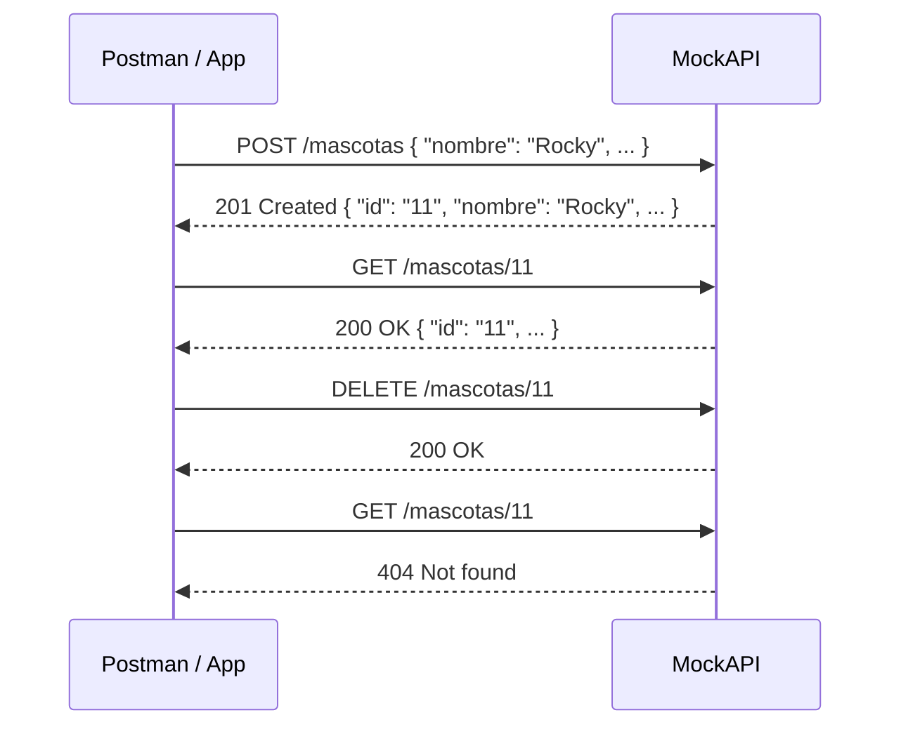

# 2. MockAPI: tu propio backend de prueba

> Para practicar HTTP necesitas un **servidor** que guarde y devuelva datos. MockAPI te da uno gratis en 5 minutos, sin programar nada.

---

## 🎭 La analogía: la utilería del teatro

En una obra de teatro, la comida que aparece en escena es de **utilería**: se ve real, los actores la usan como si fuera real, pero no salió de una cocina de verdad. 🎭🍗

**MockAPI** es la utilería del backend: te da direcciones (URLs) que responden como un servidor real (`GET`, `POST`, `PUT`, `DELETE`, JSON, códigos de estado), pero tú no escribiste el servidor. Tu app de Flutter **no nota la diferencia**.

> **Nota:** *Mock* significa "simulado" en inglés. Una **mock API** es una API simulada que sirve para desarrollar y probar el frontend mientras el backend real no existe.

Si necesitas repasar qué es una API, un endpoint o un verbo HTTP, revisa primero:
[¿Qué es una API?](../2.%20http/2-que-es-una-api.md) · [REST y JSON](../2.%20http/3-rest-y-json.md) · [Partes de una petición](../2.%20http/4-partes-peticion-http.md)

---

## 🛠️ Paso 1: Crear la cuenta y el proyecto

1. Entra a **[mockapi.io](https://mockapi.io)** e inicia sesión (puedes usar tu cuenta de GitHub o Google).
2. Crea un **proyecto nuevo**. Ponle un nombre (por ejemplo `adopciones`).
3. En el campo de **prefijo de la API** (*API prefix*) escribe `/api/v1`. Es opcional, pero ordena tus URLs.
4. Al crear el proyecto verás arriba su **URL base**, parecida a esta:

```
https://665f1a2b1e9017dc16f2a3b4.mockapi.io/api/v1
        └──────────┬───────────┘           └─┬──┘
          identificador único de tu       prefijo
          proyecto (el tuyo será otro)
```

> [!IMPORTANT]
> Copia **tu** URL base y guárdala. La de esta guía es un ejemplo y **no funciona**: cada estudiante tiene la suya.

> **Nota:** Si no pusiste prefijo, tu URL base no tendrá `/api/v1` y los recursos colgarán directo del dominio, por ejemplo `https://TU-ID.mockapi.io/mascotas`. Funciona igual; solo sé consistente.

---

## 🧱 Paso 2: Crear un recurso (la "tabla")

Un **recurso** es un tipo de dato que tu API maneja, como una tabla en una base de datos. Por ejemplo: `mascotas`, `productos`, `talleres`.

1. Dentro del proyecto, presiona **New resource**.
2. Escribe el **nombre del recurso** en plural y en minúsculas: `mascotas`.
3. Define el **esquema** (*schema*): los campos que tendrá cada mascota y su **tipo**.

MockAPI agrega algunos campos de ejemplo (`createdAt`, `name`, `avatar`). **Borra** los que no uses. El campo **`id`** déjalo siempre: MockAPI lo genera solo.

> [!NOTE]
> ¿Por qué borrar los campos que no usas? Cuando creas un registro con `POST` y **no envías** un campo que está en el esquema, MockAPI lo **rellena con un dato inventado**. Si dejas `name` en el esquema, cada mascota que crees desde tu app tendrá un `"name": "Patsy Hammes"` que nadie escribió.

### ¿Con qué se rellena cada campo?

La sección **Schema** del recurso se ve así: una fila por campo y el botón **+** para agregar otra.

```
Schema
┌──────────────┐ ┌──────────────┐
│ id           │ │ Object ID    │                       ← automático
└──────────────┘ └──────────────┘
┌──────────────┐ ┌──────────────┐ ┌────────────────┐
│ name         │ │  Faker.js  ▼ │ │ name.fullName ▼│    ← campo de ejemplo
└──────────────┘ └──────────────┘ └────────────────┘
┌──────────────┐ ┌──────────────┐ ┌────────────────┐
│ Field name   │ │  Faker.js  ▼ │ │  -Select-     ▼│    ← campo nuevo
└──────────────┘ └──────────────┘ └────────────────┘
  ( + )
```

En cada fila:

1. **Field name:** el nombre del campo, exactamente como lo leerás en Dart (`nombre`, `edad`...).
2. **Primer selector:** el **tipo**. Puede ser `Faker.js` o un tipo simple (`String`, `Number`, `Boolean`...).
3. **Segundo selector** (solo con `Faker.js`): **qué** dato inventar, escrito como `tema.dato`. Por ejemplo, `name.fullName` = un nombre completo de persona.

Hay dos caminos:

| Opción | Qué genera | Cuándo usarla |
|---|---|---|
| **Tipo simple** (`String`, `Number`, `Boolean`, ...) | Valores al azar de ese tipo: textos sin sentido, números, `true`/`false` | Cuando solo te importa que el **tipo** sea correcto |
| **Generador Faker** (nombres, imágenes, ciudades, números en un rango...) | Datos que **parecen reales**: `"Ana Torres"`, una URL de una foto, `"Lima"` | Cuando quieres que la lista **se vea bien** en tu app |

> **Nota:** *Faker* es una librería que inventa datos falsos pero realistas. MockAPI te muestra sus generadores agrupados por tema (personas, imágenes, números, texto, internet...). Busca en la lista el que más se parezca a tu campo.

Para la guía usaremos este esquema:

| Campo | Cómo rellenarlo (sugerencia) | Tipo final del valor | Ejemplo de valor |
|---|---|---|---|
| `id` | Object ID (automático) | texto | `"1"` |
| `nombre` | Faker.js → `name.firstName` | texto | `"Firulais"` |
| `especie` | Faker.js → `animal.type`, o `String` | texto | `"Perro"` |
| `edad` | `Number`, o Faker.js → un generador de número | número | `3` |
| `vacunada` | `Boolean`, o Faker.js → un generador de booleano | booleano | `true` |
| `foto` | Faker.js → `image.avatar` o uno de URL de imagen | texto | `"https://placedog.net/200?id=5"` |

> **Nota:** Los nombres exactos de los generadores pueden variar un poco. Abre el segundo selector, recorre los temas (`name`, `image`, `animal`, `datatype`, `lorem`...) y elige el que más se parezca. Al terminar, genera datos y **mira el resultado en el navegador**.

> [!TIP]
> **Lo que sí o sí debe salir bien es el tipo final.** Da igual si `edad` sale de "Number" o de un Faker de números: lo importante es que en el navegador aparezca **sin comillas**. Y si un campo de imagen se rellena con un texto al azar en lugar de una URL, tu app no podrá mostrar la foto.

> [!NOTE]
> Los generadores no conocen **tus** valores válidos: el de `especie` no sabe que solo aceptas `Perro`, `Gato`, `Conejo` u `Otro`, y uno de números puede darte edades como `48213`. Para tener algunos registros "perfectos", créalos tú con Postman (ver [paso 5](#-paso-5-probar-post-put-y-delete-con-postman)).

> [!WARNING]
> **El tipo importa, en dos lugares:**
> 1. **En el esquema:** si `edad` queda como *String*, los datos generados traerán `"3"` (texto) en lugar de `3` (número) y tu app fallará al convertir el JSON. Revisa el tipo de **cada** campo antes de guardar.
> 2. **En lo que envías:** MockAPI **no convierte** los tipos: guarda exactamente lo que le mandas. Si tu app envía `"edad": "3"` (con comillas), así quedará guardado, y la próxima vez que cargues la lista tu app fallará con ese registro.

4. Guarda el recurso. Luego usa la opción para **generar datos** (un control deslizante con la cantidad) y crea unos **10 registros** de prueba.

---

## 🌐 Paso 3: Los endpoints que obtienes gratis

Con solo crear el recurso `mascotas`, MockAPI te da **todo el CRUD**:

| Acción | Verbo | URL | Body | Respuesta exitosa |
|---|---|---|---|---|
| Listar todas | `GET` | `{base}/mascotas` | — | `200` + lista JSON `[ ... ]` |
| Ver una | `GET` | `{base}/mascotas/3` | — | `200` + objeto JSON `{ ... }` |
| Crear | `POST` | `{base}/mascotas` | JSON sin `id` | `201` + el objeto creado (ya con `id`) |
| Actualizar | `PUT` | `{base}/mascotas/3` | JSON con los cambios | `200` + el objeto actualizado |
| Eliminar | `DELETE` | `{base}/mascotas/3` | — | `200` + el objeto eliminado |

Detalles que conviene saber:

- Si pides un `id` que no existe, responde **`404`** y el body es el texto `"Not found"` (no es un objeto ni una lista).
- En el `POST`, si mandas un `id`, MockAPI lo **ignora** y pone el suyo.
- El `PUT` solo cambia los campos que envías; los demás se conservan.
- El `DELETE` devuelve el objeto que acaba de borrar.

`{base}` es tu URL base, por ejemplo `https://665f...mockapi.io/api/v1`.

En la configuración del recurso verás estos mismos cinco endpoints, cada uno con un interruptor y su respuesta:

```
On   GET     /mascotas        $mockData
On   GET     /mascotas/:id    $mockData
On   POST    /mascotas        $mockData
On   PUT     /mascotas/:id    $mockData
On   DELETE  /mascotas/:id    $mockData
```

- **`On`**: el endpoint está activo. Déjalos **todos en `On`**.
- **`:id`**: es un "hueco" en la URL que se reemplaza por el `id` real (`/mascotas/3`).
- **`$mockData`**: significa "responde con los datos guardados del recurso". **No lo cambies.**

---

## 🔎 Paso 4: Probar en el navegador

Los `GET` se pueden probar directo en el navegador. Pega en la barra de direcciones:

```
https://TU-ID.mockapi.io/api/v1/mascotas
```

Deberías ver algo así:

```json
[
  {
    "id": "1",
    "nombre": "Firulais",
    "especie": "Perro",
    "edad": 3,
    "vacunada": true,
    "foto": "https://placedog.net/200?id=1"
  },
  {
    "id": "2",
    "nombre": "Misha",
    "especie": "Gato",
    "edad": 1,
    "vacunada": false,
    "foto": "https://placedog.net/200?id=2"
  }
]
```

Observa con atención:

- Empieza con **`[`**: es una **lista** de objetos.
- El `id` viene **entre comillas**: es un `String`, no un número.
- `edad` **no** tiene comillas: es un número. `vacunada` es `true`/`false`: un booleano.

> [!TIP]
> **Antes de escribir una sola línea de Flutter, abre tu URL en el navegador.** Si ahí no ves tus datos, el problema no está en tu app.

---

## 📮 Paso 5: Probar `POST`, `PUT` y `DELETE` con Postman

El navegador solo hace `GET`. Para los demás verbos usa **[Postman](https://www.postman.com/downloads/)** (o la extensión *Thunder Client* de VS Code).

Para **crear** una mascota:

1. Método: **`POST`**. URL: `https://TU-ID.mockapi.io/api/v1/mascotas`
2. Pestaña **Body** → opción **raw** → formato **JSON**.
3. Escribe el objeto **sin `id`**:

```json
{
  "nombre": "Rocky",
  "especie": "Perro",
  "edad": 5,
  "vacunada": true,
  "foto": "https://placedog.net/200?id=9"
}
```

4. Presiona **Send**. Deberías recibir **`201 Created`** y el mismo objeto con un `id` nuevo.

Para **actualizar**, usa `PUT` con la URL que termina en el `id` (por ejemplo `/mascotas/11`) y el JSON con los cambios. Para **eliminar**, usa `DELETE` con la misma URL y sin body.



---

## 🧪 Extras: filtrar, buscar, ordenar y paginar

MockAPI entiende parámetros de consulta (*query parameters*) en la URL de la lista. Se agregan después de un `?` y se separan con `&`:

| Quiero... | URL |
|---|---|
| Las mascotas cuya especie **contiene** "Perro" | `{base}/mascotas?especie=Perro` |
| Buscar un texto en cualquier campo | `{base}/mascotas?search=fir` |
| Ordenar por edad, de mayor a menor | `{base}/mascotas?sortBy=edad&order=desc` |
| Página 1, de 5 en 5 | `{base}/mascotas?page=1&limit=5` |
| Combinar | `{base}/mascotas?especie=Gato&sortBy=nombre&order=asc` |

Pruébalos en el navegador antes de usarlos en la app. Y ten en cuenta estas reglas:

| Regla | Ejemplo |
|---|---|
| El filtro por campo busca que el valor **contenga** el texto, no que sea idéntico | `?nombre=Lu` encuentra a "Luna" y a "Lucas" |
| `limit` **solo funciona junto con `page`** | `?limit=5` sin `page` devuelve **todos** los registros |
| El `id` es texto, así que ordenar por `id` es **alfabético** | `"10"` queda antes que `"2"` |
| Ordenar funciona con los campos **del esquema** | Si un campo no está en el esquema, el orden no se aplica |

> [!WARNING]
> **Si un filtro o una búsqueda no encuentra nada, MockAPI NO devuelve `[]`: responde `404` con el texto `"Not found"`.** Para tu app eso no es un error, sino "sin resultados". En el servicio, cuando hagas una búsqueda o un filtro, trata el `404` como una **lista vacía** antes de lanzar la excepción.

---

## 📊 Resumen

| Concepto | En MockAPI |
|---|---|
| Servidor | Tu proyecto (`https://TU-ID.mockapi.io/api/v1`) |
| Tabla | Un recurso (`/mascotas`) |
| Columnas | El esquema (campos + tipos) |
| Fila | Un objeto JSON con `id` |
| CRUD | `GET`, `POST`, `PUT`, `DELETE`, ya listos |

---

## ⚠️ Errores Comunes de Principiantes

1. **Usar la URL de la guía** en lugar de la tuya: siempre da error.
2. **Nombre del recurso distinto en la URL:** si el recurso se llama `mascotas` y pides `/mascota` o `/Mascotas`, responde `404`.
3. **Tipos equivocados en el esquema:** números guardados como texto (`"3"`) rompen la conversión en Dart.
4. **Mandar el `id` en el `POST`:** no es necesario; MockAPI lo genera.
5. **Olvidar elegir "JSON" en Postman:** el servidor no entiende el body y crea un registro raro, con **todo tu texto como nombre de un solo campo** y ninguno de tus datos en su lugar.
6. **Tratar el `404` de una búsqueda como error:** en MockAPI significa "no hay resultados".
7. **Apagar un endpoint sin querer:** en la configuración del recurso cada endpoint tiene su interruptor **On/Off**. Si uno está en *Off*, esa petición no funcionará.
8. **Guardar datos privados:** cualquiera que conozca tu URL puede leer y modificar tus datos. Úsalo **solo para practicar**.

---

## 🏋️ Ejercicios

1. Crea tu proyecto en MockAPI con el recurso `mascotas` y el esquema de esta guía. Genera 10 registros.
2. Abre la lista en el navegador. Luego abre solo la mascota con `id` 4.
3. Con Postman, crea una mascota con tu nombre favorito, cámbiale la edad con `PUT` y finalmente elimínala con `DELETE`. Anota el código de estado de cada respuesta.
4. Construye en el navegador la URL que muestre solo los gatos, ordenados por nombre.

---

_Anterior: [← Future, async y await](1-future-async-await.md)_ · _Siguiente: [El paquete `http` y JSON →](3-paquete-http.md)_
