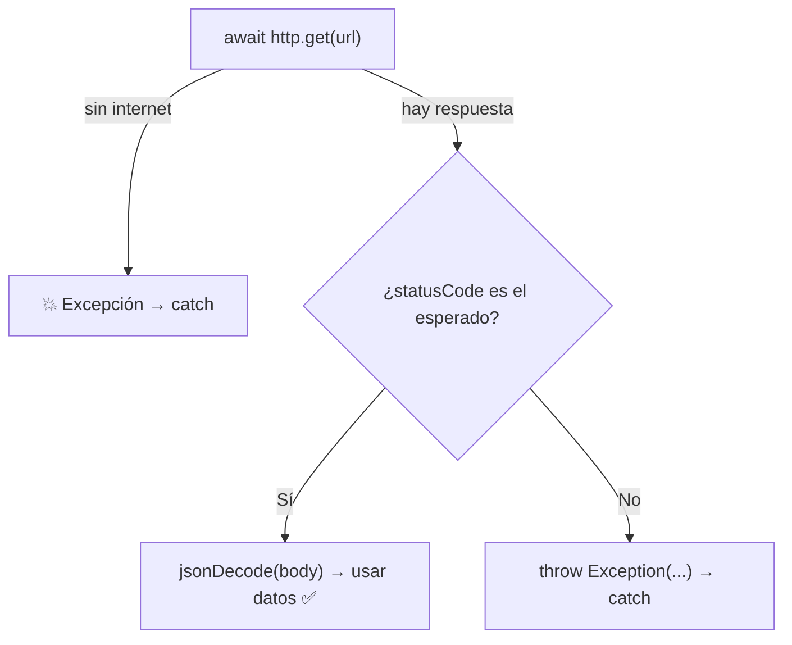

# 3. El paquete `http` y JSON

> Cómo hace Flutter una petición HTTP, lee la respuesta y convierte el JSON en datos de Dart.

---

## ✉️ La analogía: el correo postal

Hacer una petición HTTP es como **mandar una carta** ✉️:

| Carta | Petición HTTP | En Dart |
|---|---|---|
| Dirección del destinatario | URL | `Uri.parse('https://...')` |
| Tipo de trámite ("consulta", "solicitud de alta") | Verbo | `http.get`, `http.post`, ... |
| Sello "contenido: formulario" | Header `Content-Type` | `headers: {...}` |
| Lo que va dentro del sobre | Body | `body: jsonEncode(...)` |
| La carta de respuesta | Respuesta | `http.Response` |
| "Aprobado" / "Dirección no existe" | Código de estado | `respuesta.statusCode` |
| El texto de la respuesta | Body de la respuesta | `respuesta.body` |

Y como la respuesta **tarda en llegar**, todas las funciones de `http` devuelven un **`Future`** (ver [Future, async y await](1-future-async-await.md)).

---

## 📦 Paso 1: Instalar el paquete

Flutter no trae `http` incluido: es un **paquete** que se descarga de [pub.dev](https://pub.dev/packages/http) (la "tienda" de librerías de Dart).

En la terminal, dentro de la carpeta de tu proyecto:

```bash
flutter pub add http
```

Esto agrega una línea en `pubspec.yaml`, en la sección `dependencies` (la versión puede ser otra):

```yaml
dependencies:
  flutter:
    sdk: flutter
  http: ^1.6.0
```

Y en el archivo `.dart` donde lo uses, lo importas así:

```dart
import 'package:http/http.dart' as http;
```

> **Nota:** `as http` le pone un **apodo** al paquete. Por eso escribes `http.get(...)` en lugar de solo `get(...)`. Así queda claro de dónde viene cada función.

---

## 🔐 Paso 2: Permiso de internet (Android)

Abre `android/app/src/main/AndroidManifest.xml` y agrega esta línea **antes** de la etiqueta `<application`:

```xml
<manifest xmlns:android="http://schemas.android.com/apk/res/android">
    <uses-permission android:name="android.permission.INTERNET" />

    <application
        ...
```

> [!IMPORTANT]
> En modo *debug* la app suele funcionar sin esta línea, pero el **APK final** no podrá conectarse a internet. Agrégala siempre.

> [!TIP]
> Ejecuta tus prácticas en el **emulador de Android** o en **Chrome**. En macOS (escritorio) hay que configurar permisos adicionales.

---

## 📥 Paso 3: `GET`, pedir datos

```dart
import 'package:http/http.dart' as http;

Future<void> verMascotas() async {
  final url = Uri.parse('https://TU-ID.mockapi.io/api/v1/mascotas');

  final respuesta = await http.get(url);

  print(respuesta.statusCode); // 200
  print(respuesta.body);       // [{"id":"1","nombre":"Firulais",...}, ...]
}
```

Paso a paso:

1. **`Uri.parse(...)`** convierte el texto de la URL en un objeto `Uri`. `http` **no** acepta un `String` directo.
2. **`await http.get(url)`** envía la petición y espera la respuesta.
3. La respuesta es un objeto **`http.Response`** con:

| Propiedad | Qué tiene | Ejemplo |
|---|---|---|
| `statusCode` | Código de estado (`int`) | `200`, `201`, `404`, `500` |
| `body` | El cuerpo de la respuesta, **como texto** (`String`) | `'[{"id":"1",...}]'` |
| `headers` | Los headers de la respuesta (`Map`) | `{'content-type': 'application/json'}` |

> [!WARNING]
> `respuesta.body` es un **`String`**, no una lista ni un objeto. Para usar sus datos primero hay que **decodificar el JSON**. Lo vemos ahora.

---

## 🔤 Paso 4: JSON ↔ Dart con `dart:convert`

Dart trae dos funciones para traducir entre texto JSON y datos de Dart:

| Función | Convierte | Uso |
|---|---|---|
| `jsonDecode(texto)` | Texto JSON → `List` o `Map` de Dart | Al **recibir** una respuesta |
| `jsonEncode(objeto)` | `Map` o `List` de Dart → texto JSON | Al **enviar** un body |

Se importan de la librería `dart:convert` (ya viene con Dart, no hay que instalar nada):

```dart
import 'dart:convert';
```

### Cómo se traduce cada tipo

| En JSON | En Dart (después de `jsonDecode`) |
|---|---|
| `{ "clave": valor }` | `Map<String, dynamic>` |
| `[ ... ]` | `List<dynamic>` |
| `"texto"` | `String` |
| `3` | `int` |
| `3.5` | `double` |
| `true` / `false` | `bool` |
| `null` | `null` |

> **Nota:** `dynamic` significa "puede ser de cualquier tipo". Dart no sabe de antemano qué hay dentro del JSON, así que usa `dynamic`. En el [siguiente documento](4-modelos-y-servicio.md) aprenderás a convertirlo en tipos seguros.

### Decodificar una lista

```dart
import 'dart:convert';
import 'package:http/http.dart' as http;

Future<void> verNombres() async {
  final url = Uri.parse('https://TU-ID.mockapi.io/api/v1/mascotas');
  final respuesta = await http.get(url);

  final List<dynamic> lista = jsonDecode(respuesta.body); // empieza con [
  for (final item in lista) {
    print(item['nombre']); // cada item es un Map
  }
}
```

### Decodificar un solo objeto

```dart
final url = Uri.parse('https://TU-ID.mockapi.io/api/v1/mascotas/1');
final respuesta = await http.get(url);

final Map<String, dynamic> mascota = jsonDecode(respuesta.body); // empieza con {
print(mascota['nombre']); // Firulais
print(mascota['edad']);   // 3
```

> [!TIP]
> ¿Cómo sé si es `List` o `Map`? **Mira el primer carácter** de la respuesta en el navegador: `[` es lista, `{` es objeto.

---

## 📤 Paso 5: `POST`, enviar datos

Para crear algo hay que mandar un **body** en JSON y avisar al servidor con el header `Content-Type`:

```dart
import 'dart:convert';
import 'package:http/http.dart' as http;

Future<void> crearMascota() async {
  final url = Uri.parse('https://TU-ID.mockapi.io/api/v1/mascotas');

  final nueva = {
    'nombre': 'Rocky',
    'especie': 'Perro',
    'edad': 5,
    'vacunada': true,
    'foto': 'https://placedog.net/200?id=9',
  };

  final respuesta = await http.post(
    url,
    headers: {'Content-Type': 'application/json'}, // 👈 "lo que te mando es JSON"
    body: jsonEncode(nueva),                        // 👈 Map → texto JSON
  );

  print(respuesta.statusCode); // 201
  print(respuesta.body);       // {"id":"11","nombre":"Rocky",...}
}
```

> [!WARNING]
> Si olvidas el header `Content-Type`, MockAPI **no entiende** el body: responde `201` como si todo estuviera bien, pero crea un registro raro con todo tu texto convertido en el **nombre de un solo campo**, por ejemplo `{"id":"11","{\"nombre\":\"Rocky\",...}":""}`. Tus datos no quedan en `nombre`, `edad`, etc.

---

## ✏️ Paso 6: `PUT` y `DELETE`

`PUT` es igual que `POST`, pero la URL termina en el **`id`** del registro a modificar:

```dart
final url = Uri.parse('https://TU-ID.mockapi.io/api/v1/mascotas/11');

final respuesta = await http.put(
  url,
  headers: {'Content-Type': 'application/json'},
  body: jsonEncode({'edad': 6}),
);
print(respuesta.statusCode); // 200
```

> **Nota:** En MockAPI el `PUT` solo cambia los campos que envías; el resto se conserva.

`DELETE` no lleva body:

```dart
final url = Uri.parse('https://TU-ID.mockapi.io/api/v1/mascotas/11');
final respuesta = await http.delete(url);
print(respuesta.statusCode); // 200
```

---

## ✅ Paso 7: Revisar el código de estado

Que `await http.get(...)` termine **no** significa que todo salió bien. El servidor puede responder `404` o `500`. Por eso **siempre** se revisa `statusCode` antes de usar el body:

```dart
final respuesta = await http.get(url);

if (respuesta.statusCode == 200) {
  final List<dynamic> lista = jsonDecode(respuesta.body);
  // ... usar la lista
} else {
  throw Exception('Error ${respuesta.statusCode}');
}
```

| Verbo | Código esperado en MockAPI |
|---|---|
| `GET` | `200` |
| `POST` | `201` |
| `PUT` | `200` |
| `DELETE` | `200` |

Y si **no hay internet**, `http.get` ni siquiera recibe respuesta: **lanza una excepción**. Por eso la llamada se envuelve en `try`/`catch` (lo hacemos en el [documento 5](5-mostrar-datos-en-pantalla.md)).



---

## 📊 Resumen

| Quiero... | Código |
|---|---|
| Instalar | `flutter pub add http` |
| Importar | `import 'package:http/http.dart' as http;` y `import 'dart:convert';` |
| Crear la URL | `Uri.parse('https://...')` |
| Pedir | `await http.get(url)` |
| Crear | `await http.post(url, headers: {...}, body: jsonEncode(mapa))` |
| Actualizar | `await http.put(url, headers: {...}, body: jsonEncode(mapa))` |
| Eliminar | `await http.delete(url)` |
| Leer la respuesta | `respuesta.statusCode`, `jsonDecode(respuesta.body)` |

### Comparación con Retrofit (Kotlin)

| Retrofit | `http` |
|---|---|
| Interfaz con `@GET("mascotas")` | Llamas `http.get(Uri.parse(...))` tú mismo |
| Gson/Moshi convierte el JSON solo | Tú llamas a `jsonDecode` y conviertes a tu clase |
| `suspend fun` | `Future` + `async`/`await` |

---

## ⚠️ Errores Comunes de Principiantes

1. **Pasar un `String` en lugar de `Uri`:** *"The argument type 'String' can't be assigned to 'Uri'"*. Usa `Uri.parse(...)`.
2. **Usar `respuesta.body` como si fuera una lista:** es texto. Primero `jsonDecode`.
3. **Decodificar como `Map` algo que es `List`** (o al revés): *"type 'List<dynamic>' is not a subtype of type 'Map<String, dynamic>'"*. Revisa si empieza con `[` o `{`.
4. **Olvidar `Content-Type` en `POST`/`PUT`:** el servidor responde `201`, pero el registro queda con un campo raro y sin tus datos.
5. **No revisar `statusCode`:** intentas decodificar un mensaje de error como si fueran datos.
6. **Olvidar `import 'dart:convert';`:** `jsonDecode` aparece subrayado en rojo.
7. **Falta el permiso de `INTERNET`:** la app instalada desde el APK no carga nada.

---

## 🏋️ Ejercicios

1. Crea una función que haga `GET` a tu recurso `mascotas` e imprima **cuántas** mascotas hay (pista: `.length` de la lista).
2. Imprime el nombre de la mascota con `id` 3. Luego pide el `id` 999 e imprime el código de estado que recibes.
3. Crea una mascota con `POST` desde Dart. Abre la lista en el navegador y comprueba que aparece.
4. Borra la mascota que creaste usando el `id` que te devolvió el `POST`.

---

_Anterior: [← MockAPI](2-mockapi.md)_ · _Siguiente: [Modelos y clase de servicio →](4-modelos-y-servicio.md)_
