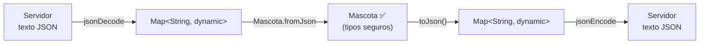

# 4. Modelos (`fromJson` / `toJson`) y clase de servicio

> Cómo pasar de un `Map` desordenado a **objetos de Dart con tipos**, y cómo juntar todas las peticiones en un solo lugar.

---

## 🛃 La analogía: la aduana

Cuando un paquete llega del extranjero, pasa por la **aduana** 🛃: lo abren, revisan que cada cosa sea lo que dice ser y lo vuelven a empacar con una etiqueta en tu idioma.

- El **JSON** que llega del servidor es el paquete extranjero: un `Map<String, dynamic>` donde cualquier cosa puede ser cualquier cosa.
- **`fromJson`** es la aduana de **entrada**: revisa cada campo y arma un objeto `Mascota` con tipos claros.
- **`toJson`** es la aduana de **salida**: toma tu `Mascota` y la empaca como `Map` para enviarla.



---

## 😖 ¿Por qué no usar el `Map` directamente?

```dart
final mascota = jsonDecode(respuesta.body);
print(mascota['nobmre']); // 😱 typo: imprime null y nadie te avisa
print(mascota['edad'] + 1); // ¿edad es int? ¿String? Dart no lo sabe
```

Con un `Map`, el editor **no te ayuda**: no autocompleta, no detecta errores de escritura y no sabe los tipos. Con una clase:

```dart
print(mascota.nobmre); // ❌ el editor lo marca en rojo al instante
print(mascota.edad + 1); // ✅ sabe que edad es int
```

---

## 🧱 Paso 1: La clase modelo

Primero, una clase normal con un atributo por cada campo del JSON (repasa [Clases e Instancias](../7.%20dart/4-clases-e-instancias.md)):

```dart
class Mascota {
  final String id;
  final String nombre;
  final String especie;
  final int edad;
  final bool vacunada;
  final String foto;

  Mascota({
    required this.id,
    required this.nombre,
    required this.especie,
    required this.edad,
    required this.vacunada,
    required this.foto,
  });
}
```

> [!IMPORTANT]
> Los tipos de Dart deben coincidir con lo que **realmente** llega en el JSON. En MockAPI el `id` llega como `"1"` (con comillas), así que es `String`, no `int`.

---

## 📥 Paso 2: `fromJson` (JSON → objeto)

Se agrega **dentro** de la clase como un constructor especial:

```dart
  factory Mascota.fromJson(Map<String, dynamic> json) {
    return Mascota(
      id: json['id'] as String,
      nombre: json['nombre'] as String,
      especie: json['especie'] as String,
      edad: json['edad'] as int,
      vacunada: json['vacunada'] as bool,
      foto: json['foto'] as String,
    );
  }
```

Desarmémoslo:

| Parte | Significa |
|---|---|
| `factory` | Un constructor que puede **calcular** cosas antes de crear el objeto y lo crea con `return` |
| `Mascota.fromJson` | Es un **constructor con nombre** (como los que viste en Dart). Se usa `Mascota.fromJson(mapa)` |
| `Map<String, dynamic> json` | Recibe el `Map` que salió de `jsonDecode` |
| `json['nombre']` | Lee el valor de la clave `"nombre"` (es `dynamic`) |
| `as String` | Le dice a Dart: "confía, esto es un `String`". Si no lo es, falla con un mensaje claro |

> [!WARNING]
> Las claves (`'nombre'`, `'edad'`) deben escribirse **exactamente** como en el JSON, con las mismas mayúsculas. `json['Nombre']` devuelve `null`.

### Campos opcionales o que podrían faltar

Si un campo puede no venir, usa un tipo con `?` o un valor por defecto con `??`:

```dart
// Si 'foto' no viene, se usa un texto vacío
foto: json['foto'] as String? ?? '',
```

### Números con decimales

Si un campo es un precio (`12.5`), a veces el servidor manda `12` (sin decimales) y Dart lo lee como `int`. Para aceptar ambos, conviértelo así:

```dart
precio: (json['precio'] as num).toDouble(),
```

`num` es el "padre" de `int` y `double`, así que acepta los dos.

---

## 📤 Paso 3: `toJson` (objeto → JSON)

Es un método normal que devuelve un `Map`. Lo usarás al hacer `POST` y `PUT`:

```dart
  Map<String, dynamic> toJson() {
    return {
      'nombre': nombre,
      'especie': especie,
      'edad': edad,
      'vacunada': vacunada,
      'foto': foto,
    };
  }
```

> **Nota:** No enviamos el `id`: al crear, MockAPI lo genera; al actualizar, el `id` ya va en la URL.

---

## 📋 Paso 4: Convertir una lista completa

El `GET` de la lista devuelve `List<dynamic>`, donde cada elemento es un `Map`. Para convertir **cada uno** en `Mascota` se usa `.map(...)` y luego `.toList()`:

```dart
final List<dynamic> datos = jsonDecode(respuesta.body);

final List<Mascota> mascotas =
    datos.map((item) => Mascota.fromJson(item)).toList();
```

Se lee: *"por cada `item` de `datos`, crea una `Mascota` con `fromJson`, y junta todo en una lista"*.

> **Nota:** Es el mismo `.map` que viste en [Colecciones de Kotlin](../0.%20kotlin/5-colecciones-y-operaciones.md). En Dart hay que terminar con `.toList()` porque `.map` devuelve un `Iterable`, no una `List`.

---

## 🗂️ Paso 5: La clase de servicio

No conviene escribir `http.get(...)` dentro de los widgets. Lo ordenado es tener **una clase** que se encargue de **todas** las peticiones de un recurso. La pantalla solo le pide cosas: *"dame las mascotas"*, *"guarda esta mascota"*.

Es como el **mesero** 🧑‍🍳: tú no entras a la cocina; le pides al mesero y él se encarga.

```dart
import 'dart:convert';

import 'package:http/http.dart' as http;

import '../modelos/mascota.dart';

class MascotaApi {
  // 👇 Reemplaza por TU URL base de MockAPI
  static const String _baseUrl = 'https://TU-ID.mockapi.io/api/v1';

  // GET lista
  Future<List<Mascota>> obtenerMascotas() async {
    final url = Uri.parse('$_baseUrl/mascotas');
    final respuesta = await http.get(url);

    if (respuesta.statusCode == 200) {
      final List<dynamic> datos = jsonDecode(respuesta.body);
      return datos.map((item) => Mascota.fromJson(item)).toList();
    } else {
      throw Exception('Error ${respuesta.statusCode} al cargar mascotas');
    }
  }

  // GET uno
  Future<Mascota> obtenerMascota(String id) async {
    final url = Uri.parse('$_baseUrl/mascotas/$id');
    final respuesta = await http.get(url);

    if (respuesta.statusCode == 200) {
      return Mascota.fromJson(jsonDecode(respuesta.body));
    } else {
      throw Exception('No se encontró la mascota $id');
    }
  }

  // POST
  Future<Mascota> crearMascota(Mascota mascota) async {
    final url = Uri.parse('$_baseUrl/mascotas');
    final respuesta = await http.post(
      url,
      headers: {'Content-Type': 'application/json'},
      body: jsonEncode(mascota.toJson()),
    );

    if (respuesta.statusCode == 201) {
      return Mascota.fromJson(jsonDecode(respuesta.body));
    } else {
      throw Exception('Error ${respuesta.statusCode} al crear la mascota');
    }
  }

  // PUT
  Future<Mascota> actualizarMascota(Mascota mascota) async {
    final url = Uri.parse('$_baseUrl/mascotas/${mascota.id}');
    final respuesta = await http.put(
      url,
      headers: {'Content-Type': 'application/json'},
      body: jsonEncode(mascota.toJson()),
    );

    if (respuesta.statusCode == 200) {
      return Mascota.fromJson(jsonDecode(respuesta.body));
    } else {
      throw Exception('Error ${respuesta.statusCode} al actualizar');
    }
  }

  // DELETE
  Future<void> eliminarMascota(String id) async {
    final url = Uri.parse('$_baseUrl/mascotas/$id');
    final respuesta = await http.delete(url);

    if (respuesta.statusCode != 200) {
      throw Exception('Error ${respuesta.statusCode} al eliminar');
    }
  }
}
```

Fíjate en el patrón que **se repite** en cada método:

1. Armar la URL con `Uri.parse`.
2. Hacer la petición con `await`.
3. Revisar el `statusCode`.
4. Si está bien: convertir con `fromJson` y devolver. Si no: `throw Exception(...)`.

> [!TIP]
> `static const` significa que `_baseUrl` es **una sola constante para toda la clase**. El `_` la hace privada: solo `MascotaApi` la usa. Si cambias de proyecto en MockAPI, la cambias en **un solo lugar**.

---

## 📁 Paso 6: Organizar los archivos

Cuando la app crece, un solo `main.dart` se vuelve imposible de leer. Una organización simple:

```
lib/
├── main.dart                  ← solo runApp y MaterialApp
├── modelos/
│   └── mascota.dart           ← class Mascota (fromJson / toJson)
├── servicios/
│   └── mascota_api.dart       ← class MascotaApi (http)
└── pantallas/
    ├── lista_mascotas.dart    ← pantalla con la lista
    └── formulario_mascota.dart← pantalla con el formulario
```

Para usar una clase de otro archivo, se importa con una **ruta relativa**:

```dart
// Dentro de lib/servicios/mascota_api.dart
import '../modelos/mascota.dart'; // ".." = subir una carpeta
```

```dart
// Dentro de lib/main.dart
import 'pantallas/lista_mascotas.dart';
```

> [!TIP]
> Si escribes el nombre de una clase que está en otro archivo, el editor la subraya en rojo y te ofrece la bombilla 💡 **"Import library..."**. Úsala.

---

## 📊 Resumen

| Pieza | Responsabilidad | Archivo |
|---|---|---|
| `Mascota` | Describe **cómo es** una mascota y cómo convertirla desde/hacia JSON | `modelos/mascota.dart` |
| `Mascota.fromJson` | `Map` → `Mascota` | |
| `toJson()` | `Mascota` → `Map` | |
| `MascotaApi` | **Habla con el servidor**: `GET`, `POST`, `PUT`, `DELETE` | `servicios/mascota_api.dart` |
| Pantallas | **Muestran** los datos y llaman a `MascotaApi` | `pantallas/...` |

| Kotlin | Dart |
|---|---|
| `data class Mascota(...)` | `class Mascota` con atributos `final` |
| Gson/Moshi (automático) | `factory Mascota.fromJson(...)` (manual) |
| Interfaz de Retrofit | Clase de servicio (`MascotaApi`) |

---

## ⚠️ Errores Comunes de Principiantes

1. ***"type 'String' is not a subtype of type 'int'"***: el JSON trae `"3"` y tú pusiste `as int`. Revisa el tipo del campo en MockAPI o en Dart.
2. ***"type 'Null' is not a subtype of type 'String'"***: la clave no existe en el JSON (¿mayúsculas? ¿typo?) o el campo viene vacío. Revisa el nombre o usa `??`.
3. **Olvidar `.toList()`** después de `.map(...)`: *"'Iterable<Mascota>' can't be assigned to 'List<Mascota>'"*.
4. **Declarar `id` como `int`:** en MockAPI el `id` es `String`.
5. **Escribir la URL base en varios archivos:** cuando cambie, olvidarás alguno. Una sola constante en el servicio.
6. **Ruta de import incorrecta:** *"Target of URI doesn't exist"*. Revisa los `..` y el nombre del archivo.

---

## 🏋️ Ejercicios

1. Crea la clase `Mascota` con `fromJson` y `toJson`. En `main`, decodifica este texto y muestra el nombre con `print`:
   `'{"id":"7","nombre":"Luna","especie":"Gato","edad":2,"vacunada":false,"foto":"https://x.com/a.png"}'`
2. Agrega a `Mascota` un getter `String get descripcion` que devuelva, por ejemplo, `"Luna (Gato, 2 años)"`.
3. Crea `MascotaApi` con tu URL y llama a `obtenerMascotas()` desde `main`. Imprime el nombre de cada mascota.
4. Agrega a `MascotaApi` un método `Future<List<Mascota>> buscarPorEspecie(String especie)` que use el filtro `?especie=` de MockAPI. Ojo: si no hay coincidencias, MockAPI responde `404` (ver [MockAPI: filtrar](2-mockapi.md#-extras-filtrar-buscar-ordenar-y-paginar)); en ese caso tu método debe devolver una lista **vacía**, no lanzar error.

---

_Anterior: [← El paquete http y JSON](3-paquete-http.md)_ · _Siguiente: [Mostrar datos de la API en pantalla →](5-mostrar-datos-en-pantalla.md)_
