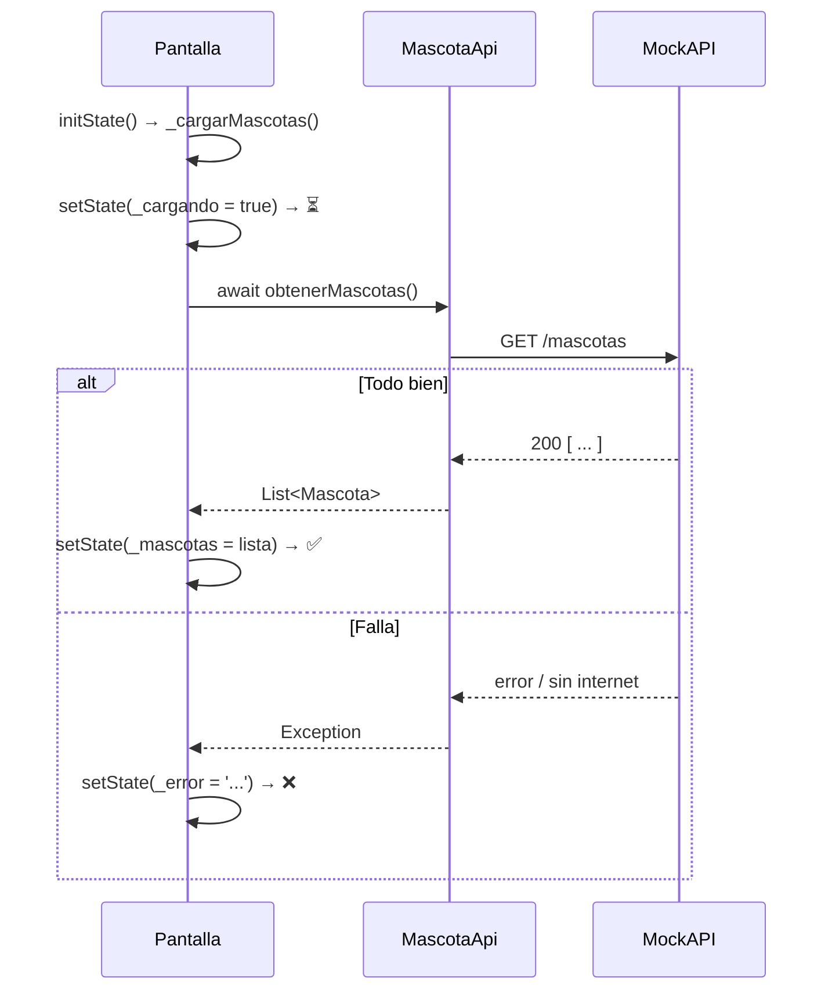

# 5. Mostrar datos de la API en pantalla

> Ya sabes pedir datos. Ahora toca **mostrarlos**: con un indicador mientras cargan, un mensaje si algo falla y la lista cuando llegan.

---

## 🍽️ La analogía: el restaurante

Cuando pides en un restaurante, la mesa pasa por **estados**:

1. ⏳ **Esperando**: el mesero dice "ya viene". No hay plato todavía.
2. ❌ **Problema**: "disculpe, se acabó ese plato". Te ofrecen pedir otra vez.
3. ✅ **Servido**: llega la comida.
4. 🍽️ **Vacío**: llega el plato... pero no tiene nada (raro, pero puede pasar).

Tu pantalla debe mostrar **algo distinto en cada estado**. Nunca una pantalla en blanco sin explicación.

| Estado | Qué muestra la pantalla | Variable que lo indica |
|---|---|---|
| Cargando | Un círculo girando (`CircularProgressIndicator`) | `_cargando == true` |
| Error | Mensaje + botón **Reintentar** | `_error != null` |
| Vacío | "Aún no hay mascotas" | `_mascotas.isEmpty` |
| Éxito | La lista | ninguna de las anteriores |

> **Nota:** Es la misma idea que vimos en Compose en [Estados de carga](../2.%20http/8-estados-carga.md) con `Loading`, `Error` y `Success`.

---

## 🧠 Paso 1: Un `StatefulWidget` (porque los datos cambian)

Al abrir la pantalla todavía no hay mascotas; unos segundos después, sí. Los datos **cambian**, así que la pantalla es un `StatefulWidget` (repasa [Stateless vs Stateful](../8.%20flutter/4-stateless-vs-stateful.md)).

El estado guarda **tres variables**:

```dart
class _ListaMascotasState extends State<ListaMascotas> {
  final MascotaApi _api = MascotaApi();

  bool _cargando = true;          // ⏳ empieza cargando
  String? _error;                 // ❌ null = no hay error
  List<Mascota> _mascotas = [];   // ✅ los datos

  // ...
}
```

---

## 🚀 Paso 2: Cargar al abrir la pantalla con `initState`

`initState` es un método de `State` que Flutter llama **una sola vez**, cuando el widget aparece por primera vez. Es el lugar perfecto para iniciar la carga.

```dart
  @override
  void initState() {
    super.initState();   // 👈 siempre primero
    _cargarMascotas();
  }
```

> [!WARNING]
> **Nunca** pidas datos dentro de `build`. `build` se ejecuta **muchas veces** (cada `setState`, al girar el celular...). Si cargas ahí, harás cientos de peticiones y un ciclo infinito.

| Método | Cuándo se ejecuta | Para qué |
|---|---|---|
| `initState()` | **Una vez**, al crear la pantalla | Iniciar cargas, preparar controladores |
| `build()` | **Muchas veces** | Solo dibujar |
| `dispose()` | **Una vez**, al cerrar la pantalla | Liberar recursos (lo usarás en formularios) |

> **Nota:** `initState` **no puede** ser `async`. Por eso llama a otra función (`_cargarMascotas`) que sí lo es, sin `await`.

---

## 🔄 Paso 3: La función que carga

```dart
  Future<void> _cargarMascotas() async {
    setState(() {
      _cargando = true;   // muestra el círculo
      _error = null;      // borra errores anteriores
    });

    try {
      final lista = await _api.obtenerMascotas();
      setState(() {
        _mascotas = lista;
        _cargando = false;
      });
    } catch (e) {
      setState(() {
        _error = 'No se pudo cargar la lista. Revisa tu conexión.';
        _cargando = false;
      });
    }
  }
```



> [!TIP]
> La misma función sirve para **cargar**, **reintentar** y **refrescar**. Escríbela una vez y llámala desde donde la necesites.

---

## 🎨 Paso 4: Dibujar según el estado

Para que `build` no se vuelva enorme, separa el cuerpo en un método que devuelve un `Widget` y decide con `if`:

```dart
  @override
  Widget build(BuildContext context) {
    return Scaffold(
      appBar: AppBar(title: const Text('Adopta una mascota')),
      body: _construirCuerpo(),
    );
  }

  Widget _construirCuerpo() {
    // ⏳ Cargando
    if (_cargando) {
      return const Center(child: CircularProgressIndicator());
    }

    // ❌ Error
    if (_error != null) {
      return Center(
        child: Column(
          mainAxisSize: MainAxisSize.min,
          children: [
            const Icon(Icons.wifi_off, size: 48, color: Colors.grey),
            const SizedBox(height: 8),
            Text(_error!),
            const SizedBox(height: 16),
            FilledButton(
              onPressed: _cargarMascotas,   // 👈 reintentar
              child: const Text('Reintentar'),
            ),
          ],
        ),
      );
    }

    // 🍽️ Vacío
    if (_mascotas.isEmpty) {
      return const Center(child: Text('Aún no hay mascotas registradas 🐾'));
    }

    // ✅ Éxito
    return ListView.builder(
      itemCount: _mascotas.length,
      itemBuilder: (context, index) {
        final mascota = _mascotas[index];
        return ListTile(
          leading: CircleAvatar(backgroundImage: NetworkImage(mascota.foto)),
          title: Text(mascota.nombre),
          subtitle: Text('${mascota.especie} · ${mascota.edad} años'),
          trailing: Icon(
            mascota.vacunada ? Icons.verified : Icons.warning_amber,
            color: mascota.vacunada ? Colors.green : Colors.orange,
          ),
        );
      },
    );
  }
```

Puntos clave:

- **El orden de los `if` importa.** Primero se revisa "cargando", luego "error", luego "vacío" y al final se muestra la lista.
- Cada `if` hace `return`, así que solo se dibuja **un** estado.
- `_error!` lleva `!` porque `_error` es `String?`; dentro de ese `if` ya sabemos que no es `null`.
- `onPressed: _cargarMascotas` pasa la función **sin paréntesis**: "ejecútala cuando toquen el botón", no "ejecútala ahora".

### `ListView.builder`

Es la forma eficiente de mostrar listas largas: solo construye los elementos que **se ven** en pantalla.

| Propiedad | Qué recibe |
|---|---|
| `itemCount` | Cuántos elementos hay (`_mascotas.length`) |
| `itemBuilder` | Una función `(context, index)` que devuelve el widget del elemento número `index` |

> **Nota:** Es el equivalente de `LazyColumn { items(lista) { ... } }` en Compose.

### `CircularProgressIndicator`

El círculo que gira. Sin parámetros gira para siempre; se usa envuelto en `Center`. Si quieres uno pequeño (por ejemplo, dentro de un botón), envuélvelo en un `SizedBox` con `width` y `height` y usa `strokeWidth: 2`.

---

## 👇 Paso 5: Deslizar hacia abajo para refrescar

`RefreshIndicator` envuelve una lista y, cuando el usuario la **jala hacia abajo**, ejecuta una función que devuelve un `Future`. Mientras el `Future` no termina, muestra su propio circulito.

```dart
    // ✅ Éxito
    return RefreshIndicator(
      onRefresh: _cargarMascotas,   // 👈 debe devolver un Future
      child: ListView.builder(
        // ... igual que antes
      ),
    );
```

> [!TIP]
> También puedes poner un botón de refrescar en la `AppBar`: un `IconButton` con `Icons.refresh` en `actions`, cuyo `onPressed` llame a la misma función.

---

## 🗑️ Paso 6 (opcional): Eliminar deslizando con `Dismissible`

`Dismissible` envuelve un elemento de la lista y permite **deslizarlo** hacia un lado para quitarlo.

```dart
      itemBuilder: (context, index) {
        final mascota = _mascotas[index];
        return Dismissible(
          key: ValueKey(mascota.id),                  // 👈 identificador único
          direction: DismissDirection.endToStart,     // solo de derecha a izquierda
          background: Container(                      // lo que se ve detrás al deslizar
            color: Colors.red,
            alignment: Alignment.centerRight,
            padding: const EdgeInsets.only(right: 16),
            child: const Icon(Icons.delete, color: Colors.white),
          ),
          onDismissed: (direccion) => _eliminar(mascota),
          child: ListTile(
            // ... igual que antes
          ),
        );
      },
```

```dart
  Future<void> _eliminar(Mascota mascota) async {
    // 1. Quitarla de la lista INMEDIATAMENTE
    setState(() {
      _mascotas.remove(mascota);
    });

    // 2. Avisar al servidor
    try {
      await _api.eliminarMascota(mascota.id);
    } catch (e) {
      if (!mounted) return;
      ScaffoldMessenger.of(context).showSnackBar(
        const SnackBar(content: Text('No se pudo eliminar')),
      );
      _cargarMascotas(); // vuelve a traer la lista real
    }
  }
```

> [!WARNING]
> Cuando un `Dismissible` se desliza, Flutter exige que **ese elemento desaparezca de la lista en ese mismo momento**. Si primero esperas al servidor y luego lo quitas, verás el error *"A dismissed Dismissible widget is still part of the tree"*. Por eso se quita **antes** del `await`.

---

## 🛡️ `mounted` y `SnackBar`

**`mounted`** es un `bool` que dice si la pantalla **sigue abierta**. Después de un `await`, el usuario pudo haber salido. Antes de usar `context` (para mostrar un mensaje o navegar) después de un `await`, revisa:

```dart
if (!mounted) return; // la pantalla ya se cerró: no hagas nada
```

**`SnackBar`** es el mensajito que aparece abajo por unos segundos. Se muestra así:

```dart
ScaffoldMessenger.of(context).showSnackBar(
  const SnackBar(content: Text('Mascota eliminada')),
);
```

---

## 🔮 Alternativa: `FutureBuilder`

Flutter tiene un widget que hace parte de este trabajo por ti: `FutureBuilder`. Recibe un `Future` y vuelve a dibujarse cuando termina, dándote un `snapshot` con el estado (`snapshot.hasError`, `snapshot.hasData`...).

Lo vas a encontrar mucho en internet. En este curso usamos **`initState` + `setState`** porque deja ver claramente cada estado y es más fácil de **refrescar** y **modificar** (agregar, eliminar). Si te interesa, investígalo como reto.

---

## 📊 Resumen

| Necesito... | Uso |
|---|---|
| Cargar al abrir | `initState()` → `_cargar()` |
| Saber en qué estado estoy | `_cargando`, `_error`, la lista |
| Avisar que cambió el estado | `setState(() { ... })` |
| Atrapar fallos de red | `try` / `catch` alrededor del `await` |
| Mostrar "cargando" | `CircularProgressIndicator` |
| Mostrar la lista | `ListView.builder` |
| Jalar para refrescar | `RefreshIndicator(onRefresh: ...)` |
| Deslizar para eliminar | `Dismissible` |
| Mensaje temporal | `ScaffoldMessenger.of(context).showSnackBar(...)` |
| Usar `context` después de `await` | Revisar `if (!mounted) return;` |

---

## ⚠️ Errores Comunes de Principiantes

1. **Cargar en `build`:** peticiones infinitas. Usa `initState`.
2. **Olvidar `setState`** al recibir los datos: llegan, pero la pantalla sigue en "cargando".
3. **No poner `_cargando = false` en el `catch`:** si falla, el círculo gira para siempre.
4. **Poner `async` en `initState`:** no está permitido. Llama a otra función `async`.
5. **`onPressed: _cargarMascotas()`** (con paréntesis): se ejecuta al dibujar, no al tocar. Va **sin** paréntesis.
6. **`RefreshIndicator` con una función que no devuelve `Future`:** el círculo desaparece al instante o da error de tipos.
7. **`Dismissible` sin `key` única:** usa el `id` del registro, no el `index`.
8. **Usar `context` después de un `await` sin revisar `mounted`:** el editor muestra una advertencia azul y la app puede fallar si el usuario ya salió.

---

## 🏋️ Ejercicios

1. Arma la pantalla `ListaMascotas` con tu `MascotaApi`. Comprueba que ves el círculo un instante y luego la lista.
2. Cambia a propósito la URL base (por ejemplo, borra una letra) y verifica que aparece el estado de **error** con su botón. Arregla la URL y toca **Reintentar**.
3. Agrega `RefreshIndicator`. Crea una mascota desde Postman y jala la lista hacia abajo: debe aparecer.
4. Agrega arriba de la lista un texto que diga cuántas mascotas hay (por ejemplo, *"10 mascotas"*). Pista: el `ListView` no puede ir directo dentro de un `Column` sin `Expanded`.
5. Agrega `Dismissible` para eliminar y verifica en el navegador que la mascota ya no está.

---

_Anterior: [← Modelos y clase de servicio](4-modelos-y-servicio.md)_ · _Siguiente: [Formularios con validación →](6-formularios.md)_
