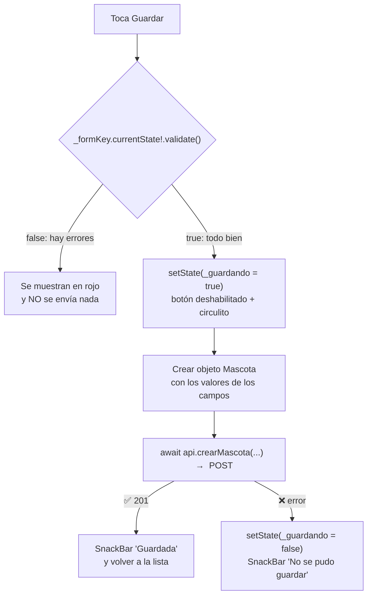

# 6. Formularios con validación y envío a la API

> Cómo pedir datos al usuario, **revisar que estén bien** antes de enviarlos y mandarlos al servidor con `POST`.

---

## 🏛️ La analogía: la ventanilla de trámites

Cuando haces un trámite en una ventanilla:

1. Llenas un **formulario en papel** 📝 (los campos).
2. El encargado **lo revisa** antes de aceptarlo: "falta tu DNI", "la fecha está mal". Si algo falla, **te lo devuelve marcado** y no avanza.
3. Si todo está bien, **lo envía** a la oficina central y te dice "listo, trámite registrado".

En Flutter:

| Ventanilla | Flutter |
|---|---|
| La hoja completa | `Form` |
| Cada casilla | `TextFormField`, `DropdownButtonFormField`, ... |
| Las reglas de cada casilla ("no vacío", "solo números") | `validator` |
| El encargado que revisa todo de una vez | `_formKey.currentState!.validate()` |
| Enviar a la oficina central | `await api.crearMascota(...)` (`POST`) |
| "Listo, registrado" | `SnackBar` y volver a la lista |

---

## 🧾 Paso 1: `Form` y su llave (`GlobalKey`)

`Form` agrupa todos los campos. Para poder pedirle *"valida todo"* desde un botón, necesitas una **llave** que lo identifique:

```dart
class _FormularioMascotaState extends State<FormularioMascota> {
  final _formKey = GlobalKey<FormState>(); // 🔑 la llave del formulario

  @override
  Widget build(BuildContext context) {
    return Scaffold(
      appBar: AppBar(title: const Text('Nueva mascota')),
      body: Form(
        key: _formKey,                        // 👈 se la entregas al Form
        child: ListView(
          padding: const EdgeInsets.all(16),
          children: [
            // ... aquí van los campos
          ],
        ),
      ),
    );
  }
}
```

> [!TIP]
> Usa **`ListView`** (no `Column`) como hijo del `Form`. Cuando aparece el teclado, la pantalla se achica; con `ListView` el usuario puede hacer scroll y no aparece la franja amarilla y negra.

---

## ✍️ Paso 2: `TextFormField` y `TextEditingController`

`TextFormField` es un `TextField` que **sabe validarse**. Para **leer** lo que el usuario escribió se usa un **`TextEditingController`**: una "cajita" conectada al campo que siempre tiene el texto actual en su propiedad `.text`.

```dart
  final _nombreCtrl = TextEditingController();
```

```dart
            TextFormField(
              controller: _nombreCtrl,
              decoration: const InputDecoration(
                labelText: 'Nombre',
                hintText: 'Ej. Firulais',
                prefixIcon: Icon(Icons.pets),
                border: OutlineInputBorder(),
              ),
            ),
```

| Quiero... | Código |
|---|---|
| Leer el texto | `_nombreCtrl.text` |
| Escribir un texto desde el código | `_nombreCtrl.text = 'Luna';` |
| Borrar el campo | `_nombreCtrl.clear();` |
| Quitar espacios al inicio y final | `_nombreCtrl.text.trim()` |

### Siempre liberar los controladores: `dispose`

Cada controlador ocupa memoria. Cuando la pantalla se cierra, hay que **liberarlos** en `dispose` (lo contrario de `initState`):

```dart
  @override
  void dispose() {
    _nombreCtrl.dispose();
    _edadCtrl.dispose();
    _fotoCtrl.dispose();
    super.dispose();        // 👈 siempre al final
  }
```

> [!WARNING]
> Crea los controladores como **atributos** de la clase `State`, **nunca dentro de `build`**. Si lo haces en `build`, se crea uno nuevo en cada redibujado y el campo se borra solo.

---

## 🧩 Paso 3: Propiedades útiles de un campo

| Propiedad | Para qué | Ejemplo |
|---|---|---|
| `keyboardType` | Qué teclado aparece | `TextInputType.number`, `.emailAddress`, `.url`, `.phone`, `.multiline` |
| `maxLines` | Cuántas líneas muestra | `maxLines: 3` |
| `maxLength` | Límite de caracteres (muestra un contador `12/50`) | `maxLength: 50` |
| `obscureText` | Ocultar el texto (contraseñas) | `obscureText: true` |
| `textCapitalization` | Mayúscula automática | `TextCapitalization.words` |
| `decoration` | Etiqueta, ayuda, íconos, borde | `InputDecoration(...)` |

Y dentro de `InputDecoration`:

| Propiedad | Qué muestra |
|---|---|
| `labelText` | La etiqueta (sube al escribir) |
| `hintText` | Texto de ejemplo gris cuando está vacío |
| `helperText` | Texto de ayuda pequeño debajo del campo |
| `prefixIcon` / `suffixIcon` | Ícono al inicio / al final |
| `border: OutlineInputBorder()` | Borde alrededor del campo |

> [!NOTE]
> `keyboardType: TextInputType.number` **solo cambia el teclado**. El valor sigue siendo un `String` (`"5"`), y en web o en un emulador con teclado físico se pueden escribir letras. Por eso **también** hay que validar.

---

## ✅ Paso 4: Reglas con `validator`

`validator` es una función que recibe el texto del campo y devuelve:

- **`null`** → ✅ el campo está bien.
- **Un `String`** → ❌ ese texto se muestra en rojo debajo del campo.

```dart
            TextFormField(
              controller: _nombreCtrl,
              decoration: const InputDecoration(
                labelText: 'Nombre',
                border: OutlineInputBorder(),
              ),
              validator: (valor) {
                if (valor == null || valor.trim().isEmpty) {
                  return 'Escribe el nombre';
                }
                if (valor.trim().length < 2) {
                  return 'Mínimo 2 letras';
                }
                return null; // ✅ todo bien
              },
            ),
```

### Validar un número

Para comprobar que el texto es un número se usa **`int.tryParse`**: devuelve el número, o **`null`** si el texto no es un número válido (nunca lanza error).

```dart
              validator: (valor) {
                final numero = int.tryParse(valor ?? '');
                if (numero == null) return 'Escribe un número';
                if (numero < 0 || numero > 30) return 'Edad entre 0 y 30';
                return null;
              },
```

| Función | Con `"12"` | Con `"doce"` |
|---|---|---|
| `int.tryParse(texto)` | `12` | `null` |
| `int.parse(texto)` | `12` | 💥 lanza un error |
| `double.tryParse(texto)` | `12.0` | `null` |

### Recetas de validaciones frecuentes

| Regla | Condición para devolver el error |
|---|---|
| Obligatorio | `valor == null \|\| valor.trim().isEmpty` |
| Mínimo N caracteres | `valor.trim().length < N` |
| Es un número entero | `int.tryParse(valor) == null` |
| Número en un rango | `numero < min \|\| numero > max` |
| Parece un correo | `!valor.contains('@')` |
| Parece una URL | `!valor.startsWith('http')` |
| Campo **opcional** pero con formato | Si está vacío → `return null`; si no, aplicar la regla |

---

## 🔽 Paso 5: Elegir de una lista con `DropdownButtonFormField`

Cuando el usuario debe elegir **una opción de una lista fija**, no le pidas que la escriba: usa un menú desplegable.

```dart
  final List<String> _especies = ['Perro', 'Gato', 'Conejo', 'Otro'];
  String? _especie; // null = todavía no eligió
```

```dart
            DropdownButtonFormField<String>(
              initialValue: _especie,
              decoration: const InputDecoration(
                labelText: 'Especie',
                border: OutlineInputBorder(),
              ),
              items: _especies
                  .map((e) => DropdownMenuItem(value: e, child: Text(e)))
                  .toList(),
              onChanged: (valor) => setState(() => _especie = valor),
              validator: (valor) => valor == null ? 'Elige una especie' : null,
            ),
```

| Propiedad | Qué recibe |
|---|---|
| `initialValue` | La opción elegida al inicio (`null` = ninguna) |
| `items` | Una `List<DropdownMenuItem>`: cada uno con un `value` y un `child` (lo que se ve) |
| `onChanged` | Función que recibe la opción elegida. Ahí la guardas con `setState` |
| `validator` | Igual que en `TextFormField` |

> **Nota:** `.map(...).toList()` convierte la lista de textos en una lista de `DropdownMenuItem`, igual que convertías `Map` en `Mascota` en el [documento 4](4-modelos-y-servicio.md#-paso-4-convertir-una-lista-completa).

---

## 🔘 Paso 6: Sí / No con `SwitchListTile`

Para un valor `bool` usa un interruptor con texto incluido:

```dart
  bool _vacunada = false;
```

```dart
            SwitchListTile(
              title: const Text('¿Está vacunada?'),
              subtitle: const Text('Marca si tiene sus vacunas al día'),
              value: _vacunada,
              onChanged: (valor) => setState(() => _vacunada = valor),
            ),
```

> [!TIP]
> Si prefieres una casilla ☑️ en lugar de un interruptor, usa **`CheckboxListTile`**. Tiene las mismas propiedades, pero su `onChanged` recibe un `bool?`, así que guarda `valor ?? false`.

---

## 📨 Paso 7: El botón Guardar

Al tocar **Guardar** pasan cuatro cosas, en orden:



```dart
  bool _guardando = false;

  Future<void> _guardar() async {
    // 1. Validar. Si algo está mal, no seguir.
    if (!_formKey.currentState!.validate()) return;

    // 2. Bloquear el botón
    setState(() => _guardando = true);

    // 3. Armar el objeto con lo que escribió el usuario
    final mascota = Mascota(
      id: '',                                   // MockAPI lo genera
      nombre: _nombreCtrl.text.trim(),
      especie: _especie!,
      edad: int.parse(_edadCtrl.text),          // ya validamos que es número
      vacunada: _vacunada,
      foto: _fotoCtrl.text.trim(),
    );

    // 4. Enviar
    try {
      await MascotaApi().crearMascota(mascota);
      if (!mounted) return;
      ScaffoldMessenger.of(context).showSnackBar(
        const SnackBar(content: Text('Mascota guardada ✅')),
      );
      Navigator.pop(context, true); // 👈 volver (ver documento 7)
    } catch (e) {
      if (!mounted) return;
      setState(() => _guardando = false);
      ScaffoldMessenger.of(context).showSnackBar(
        const SnackBar(content: Text('No se pudo guardar. Intenta de nuevo.')),
      );
    }
  }
```

Y el botón:

```dart
            FilledButton(
              onPressed: _guardando ? null : _guardar,  // null = deshabilitado
              child: _guardando
                  ? const SizedBox(
                      height: 20,
                      width: 20,
                      child: CircularProgressIndicator(strokeWidth: 2),
                    )
                  : const Text('Guardar'),
            ),
```

> [!IMPORTANT]
> **¿Por qué deshabilitar el botón?** Si el usuario toca "Guardar" tres veces rápido mientras espera, se envían **tres `POST`** y se crean tres mascotas iguales. Un botón con `onPressed: null` se ve gris y no responde.

> **Nota:** `_especie!` y `int.parse(...)` son seguros **solo porque** `validate()` ya comprobó que hay especie y que la edad es un número.

---

## ✏️ Paso 8 (opcional): Reusar el formulario para **editar**

El mismo formulario puede servir para **crear** y para **editar**. La pantalla recibe una mascota **opcional**:

```dart
class FormularioMascota extends StatefulWidget {
  final Mascota? mascota; // null = crear, con valor = editar

  const FormularioMascota({super.key, this.mascota});

  @override
  State<FormularioMascota> createState() => _FormularioMascotaState();
}
```

En `initState` se **rellenan** los campos si vino una mascota (desde el `State` se accede a ella con `widget.mascota`):

```dart
  @override
  void initState() {
    super.initState();
    final m = widget.mascota;
    if (m != null) {
      _nombreCtrl.text = m.nombre;
      _edadCtrl.text = m.edad.toString(); // int → String
      _fotoCtrl.text = m.foto;
      _especie = m.especie;
      _vacunada = m.vacunada;
    }
  }
```

Y al guardar se decide qué petición hacer:

```dart
    final mascota = Mascota(
      id: widget.mascota?.id ?? '',   // conserva el id si está editando
      // ... resto igual
    );

    final api = MascotaApi();
    if (widget.mascota == null) {
      await api.crearMascota(mascota);      // POST
    } else {
      await api.actualizarMascota(mascota); // PUT
    }
```

> [!TIP]
> El título también puede cambiar: `Text(widget.mascota == null ? 'Nueva mascota' : 'Editar mascota')`.

---

## 📊 Resumen

| Necesito... | Uso |
|---|---|
| Agrupar campos y validarlos juntos | `Form` + `GlobalKey<FormState>` |
| Campo de texto con validación | `TextFormField` + `validator` |
| Leer el texto | `TextEditingController` → `.text` |
| Liberar controladores | `dispose()` |
| Elegir de una lista | `DropdownButtonFormField` |
| Sí / No | `SwitchListTile` o `CheckboxListTile` |
| Revisar todo antes de enviar | `_formKey.currentState!.validate()` |
| Texto → número sin errores | `int.tryParse(texto)` |
| Evitar doble envío | `_guardando` + `onPressed: null` |
| Avisar al usuario | `SnackBar` |

| Compose | Flutter |
|---|---|
| `var nombre by remember { mutableStateOf("") }` + `TextField(value, onValueChange)` | `TextEditingController` + `TextFormField(controller:)` |
| Validar a mano con `if` y `isError` | `validator` + `validate()` |
| `ExposedDropdownMenuBox` | `DropdownButtonFormField` |

---

## ⚠️ Errores Comunes de Principiantes

1. **Controladores dentro de `build`:** el texto se borra solo. Van como atributos del `State`.
2. **Olvidar `dispose`:** fuga de memoria (el editor no siempre avisa).
3. **`validator` que nunca devuelve `null`:** el formulario nunca es válido.
4. **Olvidar `key: _formKey` en el `Form`:** *"Null check operator used on a null value"* al tocar Guardar.
5. **Usar `TextField` en lugar de `TextFormField`:** `TextField` no tiene `validator`.
6. **Enviar `"5"` (texto) en lugar de `5` (número):** convierte con `int.parse` antes de crear el objeto.
7. **`Column` en lugar de `ListView`:** al abrir el teclado aparece *"Bottom overflowed by ... pixels"*.
8. **No deshabilitar el botón:** registros duplicados.
9. **No cerrar la pantalla al guardar:** el usuario no sabe si funcionó y vuelve a tocar Guardar.

---

## 🏋️ Ejercicios

1. Crea un formulario de **registro de usuario** (sin API) con: nombre (obligatorio), correo (debe tener `@`), edad (número entre 16 y 99) y un `CheckboxListTile` "Acepto los términos". Al tocar **Enviar**, si todo está bien, muestra un `SnackBar` con el nombre.
2. Haz que el botón **Enviar** solo funcione si la casilla de términos está marcada.
3. Arma `FormularioMascota` completo con tu `MascotaApi`. Crea una mascota y compruébalo en el navegador.
4. Agrega un campo **opcional** "Descripción" de 3 líneas y máximo 120 caracteres. (Recuerda agregar el campo en MockAPI y en tu modelo.)

---

_Anterior: [← Mostrar datos en pantalla](5-mostrar-datos-en-pantalla.md)_ · _Siguiente: [Navegar entre pantallas →](7-navegar-entre-pantallas.md)_
