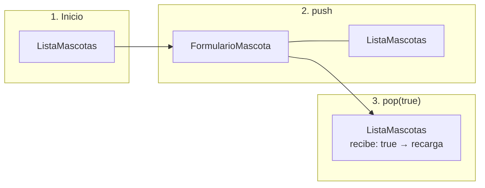
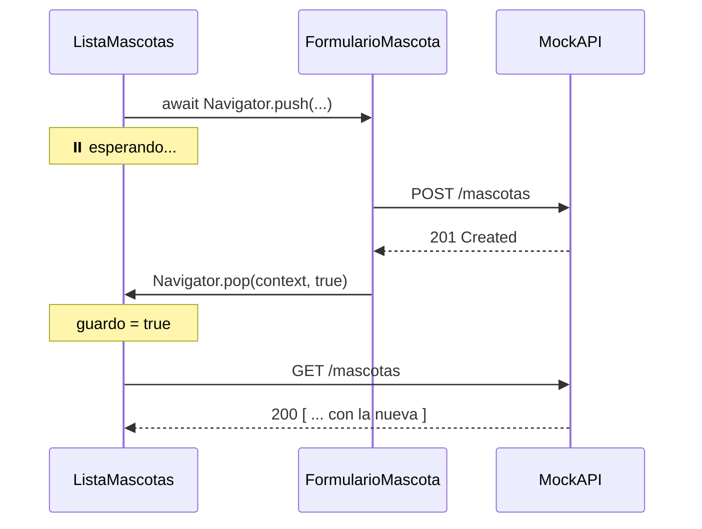

# 7. Navegar entre pantallas y devolver un resultado

> Cómo abrir el formulario desde la lista, volver al terminar y **refrescar** la lista con lo nuevo.

---

## 🃏 La analogía: una pila de cartas

Imagina las pantallas como **cartas apiladas** sobre la mesa 🃏. Solo ves la de **arriba**.

- **Abrir** una pantalla = poner una carta nueva **encima** (`push`).
- **Volver** = quitar la carta de arriba (`pop`) y ver otra vez la de abajo.
- Al quitarla, puedes **dejar una nota** para la carta de abajo: *"guardé algo, actualízate"*.



El encargado de la pila se llama **`Navigator`**. Es el equivalente del `NavController` que viste en [Navegación de Compose](../3.%20navegacion/1-que-es-navegacion.md).

---

## ➡️ Paso 1: Abrir una pantalla con `Navigator.push`

```dart
Navigator.push(
  context,
  MaterialPageRoute(builder: (context) => const FormularioMascota()),
);
```

| Parte | Qué es |
|---|---|
| `Navigator.push` | "Pon esta pantalla encima" |
| `context` | Desde dónde navegas (el `context` de tu `build` o del `State`) |
| `MaterialPageRoute` | La "carta": una ruta con la animación estándar de Android/iOS |
| `builder: (context) => ...` | Función que construye la pantalla nueva |

Un lugar típico para esto es el `FloatingActionButton` de la lista:

```dart
      floatingActionButton: FloatingActionButton(
        onPressed: _abrirFormulario,
        child: const Icon(Icons.add),
      ),
```

> [!TIP]
> No tienes que programar la flecha ← para volver: si la pantalla nueva tiene `Scaffold` con `AppBar`, Flutter la agrega **sola**. El botón "atrás" de Android también funciona automáticamente.

---

## ⬅️ Paso 2: Volver con `Navigator.pop`

Desde la pantalla de arriba, para cerrarla:

```dart
Navigator.pop(context);
```

Y para **devolver un resultado** a la pantalla de abajo, se pasa como segundo argumento:

```dart
Navigator.pop(context, true); // "volví, y sí guardé algo"
```

---

## 🔁 Paso 3: Esperar el resultado y refrescar

`Navigator.push` devuelve un **`Future`** que se completa **cuando la pantalla de arriba hace `pop`**, con el valor que esta devolvió. Así que puedes esperarlo con `await`:

```dart
  Future<void> _abrirFormulario() async {
    final guardo = await Navigator.push<bool>(
      context,
      MaterialPageRoute(builder: (context) => const FormularioMascota()),
    );

    // 👇 esto se ejecuta cuando el formulario se cierra
    if (guardo == true) {
      _cargarMascotas(); // vuelve a pedir la lista al servidor
    }
  }
```



> **Nota:** `<bool>` en `Navigator.push<bool>` indica el **tipo** del resultado esperado.

> [!IMPORTANT]
> Se compara `guardo == true` (y no solo `if (guardo)`) porque si el usuario vuelve con la flecha ← **sin guardar**, el resultado es **`null`**, no `false`.

---

## 📦 Paso 4: Enviar datos a la pantalla nueva

Para pasarle información a la pantalla que abres, se usa su **constructor**, como con cualquier widget. Por ejemplo, para **editar** una mascota al tocarla en la lista:

```dart
            child: ListTile(
              // ... leading, title, subtitle
              onTap: () => _abrirFormulario(mascota),
            ),
```

```dart
  Future<void> _abrirFormulario([Mascota? mascota]) async {
    final guardo = await Navigator.push<bool>(
      context,
      MaterialPageRoute(
        builder: (context) => FormularioMascota(mascota: mascota),
      ),
    );
    if (guardo == true) {
      _cargarMascotas();
    }
  }
```

- `[Mascota? mascota]` es un **parámetro posicional opcional** (repasa [Funciones en Dart](../7.%20dart/2-funciones.md)). El botón `+` la llama sin nada (crear) y el `ListTile` con una mascota (editar).
- Si el botón `+` llama a `_abrirFormulario` directamente (`onPressed: _abrirFormulario`), Flutter no le pasa ningún argumento, así que `mascota` queda en `null`.

| Compose (Navigation) | Flutter (`Navigator`) |
|---|---|
| `navController.navigate("form")` | `Navigator.push(context, MaterialPageRoute(...))` |
| `navController.popBackStack()` | `Navigator.pop(context)` |
| Argumentos en la ruta (`"detalle/{id}"`) | Parámetros del constructor de la pantalla |
| `savedStateHandle` para devolver un resultado | `Navigator.pop(context, resultado)` + `await push` |

---

## 💬 ¿Y el `SnackBar` después del `pop`?

En el [documento 6](6-formularios.md#-paso-7-el-botón-guardar) el formulario muestra el `SnackBar` y **justo después** hace `pop`. El mensaje **no desaparece** al cerrar la pantalla: `ScaffoldMessenger` pertenece a toda la app, así que el `SnackBar` se sigue viendo sobre la lista. 👌

---

## 📊 Resumen

| Quiero... | Código |
|---|---|
| Abrir una pantalla | `Navigator.push(context, MaterialPageRoute(builder: (context) => Pantalla()))` |
| Cerrar la pantalla actual | `Navigator.pop(context)` |
| Cerrar y devolver un valor | `Navigator.pop(context, valor)` |
| Esperar ese valor | `final r = await Navigator.push<Tipo>(...)` |
| Enviar datos a la pantalla nueva | Parámetros en su constructor |

---

## ⚠️ Errores Comunes de Principiantes

1. **Olvidar `await` en `push`:** la lista se recarga **antes** de que el usuario guarde, no después.
2. **`if (guardo)` sin comparar con `true`:** error de tipos, porque `guardo` es `bool?`.
3. **Hacer `pop` antes de que termine el `POST`:** la lista se recarga y la mascota nueva todavía no existe en el servidor. Haz `pop` **después** del `await`.
4. **Usar `context` después de `await` sin `mounted`:** advertencia azul del editor; revisa `if (!mounted) return;`.
5. **Pantalla nueva sin `Scaffold`:** se ve con fondo negro y sin flecha para volver.

---

## 🏋️ Ejercicios

1. Agrega el `FloatingActionButton` a `ListaMascotas` para abrir `FormularioMascota`. Crea una mascota y comprueba que la lista se actualiza sola al volver.
2. Vuelve con la flecha ← **sin** guardar y comprueba (con un `print`) que el resultado es `null` y la lista **no** se recarga.
3. Haz que al tocar una mascota se abra el formulario **en modo edición** con sus datos cargados. Cambia la edad, guarda y comprueba el cambio en la lista.
4. Crea una pantalla `DetalleMascota` que reciba una `Mascota` y muestre su foto grande y sus datos. Ábrela con un **toque largo** (`onLongPress`) sobre el `ListTile`.

---

_Anterior: [← Formularios con validación](6-formularios.md)_
