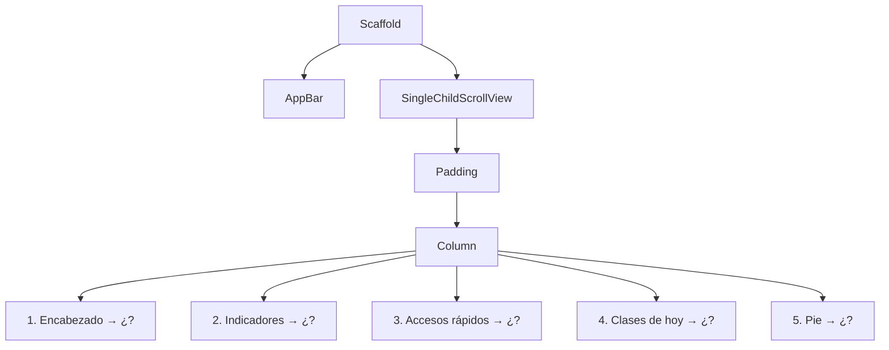

# Ejercicio 1: Contenedores, `Column` y `Row` 📦

> Aprende a **acomodar cajas**. Antes de usar widgets "bonitos", necesitas dominar cómo se ponen las cosas una debajo de otra, una al lado de otra y una dentro de otra.

---

## 🎯 Objetivo

Al terminar este ejercicio sabrás:

- Decidir cuándo usar `Column` y cuándo usar `Row`.
- Meter un `Row` dentro de un `Column` (y al revés) sin perderte.
- Usar `Container` para dar **tamaño, color, forma y espacio interno**.
- Repartir el espacio con `Expanded`, `flex` y `Spacer`.
- Alinear con `mainAxisAlignment` y `crossAxisAlignment`.
- Separar elementos con `SizedBox` y `Padding`.

### 🧠 Piensa como un armario de cajones

Imagina que la pantalla es un **armario** 🗄️:

- Un `Column` es una pila de **cajones**: uno encima del otro.
- Un `Row` es un cajón dividido en **compartimentos**: uno al lado del otro.
- Un `Container` es una **caja** que puedes pintar, redondear y meter dentro de cualquier cajón.

Toda pantalla, por complicada que se vea, es solo **cajas dentro de cajas**. Antes de escribir código, **dibuja las cajas** en un papel.

### 📏 Reglas del ejercicio

1. Solo `StatelessWidget`: **nada** de `StatefulWidget` ni `setState`.
2. **Widgets permitidos:** `Scaffold`, `AppBar`, `SingleChildScrollView`, `Column`, `Row`, `Container`, `Padding`, `SizedBox`, `Expanded`, `Spacer`, `Center`, `Text`, `Icon`.
3. **Prohibido:** `Card`, `ListTile`, `ListView`, `GridView`, `Stack`, `CircleAvatar`, `Chip`. Todo lo que parezca una tarjeta o un círculo lo construyes **tú** con `Container`.
4. Si no recuerdas una propiedad, búscala en el [Catálogo de Widgets](../../docs/8.%20flutter/5-catalogo-de-widgets.md).

---

## Paso 0: Preparar el proyecto

Crea un proyecto nuevo (`flutter create layouts_upn`) y en `lib/main.dart` deja solo:

- La función `main()` que llama a `runApp`.
- Un `MaterialApp` con `debugShowCheckedModeBanner: false` y un tema con el color que prefieras.
- Un `StatelessWidget` vacío para cada parte del ejercicio. Usa el `home` del `MaterialApp` para cambiar cuál se muestra.

> [!TIP]
> Si no recuerdas cómo se arma el `MaterialApp`, revisa [¿Qué es Flutter? y MaterialApp](../../docs/8.%20flutter/1-que-es-flutter-y-materialapp.md). Mientras no tengas nada que mostrar, devuelve un `Placeholder()` en el `build`.

---

# Parte A: Calentamiento con cajas de colores 🎨

Tres mini-retos rápidos. No llevan texto ni íconos: solo **cajas de colores**. La idea es que entiendas cómo se reparte el espacio antes de pasar a una pantalla real.

---

### A1. Semáforo 🚦

```
        ┌─────────┐
        │  (🔴)   │
        │         │
        │  (🟡)   │
        │         │
        │  (🟢)   │
        └─────────┘
   (centrado en la pantalla)
```

- [ ] Un rectángulo negro con **esquinas redondeadas**, en el **centro** de la pantalla.
- [ ] Dentro, tres **círculos** (rojo, amarillo y verde) uno debajo del otro.
- [ ] Los círculos están **separados por el mismo espacio** y centrados horizontalmente.
- [ ] El rectángulo negro **no ocupa todo el alto** de la pantalla: solo lo que necesitan los círculos más un margen interno.

📖 Consulta: [Center](../../docs/8.%20flutter/5-catalogo-de-widgets.md#center), [Container](../../docs/8.%20flutter/5-catalogo-de-widgets.md#container), [BoxDecoration](../../docs/8.%20flutter/5-catalogo-de-widgets.md#boxdecoration), [Column](../../docs/8.%20flutter/5-catalogo-de-widgets.md#column)

<details>
<summary>💡 Pista 1: ¿cómo hago un círculo sin <code>CircleAvatar</code>?</summary>

Un `Container` con el **mismo ancho y alto** y una `BoxDecoration` cuya propiedad `shape` no sea la rectangular. Revisa qué valores acepta `shape` en el catálogo de `BoxDecoration`.

</details>

<details>
<summary>💡 Pista 2: el rectángulo negro ocupa toda la pantalla</summary>

Por defecto un `Column` intenta ocupar **todo el alto** disponible. Busca la propiedad de `Column` que le dice "ocupa solo lo necesario".

</details>

<details>
<summary>💡 Pista 3: me sale un error rojo al poner <code>color</code> y <code>decoration</code></summary>

Un `Container` **no acepta** `color` y `decoration` al mismo tiempo. Si usas `decoration`, el color va **dentro** de la `BoxDecoration`.

</details>

---

### A2. Bandera del Perú 🇵🇪

```
┌──────────┬──────────┬──────────┐
│          │          │          │
│   ROJO   │  BLANCO  │   ROJO   │   ← 200 de alto
│          │          │          │
└──────────┴──────────┴──────────┘
         (todo el ancho de la pantalla)
```

- [ ] Tres franjas **verticales**: roja, blanca y roja.
- [ ] Las tres franjas ocupan **exactamente el mismo ancho** y entre todas llenan el ancho de la pantalla, sin escribir ningún número para el ancho.
- [ ] La bandera mide **200** de alto.
- [ ] La bandera tiene un **borde** gris delgado alrededor (para que la franja blanca se note sobre el fondo blanco).

**Variante:** debajo de la primera bandera, haz una segunda donde la franja blanca sea el **doble de ancha** que cada franja roja.

📖 Consulta: [Row](../../docs/8.%20flutter/5-catalogo-de-widgets.md#row), [Expanded](../../docs/8.%20flutter/5-catalogo-de-widgets.md#expanded), [BoxDecoration](../../docs/8.%20flutter/5-catalogo-de-widgets.md#boxdecoration)

<details>
<summary>💡 Pista 1: ¿Row o Column?</summary>

Las franjas están **una al lado de la otra** ↔️. ¿Cuál de los dos widgets pone a sus hijos así?

</details>

<details>
<summary>💡 Pista 2: no quiero calcular anchos</summary>

Hay un widget que le dice a un hijo de `Row` "**estírate y ocupa el espacio que sobre**". Si los tres hijos lo usan, se reparten el espacio en partes iguales. Para la variante, ese widget tiene una propiedad que indica **cuántas partes** toma cada uno.

</details>

<details>
<summary>💡 Pista 3: ¿dónde pongo el alto de 200?</summary>

Tienes dos caminos: darle el alto a **cada franja**, o envolver el `Row` completo en una caja que tenga ese alto. Prueba los dos y piensa cuál es más fácil de mantener.

</details>

---

### A3. Mosaico 🧱

```
┌───────────────────┬──────────┐
│                   │  VERDE   │
│                   │          │
│       AZUL        ├──────────┤
│                   │ NARANJA  │
│                   │          │
└───────────────────┴──────────┘
├────── 2 partes ───┼─ 1 parte ┤
```

- [ ] Un bloque de **250** de alto que ocupa todo el ancho.
- [ ] A la izquierda, una caja **azul** que ocupa **2 partes** del ancho.
- [ ] A la derecha, ocupando **1 parte**, dos cajas **una encima de la otra** (verde y naranja) que se reparten el alto en partes iguales.
- [ ] Entre todas las cajas hay una **separación de 8** (como las juntas de las baldosas).
- [ ] Todas las cajas tienen **esquinas redondeadas**.

📖 Consulta: [Row](../../docs/8.%20flutter/5-catalogo-de-widgets.md#row), [Column](../../docs/8.%20flutter/5-catalogo-de-widgets.md#column), [Expanded](../../docs/8.%20flutter/5-catalogo-de-widgets.md#expanded), [SizedBox](../../docs/8.%20flutter/5-catalogo-de-widgets.md#sizedbox)

<details>
<summary>💡 Pista 1: ¿por dónde empiezo?</summary>

Mira el dibujo de **afuera hacia adentro**. ¿El bloque completo está dividido en izquierda/derecha o en arriba/abajo? Esa es tu primera caja. Después pregúntate lo mismo por la parte derecha.

</details>

<details>
<summary>💡 Pista 2: <code>Expanded</code> dentro de <code>Expanded</code></summary>

Un `Expanded` solo funciona si su **padre directo** es un `Row` o un `Column`. Las cajas verde y naranja se estiran en **vertical**, así que necesitan un padre que reparta el espacio en vertical.

</details>

<details>
<summary>💡 Pista 3: ¿cómo hago las juntas de 8?</summary>

Un `SizedBox` vacío entre dos hijos funciona como separador. Ojo: en un `Row` el separador necesita **ancho**, y en un `Column` necesita **alto**.

</details>

---

# Parte B: Pantalla "Mi Panel UPN" 🎓

Ahora usa lo mismo para una pantalla real: el **panel de inicio de un estudiante**.

## 🖼️ Así debe quedar

```
┌────────────────────────────────────┐
│ Mi Panel UPN                       │  ← AppBar
├────────────────────────────────────┤
│ ┌────────────────────────────────┐ │
│ │ (AT)  Ana Torres            🔔 │ │  ← 1. Encabezado
│ │       Ing. de Sistemas         │ │
│ └────────────────────────────────┘ │
│                                    │
│ ┌────────┐ ┌────────┐ ┌────────┐   │
│ │  15.4  │ │  120   │ │   6    │   │  ← 2. Indicadores
│ │Promedio│ │Créditos│ │ Ciclo  │   │
│ └────────┘ └────────┘ └────────┘   │
│                                    │
│ Accesos rápidos                    │
│ ┌──────────────┐ ┌──────────────┐  │
│ │ 📅 Horario    │ │ 📊 Notas      │  │  ← 3. Cuadrícula 2 × 2
│ └──────────────┘ └──────────────┘  │
│ ┌──────────────┐ ┌──────────────┐  │
│ │ 💳 Pagos      │ │ 📚 Biblioteca │  │
│ └──────────────┘ └──────────────┘  │
│                                    │
│ Clases de hoy                      │
│ ┌────────────────────────────────┐ │
│ │ 08:00 ┃ Desarrollo Móvil        │ │
│ │       ┃ Aula B-204              │ │  ← 4. Horario del día
│ ├────────────────────────────────┤ │
│ │ 10:00 ┃ Base de Datos II        │ │
│ │       ┃ Laboratorio 3           │ │
│ ├────────────────────────────────┤ │
│ │ 14:00 ┃ Ética Profesional       │ │
│ │       ┃ Aula A-101              │ │
│ └────────────────────────────────┘ │
│                                    │
│  Ver horario completo  →           │  ← 5. Pie
└────────────────────────────────────┘
```

> **Nota:** en esta parte sí puedes usar `SingleChildScrollView`, porque la pantalla es más alta que el celular.

---

### Paso B1: Estructura

- [ ] Un `Scaffold` con una barra superior que diga **"Mi Panel UPN"**.
- [ ] El contenido se puede **desplazar** (scroll) y tiene un margen de **16** con los bordes de la pantalla.
- [ ] Todas las secciones van **una debajo de la otra**, alineadas a la izquierda y separadas por el mismo espacio.

📖 Consulta: [Scaffold](../../docs/8.%20flutter/5-catalogo-de-widgets.md#scaffold), [SingleChildScrollView](../../docs/8.%20flutter/5-catalogo-de-widgets.md#singlechildscrollview), [Padding](../../docs/8.%20flutter/5-catalogo-de-widgets.md#padding), [EdgeInsets](../../docs/8.%20flutter/5-catalogo-de-widgets.md#edgeinsets)

<details>
<summary>💡 Pista: el contenido queda centrado y no a la izquierda</summary>

Revisa el eje **cruzado** del `Column`. En un `Column`, el eje principal es el vertical, así que la alineación **horizontal** la controla la otra propiedad.

</details>

---

### Paso B2: Encabezado

- [ ] Una caja de **todo el ancho**, con fondo de color y esquinas redondeadas.
- [ ] A la izquierda, un **círculo** de 56 × 56 con las iniciales **"AT"** centradas.
- [ ] Al lado del círculo, el nombre **"Ana Torres"** (en negrita) y **debajo** la carrera **"Ing. de Sistemas"** (más pequeña).
- [ ] Un ícono de **notificaciones** pegado al **borde derecho**.
- [ ] El texto del encabezado es **blanco** para que se lea sobre el fondo.

📖 Consulta: [Container](../../docs/8.%20flutter/5-catalogo-de-widgets.md#container), [Row](../../docs/8.%20flutter/5-catalogo-de-widgets.md#row), [Spacer](../../docs/8.%20flutter/5-catalogo-de-widgets.md#spacer), [TextStyle](../../docs/8.%20flutter/5-catalogo-de-widgets.md#textstyle), [Icon](../../docs/8.%20flutter/5-catalogo-de-widgets.md#icon)

<details>
<summary>💡 Pista 1: dibuja las cajas</summary>

Hay tres "cosas" una al lado de la otra: el círculo, el bloque de textos y el ícono. Pero el bloque de textos, por dentro, tiene dos líneas **una debajo de la otra**. ¿Qué widget va afuera y cuál va adentro?

</details>

<details>
<summary>💡 Pista 2: centrar las iniciales dentro del círculo</summary>

`Container` tiene una propiedad que alinea a su hijo dentro de él. Busca en el catálogo de `Container` la propiedad que recibe un `Alignment`.

</details>

<details>
<summary>💡 Pista 3: el nombre y la carrera no quedan alineados entre sí</summary>

Los dos textos están dentro de un `Column`, y por defecto se centran uno respecto al otro. Alinéalos al inicio.

</details>

---

### Paso B3: Indicadores

- [ ] Tres cajas **una al lado de la otra**, **del mismo ancho**, que entre todas llenan el ancho disponible.
- [ ] Cada caja muestra un **número grande** arriba y una **etiqueta pequeña** abajo, ambos **centrados**:

| Número | Etiqueta |
|---|---|
| 15.4 | Promedio |
| 120 | Créditos |
| 6 | Ciclo |

- [ ] Las cajas tienen fondo de color suave, esquinas redondeadas y una separación de **12** entre ellas.

📖 Consulta: [Expanded](../../docs/8.%20flutter/5-catalogo-de-widgets.md#expanded), [Container](../../docs/8.%20flutter/5-catalogo-de-widgets.md#container), [MainAxisAlignment y CrossAxisAlignment](../../docs/8.%20flutter/5-catalogo-de-widgets.md#mainaxisalignment-y-crossaxisalignment)

<details>
<summary>💡 Pista 1: ¿esto ya lo hice antes?</summary>

Sí: es la **bandera del A2**, pero cada franja ahora tiene contenido adentro.

</details>

<details>
<summary>💡 Pista 2: el texto se pega al borde de la caja</summary>

Un `Container` puede tener espacio **interno** (entre su borde y su hijo). Busca cuál de sus propiedades es para eso: no es `margin`.

</details>

> [!TIP]
> ¿Notas que las tres cajas son iguales y solo cambian los datos? Si ya viste [Stateless vs Stateful](../../docs/8.%20flutter/4-stateless-vs-stateful.md), intenta crear un widget propio `Indicador` que reciba el `valor` y la `etiqueta`. No es obligatorio, pero tu código quedará mucho más corto.

---

### Paso B4: Accesos rápidos (cuadrícula 2 × 2)

- [ ] El subtítulo **"Accesos rápidos"** en negrita.
- [ ] **Cuatro** botones-caja organizados en **2 filas de 2**, todos del **mismo ancho**:

| Ícono sugerido | Texto |
|---|---|
| `Icons.calendar_month` | Horario |
| `Icons.bar_chart` | Notas |
| `Icons.payments` | Pagos |
| `Icons.menu_book` | Biblioteca |

- [ ] En cada caja, el ícono va **a la izquierda** del texto.
- [ ] Hay la **misma separación** entre columnas que entre filas.
- [ ] Recuerda: `GridView` está **prohibido**. Arma la cuadrícula con lo que ya conoces.

📖 Consulta: [Row](../../docs/8.%20flutter/5-catalogo-de-widgets.md#row), [Column](../../docs/8.%20flutter/5-catalogo-de-widgets.md#column), [Expanded](../../docs/8.%20flutter/5-catalogo-de-widgets.md#expanded), [SizedBox](../../docs/8.%20flutter/5-catalogo-de-widgets.md#sizedbox)

<details>
<summary>💡 Pista 1: una cuadrícula sin <code>GridView</code></summary>

Una cuadrícula de 2 × 2 es "**dos filas, una debajo de la otra**". Y cada fila es "**dos cajas, una al lado de la otra**".

</details>

<details>
<summary>💡 Pista 2: el ícono y el texto quedan muy juntos</summary>

Entre el ícono y el texto también puedes poner un separador. Como están en un `Row`, el separador necesita ancho.

</details>

---

### Paso B5: Clases de hoy

- [ ] El subtítulo **"Clases de hoy"** en negrita.
- [ ] Una caja blanca con **borde gris** y esquinas redondeadas que contiene **tres** clases.
- [ ] Cada clase tiene, de izquierda a derecha:
  - La **hora**, en una columna de **ancho fijo** (todas las horas quedan alineadas aunque tengan distinto texto).
  - Una **barra vertical** de color, delgada (4 de ancho), que mide lo mismo que el bloque de textos.
  - El **nombre del curso** (negrita) y **debajo** el **aula** (gris).
- [ ] Las clases están separadas entre sí por una **línea horizontal** gris de 1 de alto.

| Hora | Curso | Aula |
|---|---|---|
| 08:00 | Desarrollo Móvil | Aula B-204 |
| 10:00 | Base de Datos II | Laboratorio 3 |
| 14:00 | Ética Profesional | Aula A-101 |

📖 Consulta: [Container](../../docs/8.%20flutter/5-catalogo-de-widgets.md#container), [SizedBox](../../docs/8.%20flutter/5-catalogo-de-widgets.md#sizedbox), [BoxDecoration](../../docs/8.%20flutter/5-catalogo-de-widgets.md#boxdecoration), [Colors](../../docs/8.%20flutter/5-catalogo-de-widgets.md#colors)

<details>
<summary>💡 Pista 1: la hora con ancho fijo</summary>

Si cada hora está dentro de una caja con el **mismo ancho**, el resto de la fila siempre empieza en el mismo lugar. ¿Qué widget de la lista permitida le da un tamaño exacto a su hijo sin dibujar nada?

</details>

<details>
<summary>💡 Pista 2: la barra vertical</summary>

Es solo un `Container` con ancho, alto y color, sin hijo. Para que mida "lo mismo que los textos", prueba darle un alto fijo que se vea bien (por ejemplo 40).

</details>

<details>
<summary>💡 Pista 3: la línea separadora sin <code>Divider</code></summary>

Una línea horizontal es una caja **muy baja** y del ancho completo con color gris. Piensa en qué widget le da alto y color a algo.

</details>

> [!TIP]
> Otra vez tienes **tres filas iguales** con datos distintos. Es el lugar perfecto para un widget propio `FilaClase`.

---

### Paso B6: Pie

- [ ] Al final, el texto **"Ver horario completo"** seguido de un ícono de flecha a la derecha.
- [ ] Ambos van **centrados horizontalmente** en la pantalla y del **mismo color** que el fondo del encabezado.

<details>
<summary>💡 Pista: el pie queda a la izquierda</summary>

El `Column` padre alinea todo a la izquierda. Para que solo este `Row` quede centrado, revisa qué hace `mainAxisAlignment` en un `Row` que ocupa todo el ancho.

</details>

---

## 🌳 Pista general: cómo se divide la pantalla

Úsala **solo si te atascas**. Muestra las secciones grandes, pero **no** lo que va dentro de cada una: eso lo descubres tú.

<details>
<summary>Ver árbol de secciones</summary>



</details>

---

## ⚠️ Errores frecuentes

| Lo que ves | Por qué pasa | Qué revisar |
|---|---|---|
| Franja amarilla y negra en un costado | Los hijos de un `Row` no caben en el ancho | ¿El texto largo está dentro de un `Expanded`? |
| Franja amarilla y negra abajo | El contenido es más alto que la pantalla | ¿Envolviste el `Column` principal en `SingleChildScrollView`? |
| Error: *Cannot provide both a color and a decoration* | Usaste `color` y `decoration` en el mismo `Container` | Mueve el `color` dentro de la `BoxDecoration` |
| Error: *Incorrect use of ParentDataWidget* | Pusiste un `Expanded` cuyo padre no es `Row` ni `Column` | ¿El padre directo del `Expanded` es un `Row` o `Column`? |
| Pantalla en blanco + error *RenderFlex children have non-zero flex but incoming height constraints are unbounded* | Usaste `Expanded` en un `Column` que está dentro de un `SingleChildScrollView` | Dentro del scroll, los hijos del `Column` principal necesitan alto propio. Usa `Expanded` solo dentro de los `Row` (o dentro de una caja con alto fijo, como en el A3). |
| Un círculo sale ovalado | Ancho y alto distintos | Usa el mismo número para `width` y `height` |

---

## ✅ Lista de verificación

- [ ] Solo hay `StatelessWidget` y ningún widget de la lista prohibida.
- [ ] El semáforo está centrado y la caja negra solo mide lo necesario.
- [ ] Las franjas de la bandera tienen el mismo ancho **sin** haber escrito un `width`.
- [ ] El mosaico respeta la proporción 2 : 1 y las juntas de 8.
- [ ] En el encabezado, el ícono de notificaciones está pegado a la derecha.
- [ ] Las tres cajas de indicadores y las cuatro de accesos rápidos tienen el mismo ancho.
- [ ] Las horas del horario están alineadas en una columna.
- [ ] La pantalla hace scroll y **no** aparece ninguna franja amarilla y negra, ni en vertical ni girando el celular.

---

## 🚀 Retos extra

1. **Tablero de ajedrez:** en una pantalla aparte, dibuja un tablero de 4 × 4 casillas alternando blanco y negro, usando solo `Column`, `Row`, `Expanded` y `Container`.
2. **Barra de progreso casera:** debajo de los indicadores, agrega una barra que muestre que el estudiante lleva el **60 %** de la carrera. Usa dos `Expanded` con `flex` distintos (uno de color y otro gris).
3. **Widgets propios:** si no lo hiciste, crea `Indicador`, `AccesoRapido` y `FilaClase`, y verifica que cada uno esté definido **una vez** y se use varias veces.
4. **Cambia el diseño sin tocar los datos:** haz que los accesos rápidos muestren el ícono **arriba** del texto en lugar de a la izquierda. ¿Cuántas líneas tuviste que cambiar? Si creaste `AccesoRapido`, deberían ser muy pocas.

---

_Siguiente: [Ejercicio 2: Pantalla con más widgets →](2-pantalla-feria-tech.md)_
