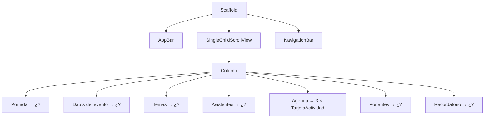

# Ejercicio 2: Pantalla "Feria Tech UPN" 🚀

> Ya sabes acomodar cajas con `Column`, `Row` y `Container`. Ahora vas a usar los widgets **prediseñados** de Material para armar una pantalla más completa en menos tiempo.

---

## 🎯 Objetivo

Construir la pantalla de **detalle de un evento**: la Feria Tecnológica de la UPN. Como en el ejercicio anterior, solo hay que **armar la interfaz**: los botones no hacen nada y no se guardan datos.

Al terminar sabrás:

- Superponer widgets con `Stack` y `Positioned`.
- Mostrar imágenes de internet con esquinas redondeadas (`Image.network` + `ClipRRect`).
- Usar `Chip`, `Wrap`, `Card`, `ListTile`, `CircleAvatar` y `Divider`.
- Poner un `TextField` y distintos tipos de botones.
- Agregar una barra de navegación inferior con `NavigationBar`.
- Crear **tu propio `StatelessWidget`** con parámetros y reutilizarlo.

### 🧠 Piensa como si armaras con LEGO

En el ejercicio 1 fabricaste cada pieza a mano: el círculo, la tarjeta, la línea separadora. 🔨

Ahora Flutter te da **piezas ya fabricadas**: `CircleAvatar` es un círculo listo, `Card` es una tarjeta con sombra lista, `Divider` es una línea lista. Tu trabajo ya no es fabricar piezas, sino **elegir la pieza correcta y encajarla en el lugar correcto**. 🧱

> [!TIP]
> Antes de escribir un widget, pregúntate: "¿esto ya existe en el [Catálogo](../../docs/8.%20flutter/5-catalogo-de-widgets.md)?". El [índice "Quiero..."](../../docs/8.%20flutter/5-catalogo-de-widgets.md#-índice-rápido-quiero) está hecho justamente para eso.

### 📏 Reglas del ejercicio

1. Solo `StatelessWidget`: **nada** de `StatefulWidget` ni `setState`.
2. Todos los botones llevan `onPressed: () {}` y no hacen nada todavía.
3. Usa el widget prediseñado cuando exista: si construyes un círculo con `Container` habiendo `CircleAvatar`, no cuenta.
4. Debe existir **al menos un** widget propio que reciba parámetros y se use **varias veces**.

---

## 🖼️ Así debe quedar

```
┌────────────────────────────────────┐
│  ←      Feria Tech UPN      🔖  ⤴  │  ← AppBar
├────────────────────────────────────┤
│ ┌────────────────────────────────┐ │
│ │                       ┌──────┐ │ │
│ │                       │  15  │ │ │  ← Stack: imagen + fecha
│ │        [ IMAGEN ]     │ NOV  │ │ │
│ │                       └──────┘ │ │
│ │ (🟢 Entrada libre)              │ │  ← etiqueta abajo a la izquierda
│ └────────────────────────────────┘ │
│                                    │
│ Feria Tecnológica 2026             │  ← Text grande
│ 📍 Campus San Isidro · Auditorio    │
│ 🕘 9:00 a. m. - 6:00 p. m.          │
│                                    │
│ (🤖 IA) (📱 Apps) (🎮 Videojuegos)    │  ← Wrap de Chips
│ (🔐 Ciberseguridad)                 │
│ ────────────────────────────────── │
│ Asistentes                         │
│ (A)(B)(C)(D)  +120 inscritos        │  ← Row de CircleAvatar
│ ────────────────────────────────── │
│ Agenda                             │
│ ┌────────────────────────────────┐ │
│ │ 09:00  🎤 Inauguración           │ │
│ │        Auditorio principal     │ │
│ └────────────────────────────────┘ │  ← 3 × TarjetaActividad
│ ┌────────────────────────────────┐ │
│ │ 11:00  💻 Taller de Flutter      │ │
│ │        Laboratorio 5           │ │
│ └────────────────────────────────┘ │
│ ┌────────────────────────────────┐ │
│ │ 15:00  🏆 Premiación hackathon   │ │
│ │        Patio central           │ │
│ └────────────────────────────────┘ │
│                                    │
│ Ponentes                           │
│ ┌────────────────────────────────┐ │
│ │ (foto) Carla Rojas           ›  │ │
│ │        Ingeniera en Google     │ │  ← Card con ListTile
│ │ ────────────────────────────── │ │
│ │ (foto) Diego Paredes         ›  │ │
│ │        Fundador de AppLab      │ │
│ └────────────────────────────────┘ │
│                                    │
│ ¿Quieres un recordatorio?          │
│ ┌────────────────────────────────┐ │
│ │ ✉ Correo  ejemplo@upn.pe        │ │  ← TextField
│ └────────────────────────────────┘ │
│ ┌──────────────┐ ┌───────────────┐ │
│ │ 🗓 Agendar    │ │ ✓ Inscribirme │ │  ← 2 botones mismo ancho
│ └──────────────┘ └───────────────┘ │
├────────────────────────────────────┤
│   🏠 Inicio   📅 Eventos   👤 Perfil  │  ← NavigationBar
└────────────────────────────────────┘
```

---

## 🧩 Widgets que vas a necesitar

No es obligatorio usar todos, pero con estos se puede armar la pantalla completa.

| Parte de la pantalla | Widgets | Consulta |
|---|---|---|
| Estructura | `Scaffold`, `AppBar`, `IconButton`, `NavigationBar` | [Scaffold](../../docs/8.%20flutter/2-scaffold.md), [AppBar](../../docs/8.%20flutter/5-catalogo-de-widgets.md#appbar) |
| Portada | `Stack`, `Positioned`, `ClipRRect`, `Image.network`, `Container` | [Stack y Positioned](../../docs/8.%20flutter/5-catalogo-de-widgets.md#stack-y-positioned), [Image y ClipRRect](../../docs/8.%20flutter/5-catalogo-de-widgets.md#image-y-cliprrect) |
| Datos del evento | `Text`, `TextStyle`, `Row`, `Icon` | [TextStyle](../../docs/8.%20flutter/5-catalogo-de-widgets.md#textstyle) |
| Temas | `Wrap`, `Chip` | [Wrap](../../docs/8.%20flutter/5-catalogo-de-widgets.md#wrap), [Chip](../../docs/8.%20flutter/5-catalogo-de-widgets.md#chip) |
| Asistentes | `CircleAvatar`, `Divider` | [CircleAvatar](../../docs/8.%20flutter/5-catalogo-de-widgets.md#circleavatar), [Divider](../../docs/8.%20flutter/5-catalogo-de-widgets.md#divider) |
| Agenda | Tu propio `StatelessWidget` | [Stateless vs Stateful](../../docs/8.%20flutter/4-stateless-vs-stateful.md), [Parámetros Nombrados](../../docs/7.%20dart/3-parametros-nombrados.md) |
| Ponentes | `Card`, `ListTile` | [Card](../../docs/8.%20flutter/5-catalogo-de-widgets.md#card), [ListTile](../../docs/8.%20flutter/5-catalogo-de-widgets.md#listtile) |
| Recordatorio | `TextField`, `OutlinedButton.icon`, `FilledButton.icon` | [TextField](../../docs/8.%20flutter/3-widgets-mas-usados.md#textfield), [Botones](../../docs/8.%20flutter/5-catalogo-de-widgets.md#botones) |

---

## 🪜 Paso a paso

> [!TIP]
> Guarda después de cada paso y mira el cambio con **Hot Reload**. Si algo se rompe, sabrás que fue lo último que tocaste.

### Paso 0: Preparar el proyecto

- [ ] Crea un proyecto nuevo (`flutter create feria_tech`).
- [ ] En `lib/main.dart` deja un `MaterialApp` con Material 3, sin la etiqueta de *debug*, y con el color principal que quieras.
- [ ] Crea un `StatelessWidget` llamado `PantallaEvento` y ponlo como `home`. Por ahora, que devuelva un `Placeholder()`.

---

### Paso 1: Esqueleto, barra superior y barra inferior

- [ ] Barra superior con un botón para **volver** a la izquierda, el título **"Feria Tech UPN"** y dos botones a la derecha: **guardar** (marcador) y **compartir**.
- [ ] Barra de navegación **inferior** con tres opciones: **Inicio**, **Eventos** y **Perfil**. La opción **Eventos** aparece seleccionada.
- [ ] El contenido del centro se puede **desplazar**, tiene margen de **16** con los bordes y sus elementos van alineados a la izquierda.

📖 Consulta: [AppBar](../../docs/8.%20flutter/5-catalogo-de-widgets.md#appbar), [bottomNavigationBar](../../docs/8.%20flutter/2-scaffold.md#bottomnavigationbar-la-barra-inferior), [SingleChildScrollView](../../docs/8.%20flutter/5-catalogo-de-widgets.md#singlechildscrollview)

<details>
<summary>💡 Pista 1: ¿dónde van los botones de la derecha del AppBar?</summary>

`AppBar` tiene una propiedad que recibe una **lista** de widgets para el lado derecho, y otra para el widget de la izquierda. Búscalas en el catálogo de `AppBar`.

</details>

<details>
<summary>💡 Pista 2: ¿cómo marco "Eventos" como seleccionada?</summary>

`NavigationBar` tiene una propiedad que indica **qué posición** está seleccionada. Recuerda que en programación las posiciones empiezan a contarse desde **0**.

</details>

---

### Paso 2: Portada del evento

- [ ] Una imagen de **todo el ancho**, de **200** de alto, con **esquinas redondeadas** y sin deformarse. Puedes usar `https://picsum.photos/seed/feria/600/300`.
- [ ] **Encima** de la imagen, en la esquina **superior derecha**, una cajita blanca con esquinas redondeadas que muestra el día **15** (grande y en negrita) y debajo el mes **NOV** (pequeño).
- [ ] **Encima** de la imagen, en la esquina **inferior izquierda**, una etiqueta verde con el texto **"Entrada libre"** en blanco.
- [ ] Las dos etiquetas quedan separadas **12** de los bordes de la imagen.

📖 Consulta: [Stack y Positioned](../../docs/8.%20flutter/5-catalogo-de-widgets.md#stack-y-positioned), [Image y ClipRRect](../../docs/8.%20flutter/5-catalogo-de-widgets.md#image-y-cliprrect), [BoxFit](../../docs/8.%20flutter/5-catalogo-de-widgets.md#boxfit), [BoxDecoration](../../docs/8.%20flutter/5-catalogo-de-widgets.md#boxdecoration)

<details>
<summary>💡 Pista 1: ¿Column o Stack?</summary>

En un `Column` las cosas van **una debajo de otra**. Aquí las etiquetas van **una encima de otra** (como stickers pegados sobre una foto). ¿Qué widget apila en profundidad?

</details>

<details>
<summary>💡 Pista 2: ¿cómo pego algo a una esquina?</summary>

Dentro de un `Stack`, el widget `Positioned` acepta las distancias a los bordes: `top`, `bottom`, `left`, `right`. Para la esquina superior derecha, ¿qué dos bordes te interesan?

</details>

<details>
<summary>💡 Pista 3: la imagen sale deformada o no llena el ancho</summary>

Una imagen necesita saber **cuánto mide** y **cómo llenar** ese espacio. Revisa qué valor de `BoxFit` recorta la imagen en lugar de estirarla, y cómo se dice "todo el ancho posible" en Flutter.

</details>

<details>
<summary>💡 Pista 4: las esquinas redondeadas no se ven</summary>

`Image` no tiene propiedad de esquinas. Necesitas **envolverla** en un widget que "recorte" a su hijo con bordes redondeados.

</details>

---

### Paso 3: Datos del evento

- [ ] El nombre **"Feria Tecnológica 2026"** como título grande y en negrita.
- [ ] Debajo, dos líneas de información, cada una con un **ícono pequeño gris** a la izquierda y el texto en gris:
  - Ubicación: **Campus San Isidro · Auditorio**
  - Horario: **9:00 a. m. - 6:00 p. m.**

📖 Consulta: [Text](../../docs/8.%20flutter/5-catalogo-de-widgets.md#text), [TextStyle](../../docs/8.%20flutter/5-catalogo-de-widgets.md#textstyle), [Icon](../../docs/8.%20flutter/5-catalogo-de-widgets.md#icon), [Colors](../../docs/8.%20flutter/5-catalogo-de-widgets.md#colors)

<details>
<summary>💡 Pista: ¿cómo hago el ícono más pequeño?</summary>

`Icon` tiene una propiedad para el tamaño y otra para el color, igual que `TextStyle`. Prueba un tamaño parecido al del texto (entre 16 y 18).

</details>

---

### Paso 4: Temas del evento

- [ ] Cuatro **etiquetas** con ícono: **IA**, **Apps**, **Videojuegos** y **Ciberseguridad**.
- [ ] Si no caben en una línea, **bajan a la siguiente** (prueba girando el celular).
- [ ] Hay espacio entre etiquetas **horizontalmente** y **verticalmente**.

| Etiqueta | Ícono sugerido |
|---|---|
| IA | `Icons.smart_toy` |
| Apps | `Icons.phone_android` |
| Videojuegos | `Icons.sports_esports` |
| Ciberseguridad | `Icons.lock` |

📖 Consulta: [Chip](../../docs/8.%20flutter/5-catalogo-de-widgets.md#chip), [Wrap](../../docs/8.%20flutter/5-catalogo-de-widgets.md#wrap)

<details>
<summary>💡 Pista 1: las etiquetas se salen de la pantalla</summary>

Si usaste `Row`, verás la franja amarilla y negra: `Row` **nunca** baja de línea. Hay otro widget que funciona como un `Row`, pero cuando se acaba el espacio, "salta" a la siguiente línea como el texto de un párrafo.

</details>

<details>
<summary>💡 Pista 2: el espacio entre líneas</summary>

Ese widget tiene **dos** propiedades de separación: una para el espacio entre elementos de la misma línea y otra para el espacio entre líneas. Revisa el catálogo de `Wrap`.

</details>

---

### Paso 5: Asistentes

- [ ] Una **línea separadora** arriba de esta sección.
- [ ] El subtítulo **"Asistentes"**.
- [ ] Una fila con **cuatro fotos circulares** pequeñas de personas, y al final el texto **"+120 inscritos"**. Puedes usar `https://i.pravatar.cc/100?img=1` (cambia el número final para obtener otra persona).
- [ ] Una segunda línea separadora al final.

📖 Consulta: [CircleAvatar](../../docs/8.%20flutter/5-catalogo-de-widgets.md#circleavatar), [Divider](../../docs/8.%20flutter/5-catalogo-de-widgets.md#divider), [Row](../../docs/8.%20flutter/5-catalogo-de-widgets.md#row)

<details>
<summary>💡 Pista 1: la foto no aparece dentro del círculo</summary>

`CircleAvatar` no recibe la imagen como `child`. Tiene una propiedad específica para la imagen de fondo, y lo que recibe **no es** un widget `Image`, sino un "proveedor" de imagen. Mira el ejemplo del catálogo.

</details>

<details>
<summary>💡 Pista 2: los círculos están pegados entre sí</summary>

Entre cada `CircleAvatar` puedes poner un separador con ancho. Si quieres un reto, investiga cómo hacer que los círculos se **monten** un poquito uno sobre otro (como en muchas apps). Pista dentro de la pista: ya usaste un widget que superpone cosas en el paso 2.

</details>

---

### Paso 6: Agenda con tu propio widget ⭐

Este es el paso más importante. Las tres actividades se ven **iguales** y solo cambian sus datos. No copies y pegues: crea **un widget reutilizable** llamado `TarjetaActividad`.

- [ ] `TarjetaActividad` recibe por su constructor la **hora**, el **ícono**, el **título** y el **lugar** de la actividad. Todos son obligatorios.
- [ ] Se ve como una caja con fondo de color suave y esquinas redondeadas.
- [ ] La **hora** va a la izquierda, en negrita y en el color principal del tema.
- [ ] A la derecha de la hora, el **ícono** y el **título** en una misma línea, y **debajo** el **lugar** en gris.
- [ ] Si el título es muy largo, **no** debe aparecer la franja amarilla y negra.
- [ ] Bajo el subtítulo **"Agenda"**, la tarjeta se usa **tres veces**, con separación entre ellas:

| Hora | Ícono sugerido | Título | Lugar |
|---|---|---|---|
| 09:00 | `Icons.mic` | Inauguración | Auditorio principal |
| 11:00 | `Icons.laptop` | Taller de Flutter | Laboratorio 5 |
| 15:00 | `Icons.emoji_events` | Premiación hackathon | Patio central |

📖 Consulta: [Stateless vs Stateful](../../docs/8.%20flutter/4-stateless-vs-stateful.md), [Parámetros Nombrados](../../docs/7.%20dart/3-parametros-nombrados.md), [Clases e Instancias](../../docs/7.%20dart/4-clases-e-instancias.md), [Container](../../docs/8.%20flutter/5-catalogo-de-widgets.md#container), [Expanded](../../docs/8.%20flutter/5-catalogo-de-widgets.md#expanded)

<details>
<summary>💡 Pista 1: ¿cómo recibe datos un widget?</summary>

Un `StatelessWidget` es una clase de Dart. Los datos que recibe se guardan en **atributos `final`** y se piden en el **constructor** con parámetros nombrados y `required`. Repasa la sección de constructores en [Clases e Instancias](../../docs/7.%20dart/4-clases-e-instancias.md).

</details>

<details>
<summary>💡 Pista 2: ¿de qué tipo es un ícono?</summary>

Cuando escribes `Icons.mic` no estás creando un widget `Icon`, sino un **dato** que describe el ícono. Pasa el mouse sobre `Icons.mic` en tu editor y fíjate qué tipo te muestra: ese es el tipo del atributo.

</details>

<details>
<summary>💡 Pista 3: el título largo se sale</summary>

El bloque de la derecha (ícono, título y lugar) debe ocupar **el espacio que sobra** después de la hora. Ya conoces el widget que hace eso desde el ejercicio 1.

</details>

<details>
<summary>💡 Pista 4: ¿cómo uso el color principal del tema?</summary>

El color del tema se obtiene desde el `context` que recibe el método `build`. Investiga qué devuelve `Theme.of(context)`: adentro tiene un `colorScheme`, y ese esquema tiene un color llamado `primary`.

</details>

---

### Paso 7: Ponentes

- [ ] El subtítulo **"Ponentes"**.
- [ ] Una **tarjeta** (con sombra) que agrupa a dos ponentes separados por una línea.
- [ ] Cada ponente tiene: su **foto circular** a la izquierda, su **nombre** como título, su **cargo** como subtítulo y una **flecha** (`›`) a la derecha.

| Nombre | Cargo | Foto |
|---|---|---|
| Carla Rojas | Ingeniera en Google | `https://i.pravatar.cc/100?img=47` |
| Diego Paredes | Fundador de AppLab | `https://i.pravatar.cc/100?img=12` |

📖 Consulta: [Card](../../docs/8.%20flutter/5-catalogo-de-widgets.md#card), [ListTile](../../docs/8.%20flutter/5-catalogo-de-widgets.md#listtile), [CircleAvatar](../../docs/8.%20flutter/5-catalogo-de-widgets.md#circleavatar), [Divider](../../docs/8.%20flutter/5-catalogo-de-widgets.md#divider)

<details>
<summary>💡 Pista 1: no construyas la fila a mano</summary>

En el ejercicio 1 armaste filas "ícono + título + subtítulo" con `Row` y `Column`. Existe un widget que ya trae **cuatro huecos** listos para eso: izquierda, título, subtítulo y derecha. Revisa sus propiedades en el catálogo.

</details>

<details>
<summary>💡 Pista 2: <code>Card</code> recibe un solo hijo</summary>

`Card` tiene `child`, no `children`. Si quieres meter varios elementos, necesitas un widget intermedio que sí acepte una lista. ¿Cuál pone los elementos uno debajo del otro?

</details>

---

### Paso 8: Recordatorio y botones

- [ ] El subtítulo **"¿Quieres un recordatorio?"**.
- [ ] Un campo de texto con **borde**, la etiqueta **"Correo"**, el texto de ayuda **"ejemplo@upn.pe"** y un ícono de **sobre** al inicio.
- [ ] Debajo, dos botones **uno al lado del otro** y **del mismo ancho**, cada uno con ícono y texto:
  - **Agendar**: acción secundaria (con borde, sin relleno).
  - **Inscribirme**: acción principal (con relleno, la que más resalta).
- [ ] El último botón **no** queda tapado por la barra inferior al hacer scroll hasta el final.

📖 Consulta: [TextField](../../docs/8.%20flutter/3-widgets-mas-usados.md#textfield), [Botones](../../docs/8.%20flutter/5-catalogo-de-widgets.md#botones), [Expanded](../../docs/8.%20flutter/5-catalogo-de-widgets.md#expanded), [Constructores con nombre](../../docs/8.%20flutter/5-catalogo-de-widgets.md#constructores-con-nombre-los-métodos-que-más-vas-a-usar)

<details>
<summary>💡 Pista 1: ¿dónde pongo la etiqueta, el borde y el ícono del campo?</summary>

`TextField` no tiene esas propiedades directamente: todas van dentro de **un objeto** que se pasa en su propiedad `decoration`. No es una `BoxDecoration`: es otra clase pensada para campos de texto.

</details>

<details>
<summary>💡 Pista 2: un botón con ícono</summary>

Los botones de Material tienen un **constructor con nombre** que agrega un ícono. En lugar de `child`, ese constructor pide `icon` y `label`.

</details>

<details>
<summary>💡 Pista 3: ¿un <code>TextField</code> en un <code>StatelessWidget</code>?</summary>

Sí se puede: el usuario podrá escribir, pero todavía **no guardarás** lo que escribe. Para leer el texto necesitarás estado, que es tema de otra clase.

</details>

---

## 🌳 Pista general: cómo se divide la pantalla

Úsala **solo si te atascas**. Muestra las secciones grandes, pero no lo que va dentro de cada una.

<details>
<summary>Ver árbol de secciones</summary>



</details>

---

## ⚠️ Errores frecuentes

| Lo que ves | Por qué pasa | Qué revisar |
|---|---|---|
| Error: *Positioned widgets must be placed directly inside Stack widgets* | Usaste `Positioned` fuera de un `Stack` | El padre directo de `Positioned` debe ser el `Stack` |
| Error: *The argument type 'Image' can't be assigned to 'ImageProvider'* | Pasaste `Image.network(...)` a `backgroundImage` | `CircleAvatar` pide un **proveedor** de imagen, no el widget `Image` |
| Error: *The named parameter 'children' isn't defined* en `Card` | `Card` recibe un solo hijo | Envuelve los elementos en un widget que acepte `children` |
| Error: *InputDecorator ... cannot have an unbounded width* | El `TextField` está dentro de un `Row` sin límite de ancho | Si lo pones en un `Row`, envuélvelo en `Expanded` |
| La imagen no carga y sale un error de red | El emulador no tiene internet o la URL está mal escrita | Prueba la URL en el navegador del computador |
| Líneas azules debajo de algunos widgets | Faltan `const` | Acepta la sugerencia del editor (bombilla 💡) |

---

## ✅ Lista de verificación

- [ ] Solo hay clases que extienden `StatelessWidget`.
- [ ] La pantalla hace scroll y **no** aparece la franja amarilla y negra, ni en vertical ni girando el celular.
- [ ] La fecha está arriba a la derecha y "Entrada libre" abajo a la izquierda, **encima** de la imagen.
- [ ] Los chips bajan de línea cuando no caben.
- [ ] Las fotos de asistentes y ponentes son circulares y usan `CircleAvatar`.
- [ ] `TarjetaActividad` está definida **una vez** y se usa **tres veces**.
- [ ] Los ponentes están dentro de una `Card` y cada uno es un `ListTile`.
- [ ] Los dos botones de abajo tienen el mismo ancho y se distingue cuál es el principal.
- [ ] La barra inferior muestra **Eventos** como seleccionada.

---

## 🚀 Retos extra

1. **Widget `TituloSeccion`:** "Asistentes", "Agenda", "Ponentes" y "¿Quieres un recordatorio?" usan el mismo estilo. Crea un `StatelessWidget` que reciba el texto y úsalo en las cuatro secciones.
2. **Widget `Ponente`:** crea un widget que reciba `nombre`, `cargo` y `urlFoto` y devuelva el `ListTile` completo.
3. **Actividad destacada:** agrega a `TarjetaActividad` un parámetro opcional `bool destacada` (por defecto `false`). Si es `true`, la tarjeta tiene **borde** del color principal y muestra un `Chip` pequeño con el texto **"Cupos limitados"**. Úsalo en el "Taller de Flutter".
4. **Avatares montados:** haz que las fotos de asistentes se superpongan un poco unas sobre otras, como en las apps de redes sociales.
5. **Datos desde una lista:** en vez de escribir tres veces `TarjetaActividad(...)`, guarda las actividades en una `List` y genera las tarjetas recorriéndola. 📖 Repasa las listas en [Variables y Tipos de Dart](../../docs/7.%20dart/1-variables-y-tipos.md).

---

_Anterior: [← Ejercicio 1: Contenedores, Column y Row](1-contenedores-column-row.md)_
