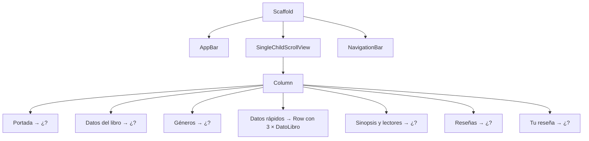

# Ejercicio 3: Pantalla "Biblioteca UPN" 📚

> Mismo reto que el ejercicio 2, otra pantalla. Vas a combinar las piezas prediseñadas de Material para armar el **detalle de un libro** de la biblioteca. Esta vez hay menos pistas obvias: intenta resolver cada paso antes de abrirlas.

---

## 🎯 Objetivo

Construir la pantalla de **detalle de un libro** en la app de la Biblioteca UPN. Igual que antes, solo hay que **armar la interfaz**: los botones no hacen nada y no se guardan datos.

Al terminar habrás practicado:

- Pegar widgets en **tres esquinas distintas** de una imagen con `Stack` y `Positioned`.
- Mostrar imágenes de internet con esquinas redondeadas (`Image.network` + `ClipRRect`).
- Usar `Chip`, `Wrap`, `Card`, `ListTile`, `CircleAvatar` y `Divider`.
- Repartir el ancho en partes iguales con `Expanded`.
- Poner un `TextField` de varias líneas y distintos tipos de botones.
- Agregar una barra de navegación inferior con `NavigationBar`.
- Crear **tu propio `StatelessWidget`** con parámetros y reutilizarlo.

### 🧠 Piensa como si ordenaras una estantería

Una biblioteca no fabrica un estante distinto para cada libro: tiene **un modelo de estante** que se repite, y en cada uno solo cambia lo que se pone encima. 📚

Tu pantalla funciona igual: si ves **tres bloques que se ven iguales** y solo cambian sus datos, no los copies tres veces. Crea **un molde** (tu propio widget) y úsalo tres veces con datos distintos.

> [!TIP]
> Antes de escribir un widget, pregúntate: "¿esto ya existe en el [Catálogo](../../docs/8.%20flutter/5-catalogo-de-widgets.md)?". El [índice "Quiero..."](../../docs/8.%20flutter/5-catalogo-de-widgets.md#-índice-rápido-quiero) está hecho justamente para eso.

### 📏 Reglas del ejercicio

1. Solo `StatelessWidget`: **nada** de `StatefulWidget` ni `setState`.
2. Todos los botones llevan `onPressed: () {}` y no hacen nada todavía.
3. Usa el widget prediseñado cuando exista: si construyes un círculo con `Container` habiendo `CircleAvatar`, no cuenta.
4. Debe existir **al menos un** widget propio que reciba parámetros y se use **varias veces**.

---

## 🖼️ Así debe quedar

```
┌────────────────────────────────────┐
│  ←      Biblioteca UPN      🔍  ⋮  │  ← AppBar
├────────────────────────────────────┤
│ ┌────────────────────────────────┐ │
│ │ (⭐ 4.8)                   (♡) │ │  ← Stack: calificación + favorito
│ │                                │ │
│ │          [ IMAGEN ]            │ │
│ │                                │ │
│ │                  (🟢 Disponible)│ │  ← etiqueta abajo a la derecha
│ └────────────────────────────────┘ │
│                                    │
│ Cien años de soledad               │  ← Text grande
│ Gabriel García Márquez             │  ← Text en color principal
│ 🏷 Código: LIT-0427                 │
│ 📍 Piso 2 · Estante B               │
│                                    │
│ (📖 Novela) (🌎 Latinoamérica)       │  ← Wrap de Chips
│ (✨ Realismo mágico) (🏆 Clásico)    │
│ ────────────────────────────────── │
│ ┌──────────┐┌──────────┐┌────────┐ │
│ │    📄    ││    🌐    ││   📅   │ │
│ │   471    ││ Español  ││  1967  │ │  ← 3 × DatoLibro
│ │ Páginas  ││  Idioma  ││  Año   │ │     (mismo ancho)
│ └──────────┘└──────────┘└────────┘ │
│ ────────────────────────────────── │
│ Sinopsis                           │
│ La historia de la familia Buendía  │
│ a lo largo de siete generaciones   │  ← Text largo
│ en el pueblo de Macondo...         │
│                                    │
│ También lo leyeron                 │
│ (A)(B)(C)(D)(E)  +35 estudiantes    │  ← Row de CircleAvatar
│                                    │
│ Reseñas                            │
│ ┌────────────────────────────────┐ │
│ │ (foto) Lucía Vargas        5 ⭐ │ │
│ │        "Me atrapó desde..."     │ │  ← Card con ListTile
│ │ ────────────────────────────── │ │
│ │ (foto) Mateo Quispe        4 ⭐ │ │
│ │        "Hay que leerlo con..."  │ │
│ └────────────────────────────────┘ │
│                                    │
│ Deja tu reseña                     │
│ ┌────────────────────────────────┐ │
│ │ ✏ Tu opinión                    │ │  ← TextField de 3 líneas
│ │   ¿Qué te pareció el libro?    │ │
│ │                                │ │
│ └────────────────────────────────┘ │
│ ┌──────────────┐ ┌───────────────┐ │
│ │ 👁 Ver muestra│ │ 📥 Reservar    │ │  ← 2 botones mismo ancho
│ └──────────────┘ └───────────────┘ │
├────────────────────────────────────┤
│  🏠 Inicio  🔍 Buscar  📚 Mis libros │  ← NavigationBar
└────────────────────────────────────┘
```

---

## 🧩 Widgets que vas a necesitar

No es obligatorio usar todos, pero con estos se puede armar la pantalla completa.

| Parte de la pantalla | Widgets | Consulta |
|---|---|---|
| Estructura | `Scaffold`, `AppBar`, `IconButton`, `NavigationBar` | [Scaffold](../../docs/8.%20flutter/2-scaffold.md), [AppBar](../../docs/8.%20flutter/5-catalogo-de-widgets.md#appbar) |
| Portada | `Stack`, `Positioned`, `ClipRRect`, `Image.network`, `Container`, `CircleAvatar` | [Stack y Positioned](../../docs/8.%20flutter/5-catalogo-de-widgets.md#stack-y-positioned), [Image y ClipRRect](../../docs/8.%20flutter/5-catalogo-de-widgets.md#image-y-cliprrect) |
| Datos del libro | `Text`, `TextStyle`, `Row`, `Icon` | [TextStyle](../../docs/8.%20flutter/5-catalogo-de-widgets.md#textstyle) |
| Géneros | `Wrap`, `Chip` | [Wrap](../../docs/8.%20flutter/5-catalogo-de-widgets.md#wrap), [Chip](../../docs/8.%20flutter/5-catalogo-de-widgets.md#chip) |
| Datos rápidos | Tu propio `StatelessWidget`, `Expanded` | [Stateless vs Stateful](../../docs/8.%20flutter/4-stateless-vs-stateful.md), [Expanded](../../docs/8.%20flutter/5-catalogo-de-widgets.md#expanded) |
| Sinopsis | `Text` | [Text](../../docs/8.%20flutter/5-catalogo-de-widgets.md#text) |
| Lectores | `CircleAvatar`, `Divider` | [CircleAvatar](../../docs/8.%20flutter/5-catalogo-de-widgets.md#circleavatar), [Divider](../../docs/8.%20flutter/5-catalogo-de-widgets.md#divider) |
| Reseñas | `Card`, `ListTile` | [Card](../../docs/8.%20flutter/5-catalogo-de-widgets.md#card), [ListTile](../../docs/8.%20flutter/5-catalogo-de-widgets.md#listtile) |
| Tu reseña | `TextField`, `OutlinedButton.icon`, `FilledButton.icon` | [TextField](../../docs/8.%20flutter/3-widgets-mas-usados.md#textfield), [Botones](../../docs/8.%20flutter/5-catalogo-de-widgets.md#botones) |

---

## 🪜 Paso a paso

> [!TIP]
> Guarda después de cada paso y mira el cambio con **Hot Reload**. Si algo se rompe, sabrás que fue lo último que tocaste.

### Paso 0: Preparar el proyecto

- [ ] Crea un proyecto nuevo (`flutter create biblioteca_upn`).
- [ ] En `lib/main.dart` deja un `MaterialApp` con Material 3, sin la etiqueta de *debug*, y con el color principal que quieras (te sugerimos un tono marrón o índigo, que recuerdan a los libros).
- [ ] Crea un `StatelessWidget` llamado `PantallaLibro` y ponlo como `home`. Por ahora, que devuelva un `Placeholder()`.

---

### Paso 1: Esqueleto, barra superior y barra inferior

- [ ] Barra superior con un botón para **volver** a la izquierda, el título **"Biblioteca UPN"** y dos botones a la derecha: **buscar** (lupa) y **más opciones** (tres puntos verticales).
- [ ] Barra de navegación **inferior** con tres opciones: **Inicio**, **Buscar** y **Mis libros**. La opción **Buscar** aparece seleccionada.
- [ ] El contenido del centro se puede **desplazar**, tiene margen de **16** con los bordes y sus elementos van alineados a la izquierda.

📖 Consulta: [AppBar](../../docs/8.%20flutter/5-catalogo-de-widgets.md#appbar), [bottomNavigationBar](../../docs/8.%20flutter/2-scaffold.md#bottomnavigationbar-la-barra-inferior), [SingleChildScrollView](../../docs/8.%20flutter/5-catalogo-de-widgets.md#singlechildscrollview)

<details>
<summary>💡 Pista 1: ¿cómo se llama el ícono de los tres puntos?</summary>

Escribe `Icons.more_` en tu editor y deja que el autocompletado te muestre las opciones. Hay una versión **vertical** y otra **horizontal**.

</details>

<details>
<summary>💡 Pista 2: ¿qué número le pongo a la opción seleccionada?</summary>

Es el mismo razonamiento del ejercicio 2: cuenta las opciones empezando desde **0**. ¿En qué posición está **Buscar**?

</details>

---

### Paso 2: Portada del libro

- [ ] Una imagen de **todo el ancho**, de **220** de alto, con **esquinas redondeadas** y sin deformarse. Puedes usar `https://picsum.photos/seed/libro/600/300`.
- [ ] **Encima** de la imagen, en la esquina **superior izquierda**, una cajita blanca con esquinas redondeadas que muestra una **estrella** amarilla y el texto **4.8** en negrita, uno al lado del otro.
- [ ] **Encima** de la imagen, en la esquina **superior derecha**, un **círculo blanco** con un ícono de **corazón** (solo el contorno).
- [ ] **Encima** de la imagen, en la esquina **inferior derecha**, una etiqueta verde con el texto **"Disponible"** en blanco.
- [ ] Las tres etiquetas quedan separadas **12** de los bordes de la imagen.

📖 Consulta: [Stack y Positioned](../../docs/8.%20flutter/5-catalogo-de-widgets.md#stack-y-positioned), [Image y ClipRRect](../../docs/8.%20flutter/5-catalogo-de-widgets.md#image-y-cliprrect), [BoxFit](../../docs/8.%20flutter/5-catalogo-de-widgets.md#boxfit), [BoxDecoration](../../docs/8.%20flutter/5-catalogo-de-widgets.md#boxdecoration), [CircleAvatar](../../docs/8.%20flutter/5-catalogo-de-widgets.md#circleavatar)

<details>
<summary>💡 Pista 1: ¿cuántos <code>Positioned</code> necesito?</summary>

Uno por cada cosa que quieras pegar sobre la imagen. Y la imagen va **primero** en la lista de hijos del `Stack`: lo que está primero queda **al fondo**.

</details>

<details>
<summary>💡 Pista 2: la cajita de la calificación ocupa todo el ancho</summary>

Dentro de la cajita hay un `Row` con la estrella y el número. Un `Row`, por defecto, intenta ocupar **todo el ancho** que le dejan. Busca la propiedad de `Row` que le dice "ocupa solo lo **mínimo** necesario".

</details>

<details>
<summary>💡 Pista 3: ¿cómo hago el círculo blanco con el corazón?</summary>

Regla 3: no construyas el círculo con `Container`. Ya conoces un widget que es un círculo listo y que, además de una foto, puede recibir un `child`. Cambia su color de fondo a blanco.

</details>

<details>
<summary>💡 Pista 4: corazón relleno o solo contorno</summary>

Muchos íconos de Material tienen variantes. Escribe `Icons.favorite` y mira qué otras opciones te sugiere el editor: una de ellas termina en `_border`.

</details>

---

### Paso 3: Datos del libro

- [ ] El título **"Cien años de soledad"** grande y en negrita.
- [ ] Debajo, el autor **"Gabriel García Márquez"** en el **color principal del tema**.
- [ ] Debajo, dos líneas de información, cada una con un **ícono pequeño gris** a la izquierda y el texto en gris:
  - Código: **LIT-0427**
  - Ubicación: **Piso 2 · Estante B**

📖 Consulta: [Text](../../docs/8.%20flutter/5-catalogo-de-widgets.md#text), [TextStyle](../../docs/8.%20flutter/5-catalogo-de-widgets.md#textstyle), [Icon](../../docs/8.%20flutter/5-catalogo-de-widgets.md#icon), [Colors](../../docs/8.%20flutter/5-catalogo-de-widgets.md#colors)

<details>
<summary>💡 Pista 1: ¿cómo uso el color principal del tema?</summary>

Lo hiciste en el paso 6 del ejercicio 2: el color sale de `Theme.of(context)`, dentro de su `colorScheme`.

</details>

<details>
<summary>💡 Pista 2: las dos líneas con ícono se ven iguales...</summary>

¿Notas que son la misma estructura con datos distintos? Si quieres adelantarte, este es un buen candidato para un widget propio pequeño (ver **Retos extra**).

</details>

---

### Paso 4: Géneros del libro

- [ ] Cuatro **etiquetas** con ícono: **Novela**, **Latinoamérica**, **Realismo mágico** y **Clásico**.
- [ ] Si no caben en una línea, **bajan a la siguiente** (prueba girando el celular).
- [ ] Hay espacio entre etiquetas **horizontalmente** y **verticalmente**.
- [ ] Una **línea separadora** debajo de las etiquetas.

| Etiqueta | Ícono sugerido |
|---|---|
| Novela | `Icons.menu_book` |
| Latinoamérica | `Icons.public` |
| Realismo mágico | `Icons.auto_awesome` |
| Clásico | `Icons.workspace_premium` |

📖 Consulta: [Chip](../../docs/8.%20flutter/5-catalogo-de-widgets.md#chip), [Wrap](../../docs/8.%20flutter/5-catalogo-de-widgets.md#wrap), [Divider](../../docs/8.%20flutter/5-catalogo-de-widgets.md#divider)

<details>
<summary>💡 Pista: ya lo hiciste antes</summary>

Es exactamente la misma técnica del paso 4 del ejercicio 2. Si no te acuerdas, vuelve a revisarlo antes de abrir el catálogo.

</details>

---

### Paso 5: Datos rápidos con tu propio widget ⭐

Este es el paso más importante. Los tres bloques (páginas, idioma y año) se ven **iguales** y solo cambian sus datos. No copies y pegues: crea **un widget reutilizable** llamado `DatoLibro`.

- [ ] `DatoLibro` recibe por su constructor un **ícono**, un **valor** y una **etiqueta**. Todos son obligatorios.
- [ ] Se ve como una caja con fondo de color suave, esquinas redondeadas y un poco de espacio interno.
- [ ] Por dentro, todo va **centrado** y **uno debajo del otro**: el **ícono** en el color principal, el **valor** en negrita y la **etiqueta** pequeña en gris.
- [ ] Se usa **tres veces** en una misma fila, con separación entre cajas:

| Ícono sugerido | Valor | Etiqueta |
|---|---|---|
| `Icons.description` | 471 | Páginas |
| `Icons.language` | Español | Idioma |
| `Icons.calendar_month` | 1967 | Año |

- [ ] Las tres cajas tienen **exactamente el mismo ancho**, aunque "Español" sea más largo que "1967".
- [ ] Una **línea separadora** debajo de la fila.

📖 Consulta: [Stateless vs Stateful](../../docs/8.%20flutter/4-stateless-vs-stateful.md), [Parámetros Nombrados](../../docs/7.%20dart/3-parametros-nombrados.md), [Clases e Instancias](../../docs/7.%20dart/4-clases-e-instancias.md), [Container](../../docs/8.%20flutter/5-catalogo-de-widgets.md#container), [Expanded](../../docs/8.%20flutter/5-catalogo-de-widgets.md#expanded)

<details>
<summary>💡 Pista 1: ¿cómo empiezo el widget?</summary>

Mira cómo hiciste `TarjetaActividad` en el ejercicio 2: atributos `final`, constructor con parámetros nombrados `required` y un método `build`. Solo cambian los nombres y el contenido.

</details>

<details>
<summary>💡 Pista 2: las cajas tienen anchos distintos</summary>

Sin ayuda, cada caja mide lo que mide su texto. Necesitas que **cada caja** reparta el espacio de la fila **en partes iguales**. Ya usaste el widget que hace esto en el ejercicio 1. ¿Dónde va: dentro de `DatoLibro` o alrededor de cada uso en el `Row`?

</details>

<details>
<summary>💡 Pista 3: el contenido no queda centrado</summary>

Hay **dos** centrados que revisar: el `Column` tiene que centrar a sus hijos **horizontalmente**, y la caja tiene que medir lo mismo que su espacio. Recuerda que en un `Column` el eje "cruzado" es el horizontal.

</details>

<details>
<summary>💡 Pista 4: ¿de qué tipo es el valor?</summary>

"471" y "1967" parecen números, pero "Español" no. Si los tres van al mismo atributo, ¿qué tipo de dato sirve para los tres?

</details>

---

### Paso 6: Sinopsis y lectores

- [ ] El subtítulo **"Sinopsis"** y debajo un párrafo en gris (el texto que quieras, de tres o cuatro líneas). Si quieres, usa: *"La historia de la familia Buendía a lo largo de siete generaciones en el pueblo de Macondo, donde lo extraordinario se vuelve parte de la vida diaria."*
- [ ] El párrafo tiene un **interlineado** un poco más amplio que el normal para que se lea cómodo.
- [ ] El subtítulo **"También lo leyeron"**.
- [ ] Una fila con **cinco fotos circulares** pequeñas de personas, y al final el texto **"+35 estudiantes"**. Puedes usar `https://i.pravatar.cc/100?img=5` (cambia el número final para obtener otra persona).

📖 Consulta: [TextStyle](../../docs/8.%20flutter/5-catalogo-de-widgets.md#textstyle), [CircleAvatar](../../docs/8.%20flutter/5-catalogo-de-widgets.md#circleavatar), [Row](../../docs/8.%20flutter/5-catalogo-de-widgets.md#row)

<details>
<summary>💡 Pista 1: ¿cómo cambio el interlineado?</summary>

Está en `TextStyle`. Es una propiedad que **multiplica** la altura normal de la línea: `1.0` es lo normal, valores mayores separan más las líneas.

</details>

<details>
<summary>💡 Pista 2: la foto no aparece</summary>

Mismo error típico del ejercicio 2: `CircleAvatar` no recibe un widget `Image`, sino un **proveedor** de imagen en su propiedad de fondo.

</details>

---

### Paso 7: Reseñas

- [ ] El subtítulo **"Reseñas"**.
- [ ] Una **tarjeta** (con sombra) que agrupa dos reseñas separadas por una línea.
- [ ] Cada reseña tiene: la **foto circular** del lector a la izquierda, su **nombre** como título, el **comentario** como subtítulo y, a la derecha, la **nota** con una estrella amarilla (por ejemplo, `5 ⭐`).

| Nombre | Comentario | Nota | Foto |
|---|---|---|---|
| Lucía Vargas | "Me atrapó desde la primera página." | 5 | `https://i.pravatar.cc/100?img=32` |
| Mateo Quispe | "Hay que leerlo con calma, pero vale la pena." | 4 | `https://i.pravatar.cc/100?img=15` |

📖 Consulta: [Card](../../docs/8.%20flutter/5-catalogo-de-widgets.md#card), [ListTile](../../docs/8.%20flutter/5-catalogo-de-widgets.md#listtile), [CircleAvatar](../../docs/8.%20flutter/5-catalogo-de-widgets.md#circleavatar), [Divider](../../docs/8.%20flutter/5-catalogo-de-widgets.md#divider)

<details>
<summary>💡 Pista 1: ¿qué pongo a la derecha del <code>ListTile</code>?</summary>

En el ejercicio 2 pusiste solo un ícono de flecha. Aquí necesitas **dos cosas** (el número y la estrella), pero esa posición recibe **un solo** widget. ¿Qué widget junta dos cosas una al lado de la otra? Ojo con la Pista 2 del paso 2.

</details>

<details>
<summary>💡 Pista 2: el comentario largo se corta raro</summary>

Por defecto el subtítulo de un `ListTile` puede ocupar varias líneas. Si prefieres que se vea en una sola línea con `...` al final, revisa las propiedades `maxLines` y `overflow` de `Text`.

</details>

---

### Paso 8: Tu reseña y botones

- [ ] El subtítulo **"Deja tu reseña"**.
- [ ] Un campo de texto con **borde**, la etiqueta **"Tu opinión"**, el texto de ayuda **"¿Qué te pareció el libro?"**, un ícono de **lápiz** al inicio y una altura de **3 líneas**.
- [ ] Debajo, dos botones **uno al lado del otro** y **del mismo ancho**, cada uno con ícono y texto:
  - **Ver muestra**: acción secundaria (con borde, sin relleno), ícono de ojo.
  - **Reservar**: acción principal (con relleno, la que más resalta), ícono de descarga o de libro.
- [ ] El último botón **no** queda tapado por la barra inferior al hacer scroll hasta el final.

📖 Consulta: [TextField](../../docs/8.%20flutter/3-widgets-mas-usados.md#textfield), [Botones](../../docs/8.%20flutter/5-catalogo-de-widgets.md#botones), [Expanded](../../docs/8.%20flutter/5-catalogo-de-widgets.md#expanded), [Constructores con nombre](../../docs/8.%20flutter/5-catalogo-de-widgets.md#constructores-con-nombre-los-métodos-que-más-vas-a-usar)

<details>
<summary>💡 Pista 1: ¿cómo hago el campo más alto?</summary>

La altura **no** se pone con un `SizedBox`. `TextField` tiene una propiedad que indica **cuántas líneas** muestra. Por defecto vale `1`.

</details>

<details>
<summary>💡 Pista 2: el ícono del lápiz queda centrado verticalmente</summary>

Es normal en campos de varias líneas y está bien así. Si quieres que quede arriba, investiga la propiedad `alignLabelWithHint` de `InputDecoration`. (Opcional.)

</details>

<details>
<summary>💡 Pista 3: los botones no miden lo mismo</summary>

Es el mismo problema de los `DatoLibro` del paso 5, y se resuelve igual.

</details>

---

## 🌳 Pista general: cómo se divide la pantalla

Úsala **solo si te atascas**. Muestra las secciones grandes, pero no lo que va dentro de cada una.

<details>
<summary>Ver árbol de secciones</summary>



</details>

---

## ⚠️ Errores frecuentes

| Lo que ves | Por qué pasa | Qué revisar |
|---|---|---|
| Error: *Positioned widgets must be placed directly inside Stack widgets* | Usaste `Positioned` fuera de un `Stack` | El padre directo de `Positioned` debe ser el `Stack` |
| La cajita de la calificación se estira a todo el ancho | El `Row` interno ocupa todo el espacio disponible | Indícale al `Row` que use solo el tamaño mínimo |
| Error: *Incorrect use of ParentDataWidget* | Pusiste `Expanded` donde su padre no es `Row`, `Column` ni `Flex` | `Expanded` debe ser hijo **directo** del `Row` |
| Error: *The argument type 'int' can't be assigned to 'String'* | Pasaste `471` (número) a un atributo `String` | Escríbelo entre comillas: `'471'` |
| Error: *The named parameter 'children' isn't defined* en `Card` | `Card` recibe un solo hijo | Envuelve los elementos en un widget que acepte `children` |
| Error: *InputDecorator ... cannot have an unbounded width* | El `TextField` está dentro de un `Row` sin límite de ancho | Si lo pones en un `Row`, envuélvelo en `Expanded` |
| La imagen no carga y sale un error de red | El emulador no tiene internet o la URL está mal escrita | Prueba la URL en el navegador del computador |
| Líneas azules debajo de algunos widgets | Faltan `const` | Acepta la sugerencia del editor (bombilla 💡) |

---

## ✅ Lista de verificación

- [ ] Solo hay clases que extienden `StatelessWidget`.
- [ ] La pantalla hace scroll y **no** aparece la franja amarilla y negra, ni en vertical ni girando el celular.
- [ ] Sobre la imagen se ven: calificación arriba a la izquierda, corazón arriba a la derecha y "Disponible" abajo a la derecha.
- [ ] El autor aparece en el color principal del tema.
- [ ] Los chips bajan de línea cuando no caben.
- [ ] `DatoLibro` está definido **una vez**, se usa **tres veces** y las tres cajas miden lo mismo.
- [ ] Las fotos de lectores y reseñas son circulares y usan `CircleAvatar`.
- [ ] Las reseñas están dentro de una `Card` y cada una es un `ListTile` con la nota a la derecha.
- [ ] El campo de reseña muestra 3 líneas.
- [ ] Los dos botones de abajo tienen el mismo ancho y se distingue cuál es el principal.
- [ ] La barra inferior muestra **Buscar** como seleccionada.

---

## 🚀 Retos extra

1. **Widget `LineaInfo`:** las líneas de "Código" y "Ubicación" del paso 3 tienen la misma forma. Crea un widget que reciba `icono` y `texto` y úsalo dos veces.
2. **Widget `Resena`:** crea un widget que reciba `nombre`, `comentario`, `nota` y `urlFoto` y devuelva el `ListTile` completo.
3. **Estrellas reales:** en lugar de mostrar `5 ⭐`, haz que `Resena` dibuje tantas estrellas como diga `nota` (por ejemplo, 4 estrellas llenas y 1 vacía). Pista: investiga `List.generate`.
4. **Libro no disponible:** agrega a `PantallaLibro` un atributo `bool disponible`. Si es `false`, la etiqueta dice **"Prestado"** en rojo y el botón principal dice **"Avisarme"**. Prueba la pantalla con ambos valores.
5. **Avatares montados:** haz que las fotos de "También lo leyeron" se superpongan un poco, como en el reto 4 del ejercicio 2.

---

_Anterior: [← Ejercicio 2: Pantalla Feria Tech UPN](2-pantalla-feria-tech.md)_
