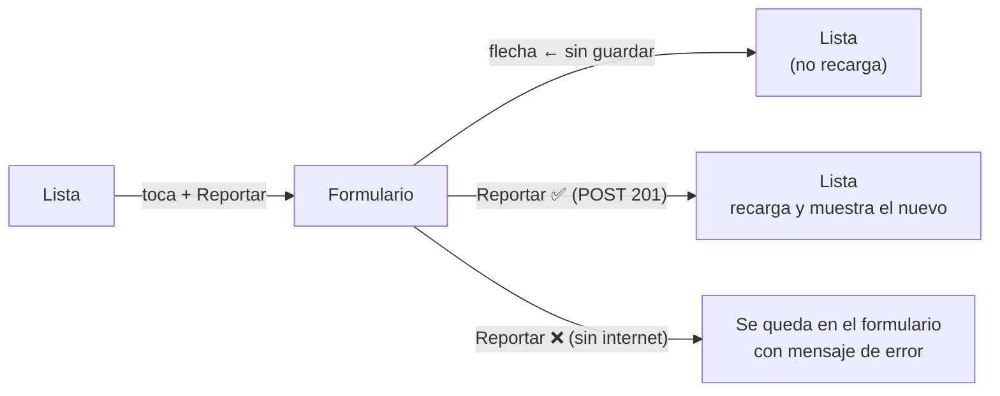

# Grupo B · Ejercicio 2: Formulario "Reportar objeto" con MockAPI 📝

> Ahora la app no solo **lee**: también **escribe**. Vas a crear un formulario que valida los datos, los envía con `POST` a tu API y vuelve a la lista actualizada.

---

## 🎯 Objetivo

En la oficina de Bienestar UPN quieren registrar los objetos encontrados **desde la app**, sin entrar a MockAPI. Vas a agregar a la app del [Ejercicio 1](1-lista-objetos-perdidos-mockapi.md) una pantalla **"Reportar objeto"** que:

1. Pide los datos con un formulario.
2. **No deja enviar** si algo está mal y explica qué corregir.
3. Envía el objeto al servidor.
4. Vuelve a la lista, que se **actualiza sola** con el objeto nuevo.

Al terminar habrás practicado:

- `Form`, `GlobalKey<FormState>` y `validate()`.
- `TextFormField` con `validator`, `TextEditingController` y `dispose`.
- `DropdownButtonFormField` y `SwitchListTile`.
- Convertir texto en número de forma segura.
- `toJson`, `jsonEncode` y `POST` con el header correcto.
- Evitar envíos duplicados mientras se guarda.
- Navegar con `Navigator.push` / `Navigator.pop` y **devolver un resultado**.

### 🧠 Piensa como si recibieras objetos en la oficina

Cuando alguien entrega un objeto encontrado, quien atiende no lo guarda en un cajón sin más: llena una **ficha** (qué es, dónde se encontró, quién lo trae) y la revisa **antes** de archivarla. Si falta un dato, lo pide en ese momento. Y archiva **una sola** ficha por objeto, aunque la persona insista. Tu formulario hace lo mismo: **revisa → envía una sola vez → confirma**.

---

## 🚫 Reglas del ejercicio

1. **Prohibido usar IA para generar código** (ChatGPT, Gemini, Copilot, Claude, Cursor, asistentes del editor). Desactiva el autocompletado con IA.
2. Tu única fuente es la documentación de este repositorio. El ejemplo de la documentación es de **mascotas**: entiéndelo y adáptalo a **objetos perdidos**. No hay código para copiar aquí.
3. Debes poder **explicar cada línea** en la sustentación.
4. Continúa tu **bitácora de errores** del ejercicio 1.
5. **Requisito:** el ejercicio 1 debe funcionar (la lista carga desde tu MockAPI).

### 📚 Documentación que necesitas

| Tema | Documento |
|---|---|
| `toJson` y `POST` | [3. El paquete http](../../../docs/9.%20flutter%20http/3-paquete-http.md), [4. Modelos y servicio](../../../docs/9.%20flutter%20http/4-modelos-y-servicio.md) |
| Formularios y validación | [6. Formularios con validación](../../../docs/9.%20flutter%20http/6-formularios.md) |
| Abrir, cerrar y devolver resultado | [7. Navegar entre pantallas](../../../docs/9.%20flutter%20http/7-navegar-entre-pantallas.md) |
| `mounted` y `SnackBar` | [5. Mostrar datos en pantalla](../../../docs/9.%20flutter%20http/5-mostrar-datos-en-pantalla.md) |
| Widgets | [Catálogo de Widgets](../../../docs/8.%20flutter/5-catalogo-de-widgets.md) |

---

## 🖼️ Así debe quedar

```
 LISTA                                  FORMULARIO (con errores)
┌────────────────────────────────────┐ ┌────────────────────────────────────┐
│  Objetos Perdidos UPN           ⟳  │ │  ←  Reportar objeto                │
├────────────────────────────────────┤ ├────────────────────────────────────┤
│ 14 objetos reportados              │ │ ┌─ ¿Qué objeto es? ──────────────┐ │
│ ┌────────────────────────────────┐ │ │ │ 🎒 Ll                           │ │
│ │ (img) Casaca azul             ✅│ │ │ └────────────────────────────────┘ │
│ │       Biblioteca · Ana Torres   │ │ │   Mínimo 3 caracteres      2/30   │
│ │                    hace 2 días │ │ │ ┌─ Reportado por ────────────────┐ │
│ └────────────────────────────────┘ │ │ │ 👤 Ana                          │ │
│              ...                   │ │ └────────────────────────────────┘ │
│                                    │ │   Escribe nombre y apellido       │
│                                    │ │ ┌─ ¿Dónde se encontró? ────── ▼ ┐ │
│                                    │ │ │ 📍                              │ │
│                                    │ │ └────────────────────────────────┘ │
│                                    │ │   Elige dónde se encontró         │
│                                    │ │ ┌─ Días en la oficina ───────────┐ │
│                                    │ │ │ 📅 90                           │ │
│                                    │ │ └────────────────────────────────┘ │
│                                    │ │   Los días van de 0 a 60          │
│                                    │ │ ┌─ URL de la foto (opcional) ────┐ │
│                                    │ │ │ 🖼                              │ │
│                                    │ │ └────────────────────────────────┘ │
│                    ┌─────────────┐ │ │  Ya fue devuelto            [◯ ]  │
│                    │ + Reportar  │ │ │  Sigue en la oficina de Bienestar │
│                    └─────────────┘ │ │                                    │
│                                    │ │  ┌──────────────────────────────┐  │
└────────────────────────────────────┘ │  │       📤 Reportar objeto      │  │
                                       │  └──────────────────────────────┘  │
                                       └────────────────────────────────────┘
```



---

## 🪜 Paso a paso

### Paso 1: Preparar el modelo y el servicio

- [ ] Agrega a `ObjetoPerdido` el método **`toJson`**. Piensa: ¿qué campo **no** debes enviar al crear?
- [ ] Agrega a `ObjetoPerdidoApi` un método **`reportarObjeto`** que reciba un `ObjetoPerdido`, haga `POST` a `/objetos` y devuelva el `ObjetoPerdido` creado (el que responde el servidor, ya con su `id`).
- [ ] Si el código de estado no es el que MockAPI devuelve al **crear**, lanza una excepción.
- [ ] **Prueba el servicio antes de hacer la pantalla:** llámalo una vez desde `main` con un objeto escrito a mano, abre la URL en el navegador y confirma que el objeto aparece con **todos** sus campos llenos y con los **mismos nombres de clave** que los demás. Luego borra esa prueba.

📖 Consulta: [3. POST](../../../docs/9.%20flutter%20http/3-paquete-http.md), [4. toJson y clase de servicio](../../../docs/9.%20flutter%20http/4-modelos-y-servicio.md), [2. Tabla de endpoints](../../../docs/9.%20flutter%20http/2-mockapi.md)

<details>
<summary>💡 Pista 1: el objeto aparece en MockAPI con un campo raro y sin mis datos</summary>

El servidor no entendió que le mandabas JSON. Hay **dos** cosas que revisar en tu `POST`: un header y cómo conviertes el body. Después, borra ese registro raro: si lo dejas, tu lista fallará al convertirlo.

</details>

<details>
<summary>💡 Pista 2: el objeto se creó, pero mi método lanza la excepción</summary>

Estás comparando con el código equivocado. Al **crear**, MockAPI no responde lo mismo que al **leer**. Revisa la tabla de endpoints.

</details>

<details>
<summary>💡 Pista 3: en el navegador mi objeto tiene <code>reportadopor</code> y los demás <code>reportadoPor</code></summary>

Las claves que escribes en `toJson` tienen que ser **idénticas** a las que lees en `fromJson`, con mayúsculas incluidas. Si no, al recargar la lista tu propio objeto romperá la app.

</details>

<details>
<summary>💡 Pista 4: ¿qué <code>id</code> le pongo al objeto que voy a crear si todavía no existe?</summary>

El constructor lo pide, pero `toJson` no lo envía. Cualquier texto sirve como "relleno" (por ejemplo, uno vacío): el `id` real lo trae la respuesta del servidor. (Aunque lo enviaras, MockAPI lo ignora y pone el suyo.)

</details>

---

### Paso 2: La pantalla del formulario

- [ ] Crea `FormularioObjeto` en `pantallas/formulario_objeto.dart`.
- [ ] ¿Stateless o Stateful? (Pista: el interruptor cambia, el botón cambia mientras guarda...)
- [ ] `AppBar` con el título **"Reportar objeto"**.
- [ ] El cuerpo es un **formulario** con su **llave**, y dentro una lista con scroll y margen de 16.
- [ ] Un espacio de 16 entre campo y campo.

📖 Consulta: [6. Paso 1: Form y GlobalKey](../../../docs/9.%20flutter%20http/6-formularios.md)

<details>
<summary>💡 Pista: ¿por qué una lista con scroll y no un <code>Column</code>?</summary>

Abre el teclado del emulador con un `Column` y mira qué pasa abajo de la pantalla. La respuesta está en el Tip del paso 1 del documento de formularios.

</details>

---

### Paso 3: Los campos de texto y sus reglas ⭐

Este es el corazón del ejercicio. Cada campo de texto necesita su **controlador** y su **validador**.

- [ ] Crea **cuatro controladores**, uno por campo de texto, en el lugar correcto (no dentro de `build`).
- [ ] **Libéralos** cuando la pantalla se cierre.
- [ ] Todos los campos tienen **borde**, **etiqueta** e **ícono** al inicio.

| Campo (etiqueta) | Ícono sugerido | Teclado | Reglas (mensaje de error entre comillas) |
|---|---|---|---|
| ¿Qué objeto es? | `Icons.backpack` | Normal, primera letra en mayúscula | Obligatorio → *"Escribe qué objeto es"*. Mínimo 3 caracteres → *"Mínimo 3 caracteres"*. Máximo 30, con **contador visible** |
| Reportado por | `Icons.person` | Normal, cada palabra con mayúscula | Obligatorio → *"Escribe quién lo entrega"*. Debe tener nombre **y** apellido → *"Escribe nombre y apellido"* |
| Días en la oficina | `Icons.calendar_today` | Numérico | Debe ser un número entero → *"Escribe un número entero"*. Entre **0** y 60 → *"Los días van de 0 a 60"* |
| URL de la foto | `Icons.image` | De URL | **Opcional.** Si está vacío, es válido. Si tiene texto, debe empezar con `http` → *"La URL debe empezar con http"* |

- [ ] El campo de días tiene el **texto de ayuda** *"Escribe 0 si lo encontraron hoy"*.
- [ ] El campo de URL tiene el **texto de ayuda** *"Si lo dejas vacío, usaremos una imagen por defecto"*.
- [ ] Ningún campo acepta un texto formado **solo por espacios**.

📖 Consulta: [6. Pasos 2, 3 y 4](../../../docs/9.%20flutter%20http/6-formularios.md) (`TextEditingController`, `dispose`, propiedades útiles, `validator`, recetas de validaciones)

<details>
<summary>💡 Pista 1: ¿cómo muestro el contador "2/30"?</summary>

Hay una propiedad del campo que pone un **límite** de caracteres y, de paso, muestra el contador. Está en la tabla de propiedades útiles.

</details>

<details>
<summary>💡 Pista 2: ¿cómo sé si escribió nombre y apellido?</summary>

Si alguien escribe nombre y apellido, entre ellos hay un **espacio**. Pero ojo: `"Ana "` también tiene un espacio (al final). ¿Qué haces primero con el texto para que eso no cuente?

</details>

<details>
<summary>💡 Pista 3: el validador de días</summary>

No uses la conversión que **lanza error**: usa la que devuelve `null` cuando el texto no es un número. Primero revisa si es número; **solo después** revisa el rango. Cuidado: **0 es un valor válido**. Prueba que `0` pase y que `-1` no.

</details>

<details>
<summary>💡 Pista 4: el campo opcional</summary>

Mira la última fila de la tabla de "Recetas de validaciones frecuentes": si está vacío, el validador debe decir "todo bien" **antes** de revisar el formato.

</details>

<details>
<summary>💡 Pista 5: "solo espacios" pasa la validación</summary>

`"   "` no está vacío para Dart: tiene 3 caracteres. Hay un método de `String` que quita los espacios del inicio y del final.

</details>

---

### Paso 4: Lugar y estado de devolución

- [ ] Un **menú desplegable** con la etiqueta **"¿Dónde se encontró?"**, ícono `Icons.place` y las opciones **Biblioteca**, **Cafetería**, **Laboratorio** y **Patio**. Al inicio no hay ninguna elegida. Si no elige ninguna → *"Elige dónde se encontró"*.
- [ ] Un **interruptor** con el título **"Ya fue devuelto"**. Empieza **apagado**.
- [ ] Debajo del título del interruptor, un subtítulo que **cambia** según su valor: *"Ya está con su dueño"* si está encendido y *"Sigue en la oficina de Bienestar"* si está apagado.

📖 Consulta: [6. Paso 5: DropdownButtonFormField](../../../docs/9.%20flutter%20http/6-formularios.md), [6. Paso 6: SwitchListTile](../../../docs/9.%20flutter%20http/6-formularios.md)

<details>
<summary>💡 Pista 1: las opciones del menú</summary>

Guarda los cuatro lugares en una lista. El menú no recibe textos sino **elementos de menú**: hay que **convertir** cada texto en uno. Ya lo hiciste al convertir JSON en objetos.

</details>

<details>
<summary>💡 Pista 2: ¿qué tipo tiene la variable del lugar elegido?</summary>

Al inicio **no hay** lugar elegido. ¿Qué tipo de `String` acepta "nada"?

</details>

<details>
<summary>💡 Pista 3: el subtítulo no cambia al mover el interruptor</summary>

El valor cambia, pero ¿le avisaste a Flutter que vuelva a dibujar?

</details>

---

### Paso 5: El botón y la lógica de guardar

- [ ] Al final del formulario, un botón **principal** de todo el ancho con ícono de enviar y el texto **"Reportar objeto"**.
- [ ] Al tocarlo:
  1. Si el formulario **no es válido**, no pasa nada más (los errores ya se ven en rojo).
  2. Si es válido, el botón se **deshabilita** y muestra un **circulito de carga pequeño** en lugar del texto.
  3. Se arma un `ObjetoPerdido` con los valores de los campos. Los días se envían como **número**, no como texto.
  4. Si la URL de la foto quedó vacía, se usa `https://picsum.photos/seed/perdido/200`.
  5. Se envía con `reportarObjeto`.
  6. **Si funcionó:** mensaje *"Objeto reportado ✅"* y se vuelve a la lista **avisando que se guardó**.
  7. **Si falló:** el botón se **vuelve a habilitar** y aparece el mensaje *"No se pudo reportar. Revisa tu conexión."*. El usuario **no pierde** lo que escribió.
- [ ] Antes de usar `context` después de esperar al servidor, compruebas que la pantalla sigue abierta.

📖 Consulta: [6. Paso 7: El botón Guardar](../../../docs/9.%20flutter%20http/6-formularios.md), [7. Paso 2: Volver con pop](../../../docs/9.%20flutter%20http/7-navegar-entre-pantallas.md), [5. mounted y SnackBar](../../../docs/9.%20flutter%20http/5-mostrar-datos-en-pantalla.md), [Botones](../../../docs/8.%20flutter/5-catalogo-de-widgets.md#botones)

<details>
<summary>💡 Pista 1: ¿cómo deshabilito un botón?</summary>

Un botón cuyo `onPressed` es `null` se ve gris y no responde. Usa una variable `bool` del estado para decidir entre `null` y tu función.

</details>

<details>
<summary>💡 Pista 2: ¿cómo hago que el botón ocupe todo el ancho?</summary>

Dentro de un `ListView`, los hijos ya se estiran a todo el ancho. Si el tuyo no lo hace, revisa si lo envolviste en algo que lo achique (por ejemplo, un `Center`).

</details>

<details>
<summary>💡 Pista 3: ¿por qué uso la conversión que lanza error aquí, si en el validador usé la otra?</summary>

Porque cuando llegas a este punto, `validate()` **ya comprobó** que el texto es un número. Explícalo en tu bitácora con tus palabras.

</details>

<details>
<summary>💡 Pista 4: la foto por defecto</summary>

Necesitas una condición: "si el texto (sin espacios) está vacío, usa la URL por defecto; si no, usa el texto". Una sola línea con `? :` alcanza.

</details>

---

### Paso 6: Conectar la lista con el formulario

- [ ] En `ListaObjetos`, agrega un **botón flotante extendido** con ícono `+` y el texto **"Reportar"**.
- [ ] Al tocarlo se abre `FormularioObjeto`.
- [ ] La lista **espera** a que el formulario se cierre. **Solo si** el formulario avisó que guardó, la lista se recarga desde el servidor.
- [ ] Si el usuario vuelve con la flecha ← sin guardar, la lista **no** se recarga.

📖 Consulta: [7. Navegar entre pantallas](../../../docs/9.%20flutter%20http/7-navegar-entre-pantallas.md), [FloatingActionButton](../../../docs/8.%20flutter/5-catalogo-de-widgets.md#floatingactionbutton)

<details>
<summary>💡 Pista 1: la lista se recarga antes de que yo guarde</summary>

Abriste el formulario pero no **esperaste** a que se cerrara. ¿Qué palabra falta antes de abrirlo?

</details>

<details>
<summary>💡 Pista 2: <i>A value of type 'bool?' can't be used as a condition</i></summary>

Si el usuario vuelve con la flecha, el resultado no es `false`: es `null`. Compara el resultado **explícitamente** con `true`.

</details>

<details>
<summary>💡 Pista 3: ¿cómo compruebo que no recarga al volver con la flecha?</summary>

Pon un `print` temporal dentro de tu función de carga y mira la consola al volver de las dos formas.

</details>

---

### Paso 7: Pruebas que debes hacer (y anotar)

Haz **cada** prueba y anota el resultado en tu bitácora. Si alguna no da lo esperado, corrígela antes de entregar.

| # | Qué hago | Qué debe pasar |
|---|---|---|
| 1 | Toco **Reportar objeto** con todo vacío | 4 mensajes de error (objeto, reportado por, lugar, días). La URL **no** marca error. No se envía nada |
| 2 | Objeto: `Ll` | *"Mínimo 3 caracteres"* |
| 3 | Objeto: solo espacios | *"Escribe qué objeto es"* |
| 4 | Reportado por: `Ana` | *"Escribe nombre y apellido"* |
| 5 | Días: `abc` / `-1` / `61` / `2.5` | Error en los cuatro casos |
| 6 | Días: `0` | **Sin** error |
| 7 | URL: `ftp://foto.png` | *"La URL debe empezar con http"* |
| 8 | Todo correcto, URL vacía, días `0` | Mensaje de éxito, vuelve a la lista, el objeto aparece con la foto por defecto y *"hace 0 días"*, y el contador sube |
| 9 | Abro el formulario y vuelvo con ← | La lista **no** se recarga |
| 10 | Modo avión + todo correcto + **Reportar objeto** | Mensaje de error, sigo en el formulario con mis datos y el botón se puede volver a tocar |
| 11 | Toco **Reportar objeto** 3 veces muy rápido (con internet) | Se crea **un solo** objeto |
| 12 | Abro mi URL en el navegador | El objeto nuevo aparece con `dias` **sin comillas**, `devuelto` como `true`/`false` y la clave `reportadoPor` escrita igual que en los demás |

---

## ⚠️ Errores frecuentes

| Lo que ves | Por qué pasa | Qué revisar |
|---|---|---|
| El texto de un campo se borra solo al escribir en otro | El controlador se crea dentro de `build` | Dónde declaras los controladores |
| *Null check operator used on a null value* al tocar Reportar | El `Form` no tiene la llave | La propiedad `key` del `Form` |
| El formulario nunca es válido | Un validador nunca devuelve `null` | Que cada validador termine con "todo bien" |
| `0` días marca error | La condición del rango excluye el 0 | ¿Usaste `<` o `<=`? |
| *Bottom overflowed by ... pixels* al abrir el teclado | Usaste `Column` en el formulario | Usa una lista con scroll |
| El objeto se crea con un campo raro y sin tus datos | Falta el header o la conversión a JSON | Tu método `reportarObjeto` |
| El objeto nuevo trae campos que no enviaste (por ejemplo, `name`) | Dejaste campos de ejemplo en el esquema de MockAPI y los rellena solo | Borra del esquema los campos que no usas |
| La lista deja de cargar después de reportar un objeto | Ese objeto se guardó con un tipo o una clave equivocada (`"dias": "3"`, `reportadopor`) y `fromJson` falla | Mira el registro en el navegador, bórralo y corrige `toJson` |
| *FormatException: Invalid radix-10 number* | Usaste la conversión que lanza error con un texto que no es número | ¿Validaste antes? ¿Usas la versión segura en el validador? |
| Se crean objetos duplicados | El botón sigue activo mientras se guarda | La variable que deshabilita el botón |
| Advertencia azul *Don't use 'BuildContext's across async gaps* | Usas `context` después de un `await` | Comprueba que la pantalla sigue abierta |
| La lista no muestra el objeto nuevo | No esperaste el resultado o no recargas | El paso 6 |

---

## ✅ Lista de verificación

- [ ] `ObjetoPerdido` tiene `toJson`, **no** envía el `id` y usa las mismas claves que `fromJson`.
- [ ] `ObjetoPerdidoApi.reportarObjeto` usa el header correcto y compara con el código de **creación**.
- [ ] Los 4 controladores se crean como atributos y se liberan en `dispose`.
- [ ] Cada campo tiene borde, etiqueta, ícono y el teclado adecuado.
- [ ] El campo del objeto muestra el contador `N/30`.
- [ ] Todas las reglas de la tabla del paso 3 funcionan con sus mensajes exactos, y `0` días es válido.
- [ ] El menú de lugar empieza vacío y es obligatorio.
- [ ] El subtítulo del interruptor cambia al moverlo.
- [ ] El botón se deshabilita y muestra un circulito mientras guarda.
- [ ] Si falla, el botón se reactiva y no se pierden los datos.
- [ ] La lista se recarga **solo** cuando se guardó.
- [ ] Las 12 pruebas del paso 7 dan el resultado esperado.

---

## 📦 Entregable

1. El proyecto Flutter actualizado.
2. Capturas: formulario con **todos** los errores visibles, formulario guardando (botón con circulito), lista con el objeto nuevo y el navegador mostrando ese objeto en MockAPI.
3. La tabla de las **12 pruebas** con el resultado que obtuviste.
4. Tu bitácora de errores (mínimo 5 entradas **nuevas**).
5. Responde en 2 o 3 líneas cada una:
   - ¿Por qué se deshabilita el botón mientras se guarda?
   - ¿Qué diferencia hay entre volver con `pop(context)` y con `pop(context, true)` en tu app?

---

## 🚀 Retos extra

1. **Marcar como devuelto (`PUT`):** al tocar un objeto de la lista se abre **el mismo** formulario con sus datos cargados, el título dice **"Editar objeto"** y el botón **"Guardar cambios"**. Al guardar se usa `PUT` en lugar de `POST`. Prueba encender "Ya fue devuelto" en un objeto rojo: al volver, debe dejar de verse en rojo. 📖 [6. Paso 8: Reusar el formulario para editar](../../../docs/9.%20flutter%20http/6-formularios.md), [7. Paso 4: Enviar datos a la pantalla nueva](../../../docs/9.%20flutter%20http/7-navegar-entre-pantallas.md)
2. **Eliminar deslizando (`DELETE`):** desliza un objeto hacia la izquierda para borrarlo. Si el servidor falla, avisa con un mensaje y recarga la lista. 📖 [5. Paso 6: Dismissible](../../../docs/9.%20flutter%20http/5-mostrar-datos-en-pantalla.md)
3. **Vista previa en vivo:** encima del botón, muestra una tarjeta **igual a la de la lista** que se actualiza **mientras escribes** el objeto, quién lo reporta, el lugar y los días. Si la tarjeta de tu lista es un widget propio, ¡reúsalo! Pista: los campos tienen `onChanged`. 📖 [Stateless vs Stateful, ejercicio 3](../../../docs/8.%20flutter/4-stateless-vs-stateful.md)
4. **Descripción:** agrega el campo `descripcion` (String) en MockAPI, en el modelo y en el formulario: opcional, 3 líneas y máximo 150 caracteres (por ejemplo, *"Tiene un llavero de la UPN"*). Muéstralo en la pantalla de detalle (reto 3 del ejercicio 1).
5. **Sin duplicados:** antes de reportar, pide al servidor los objetos con el **mismo nombre** y el **mismo lugar** (filtros en la URL). Si ya existe uno **sin devolver**, no lo crees y muestra *"Ese objeto ya fue reportado"*. Cuidado con dos detalles de MockAPI: el filtro encuentra los valores que **contienen** el texto (no solo los idénticos), así que tendrás que comparar tú mismo; y si no encuentra nada responde `404`, que aquí significa "no existe, puedes crearlo". 📖 [2. MockAPI: filtrar](../../../docs/9.%20flutter%20http/2-mockapi.md)

---

_Anterior: [← Grupo B · Ejercicio 1: Lista "Objetos Perdidos UPN"](1-lista-objetos-perdidos-mockapi.md)_
